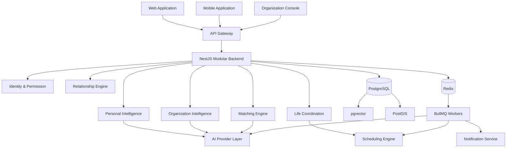

# PAN — Product & Engineering Development Specification

**项目名称：** Personal AI Network  
**项目代号：** PAN  
**文档版本：** Development Specification 1.0  
**项目阶段：** Product Definition → Engineering Implementation  
**首发试点：** 西安交通大学  
**目标平台：** Web、Android、iOS  
**设计方向：** ChatGPT × Perplexity 的极简 AI 原生交互  
**工程原则：** Modular Monolith、API-first、Mobile-first、Privacy-first、AI-native

---

# 0. 开发总纲

## 0.1 产品开发目标

PAN 不是在传统校园 App 上增加一个 AI 聊天框，而是建立一个由个人 AI 和组织 AI 构成的智能网络。

产品需要具备四种基本能力：

1. 理解个人及其长期目标。
2. 理解组织及其资源和需求。
3. 在授权条件下发现人与人、人与组织之间的潜在连接。
4. 将连接转化为真实的交流、活动、合作和日常行动。

整个产品必须以这四种能力为中心进行设计。

## 0.2 核心设计原则

### Principle 1：AI First, Not Chat First

AI First 不等于所有页面都变成聊天窗口。

AI 应当贯穿整个产品，但用户不应该每做一件事情都必须先与 AI 对话。

例如：

- 用户可以直接搜索机会。
- 用户可以直接查看活动。
- 用户可以直接编辑个人资料。
- 用户可以直接接受或拒绝引荐。
- 用户也可以用自然语言让 AI 完成上述操作。

AI 是整个应用的智能基础设施，而不是唯一的操作入口。

### Principle 2：Context Before Conversation

AI 的价值不仅在于能够回答当前问题，更在于理解用户当前所处的上下文。

当用户询问：

“最近有没有适合我的科研机会？”

系统应当综合考虑用户主动开放的研究方向、能力、项目经历、目标和机会偏好，而不是把它当成一次全新的通用问答。

### Principle 3：Network Before Feed

不建立传统的无限信息流。

平台内容应该围绕：

- 与用户相关的人。
- 与用户相关的项目。
- 用户可能感兴趣的机会。
- 用户参与的组织。
- 用户需要完成的现实行动。

推荐内容必须具备明确的相关性和可解释性。

### Principle 4：Minimal Interface, Deep Capability

界面保持极简。

复杂的 Agent 运行过程、权限判断、匹配算法和任务调度都在后台完成。

用户只需要理解：

- AI 正在做什么。
- 为什么推荐这件事。
- 需要自己确认什么。
- 当前执行到了哪一步。
- 最终产生了什么结果。

### Principle 5：Human-Controlled Network

所有个人信息共享、关系建立和高影响操作都必须具备明确的授权机制。

不能为了实现所谓的自动化，让用户失去对个人身份和社交关系的控制权。

---

# 1. UI/UX Design System

这是 PAN 的重点开发要求。

我们希望产品拥有 ChatGPT 和 Perplexity 那种成熟的 AI 应用体验，但不能成为它们的简单复制品。

## 1.1 视觉定位

关键词：

- Minimal
- Refined
- Quiet
- Intelligent
- Editorial
- Spatial
- Functional

视觉上采用中性颜色、大量留白、克制的边框、清晰的字体层级和轻量动效。

不使用传统 SaaS 仪表盘的设计套路。

禁止：

- 大量渐变背景。
- 过度使用玻璃拟态。
- 大面积彩色卡片。
- 每个功能都用一个独立彩色图标。
- 过度圆润的儿童化 UI。
- 不必要的装饰性插画。
- Emoji 作为核心 UI 图标。
- 大量阴影和浮动按钮。
- 复杂的多层级导航。

## 1.2 视觉参考

### ChatGPT

主要借鉴：

- 左侧 Sidebar。
- 中央内容区域。
- 自然语言输入框。
- 简洁的 AI 回答排版。
- 对话上下文连续性。
- 轻量工具执行状态。
- 响应式布局。
- 极简图标和菜单。

### Perplexity

主要借鉴：

- 搜索和发现体验。
- 信息卡片的层级。
- 结果来源展示。
- 结果摘要。
- 结构化信息组织。
- 清晰的上下文切换。
- 内容与操作之间的空间关系。

### PAN 的独特设计

PAN 应当在上述基础上增加：

- Personal Context。
- Organization Context。
- Relationship Context。
- Opportunity Cards。
- Connection Requests。
- Action Preview。
- Life Coordination。

最终设计语言应当是：

**ChatGPT 的交互空间 + Perplexity 的信息组织 + PAN 的关系与行动系统。**

## 1.3 Design Tokens

建立统一设计令牌。

### Color System

Light Theme：

| Token | 色值 | 用途 |
|---|---|---|
| background | #FFFFFF | 页面背景 |
| background-secondary | #F7F7F6 | 次级页面背景 |
| surface | #FFFFFF | 内容表面 |
| surface-secondary | #F5F5F4 | 次级表面 |
| foreground | #191919 | 主文字 |
| foreground-secondary | #6B6B6B | 次级文字 |
| foreground-tertiary | #999999 | 辅助文字 |
| border | #E8E8E6 | 普通边框 |
| border-strong | #D6D6D3 | 强调边框 |
| primary | #202020 | 主按钮 |
| primary-foreground | #FFFFFF | 主按钮文字 |
| accent | #526B5F | 品牌强调 |
| destructive | #B94B4B | 危险操作 |

Dark Theme：

| Token | 色值 | 用途 |
|---|---|---|
| background | #111214 | 页面背景 |
| background-secondary | #17191C | 次级背景 |
| surface | #191B1E | 内容表面 |
| surface-secondary | #202226 | 次级表面 |
| foreground | #F3F3F1 | 主文字 |
| foreground-secondary | #A0A2A6 | 次级文字 |
| foreground-tertiary | #777A80 | 辅助文字 |
| border | #2B2E33 | 边框 |
| primary | #F2F2F0 | 主按钮 |
| primary-foreground | #171717 | 主按钮文字 |
| accent | #89A795 | 品牌强调 |

所有颜色必须使用 Token，不允许在组件中随意写入大量硬编码颜色。

强调色只用于重要状态、选中项和关键操作。

不能让整个平台变成绿色或蓝色的营销网站。

### Typography

推荐字体：

- 英文：Inter 或 Geist。
- 中文：PingFang SC、Noto Sans SC、Microsoft YaHei。
- 等宽字体：Geist Mono。

字体大小：

| Token | 大小 | 用途 |
|---|---:|---|
| display | 36px | 特殊欢迎标题 |
| h1 | 28px | 页面主标题 |
| h2 | 22px | 页面分区标题 |
| h3 | 18px | 卡片标题 |
| body | 15px | 正文 |
| body-sm | 14px | 辅助正文 |
| caption | 12px | 元数据 |
| micro | 11px | 极少量辅助信息 |

正文行高建议 1.65。

标题行高建议 1.25—1.35。

避免所有文字都加粗。

### Spacing

使用 4px 基础间距体系。

核心间距：

4 / 8 / 12 / 16 / 20 / 24 / 32 / 40 / 48 / 64。

主要内容区应具有充足留白。

不要为了展示更多信息而把页面挤满。

### Radius

| Token | 半径 | 用途 |
|---|---:|---|
| radius-sm | 6px | 小型元素 |
| radius-md | 10px | 按钮、输入框 |
| radius-lg | 14px | 卡片 |
| radius-xl | 18px | 大型内容容器 |
| radius-full | 999px | 头像、标签 |

避免所有组件都使用特别大的圆角。

### Shadows

尽量不使用阴影。

优先通过背景颜色和细边框区分层级。

只在 Popover、Dialog 和浮动菜单中使用非常轻微的阴影。

## 1.4 图标系统

使用 Lucide Icons。

统一：

- 线性图标。
- 1.5px 或 1.75px 视觉线宽。
- 20px 常规尺寸。
- 16px 小型尺寸。
- 24px 重点尺寸。

不要混合多个图标库。

不要在每个菜单项前放置不同颜色的图标。

## 1.5 动效规范

使用 Motion for React 作为 Web 动效方案。

React Native 使用 Reanimated。

建议：

| 动作 | 时长 |
|---|---:|
| Hover | 120ms |
| Button Feedback | 120ms |
| Popover | 150ms |
| Modal | 180ms |
| Sidebar | 200ms |
| Page Transition | 200ms |
| Large Panel | 240ms |

动效应该自然，不应让用户感觉整个界面在不断运动。

AI 生成内容采用平滑的流式显示。

工具执行使用简洁的状态变化，而不是复杂的加载动画。

支持减少动态效果的系统设置。

---

# 2. Global Application Architecture

## 2.1 桌面端整体布局

采用三层结构：

1. Navigation Sidebar。
2. Main Workspace。
3. Optional Context Panel。

基础布局：

```text
┌─────────────────────────────────────────────────────────────┐
│ PAN                                                         │
├──────────────┬────────────────────────────┬─────────────────┤
│              │                            │                 │
│   Sidebar    │       Main Workspace      │ Context Panel   │
│              │                            │                 │
│  Today       │                            │                 │
│  Network     │       Current Content     │  Context        │
│  Life        │                            │  Information    │
│  Spaces      │                            │                 │
│              │                            │                 │
│  ──────────  │                            │                 │
│              │                            │                 │
│  Recent      │                            │                 │
│  Activity    │                            │                 │
│              │                            │                 │
│  ──────────  │                            │                 │
│  My AI       │                            │                 │
│  Settings    │                            │                 │
└──────────────┴────────────────────────────┴─────────────────┘
```

### Sidebar

桌面端建议宽度：

- 展开：248px。
- 收起：64px。

内容：

顶部：
- PAN Logo。
- New Action。

主要导航：
- Today。
- Network。
- Life。
- Spaces。

中部：
- 最近对话或最近工作。
- 最近访问的组织。
- 最近的关系空间。

底部：
- My AI。
- Settings。
- Profile。

Sidebar 必须支持收起。

移动端不保留固定侧栏。

### Main Workspace

普通页面建议最大内容宽度：

760—900px。

内容根据具体页面动态调整。

AI 对话页面建议：

- 最大正文宽度 760px。
- 居中。
- 文字内容不要横向铺满。
- 输入框固定在底部区域。
- 页面滚动时保持输入区域可用。

### Context Panel

仅在需要时出现。

例如：

- 查看某个机会时显示组织详情。
- 查看某个人时显示双方共同背景。
- 安排活动时显示参与者和约束条件。
- 查看项目时显示成员、目标和需求。

不能所有页面都强制使用三栏布局。

## 2.2 移动端整体布局

移动端采用原生优先设计。

底部导航：

```text
┌─────────────────────────────┐
│                             │
│                             │
│        Main Content         │
│                             │
│                             │
├─────────────────────────────┤
│                             │
│  Today Network Life Spaces  │
│                 My AI       │
└─────────────────────────────┘
```

建议底部五个入口：

Today / Network / Life / Spaces / My AI。

不把复杂 Sidebar 缩小后直接放进手机。

主要页面使用原生 Stack Navigation。

聊天输入框必须考虑软键盘、Safe Area 和输入焦点。

---

# 3. Core Screen Specifications

## 3.1 Today — Personal AI Workspace

这是用户打开 PAN 后的默认页面。

设计目标：

让用户一眼知道今天有哪些重要的事，以及 AI 为自己发现了什么。

页面布局：

```text
Good morning, Alex.

What would you like to work on?

[ Ask your AI anything...             ]

Today
────────────────────────────────

Your schedule
09:00  Research meeting
14:00  Project discussion

For you
────────────────────────────────

A research opportunity was found
Your interests match a laboratory project.

[View opportunity] [Dismiss]

People you may want to meet
────────────────────────────────

A person working on battery thermal
management and drone systems.

[Explore connection]

Your activity
────────────────────────────────

2 pending invitations
1 relationship follow-up
```

### 页面模块

A. Greeting

显示时间相关问候和用户显示名称。

不需要过度个性化。

B. AI Composer

页面最重要的入口。

支持：

- 自然语言输入。
- 文件上传。
- 图片上传。
- 语音输入（后续版本）。
- 快捷操作。
- 对话上下文选择。

占位文案：

“告诉我你正在寻找什么，或者想安排什么……”

C. Today Schedule

展示当天日程。

D. For You

展示真正相关的机会。

E. Network Activity

展示新的引荐请求、双方已确认的连接及关系后续事项。

F. Life Activity

展示需要确认的活动、时间安排和邀请。

### 交互要求

每个推荐项目都应该支持：

- 查看。
- 保存。
- 忽略。
- 不感兴趣。
- 请求进一步了解。

不允许仅提供一个模糊的 Like 按钮。

推荐卡片不应该显示没有解释的匹配分数。

## 3.2 AI Conversation — 核心对话页面

这是整个产品最重要的交互组件。

参考 ChatGPT 的交互方式，但增加 PAN 特有的行动能力。

布局：

```text
┌─────────────────────────────────────────┐
│ ← Back                    New Session    │
│                                         │
│ You                                     │
│                                         │
│ 我想找一些适合我的科研机会。             │
│                                         │
│ PAN                                     │
│                                         │
│ 根据你开放的研究兴趣和项目经历，         │
│ 我发现了几个可能值得了解的机会。         │
│                                         │
│ ┌─────────────────────────────────────┐ │
│ │ Research Opportunity               │ │
│ │                                     │ │
│ │ Battery Thermal Management Lab     │ │
│ │                                     │ │
│ │ 相关原因：                          │ │
│ │ · 研究方向与你的兴趣相符             │ │
│ │ · 项目阶段适合本科生参与             │ │
│ │                                     │ │
│ │ [View] [Request Introduction]       │ │
│ └─────────────────────────────────────┘ │
│                                         │
│ ─────────────────────────────────────── │
│                                         │
│ [ Ask a follow-up...               ↑ ]  │
└─────────────────────────────────────────┘
```

### AI 消息类型

不要把所有内容都作为纯文本展示。

至少支持：

- Text Message。
- Opportunity Card。
- Person Card。
- Organization Card。
- Project Card。
- Event Card。
- Action Preview。
- Tool Activity。
- Source Reference。
- Confirmation Dialog。

### 工具执行展示

参考 ChatGPT 的工具状态展示方式。

显示：

- 正在分析需求。
- 正在查找相关项目。
- 正在检查可用时间。
- 已找到 3 个候选机会。
- 等待你确认。

不直接暴露内部 Prompt、隐藏推理或模型原始工具参数。

工具卡片支持折叠。

默认展示简洁摘要。

用户点击后查看执行详情。

失败状态必须提供明确错误和重试操作。

### 流式输出

支持：

- 文本流式显示。
- 卡片渐进式生成。
- 工具状态更新。
- 中断生成。
- 网络恢复。
- 继续执行可恢复任务。

重要的是，工具执行和文本生成不能共用一个模糊的 loading 状态。

## 3.3 Network — 智能网络

页面目标：

让用户找到值得认识的人、值得参与的项目和值得关注的组织。

顶部：

```text
Network

Find people, projects and opportunities.

[ What are you looking for?              ]

People   Projects   Organizations   Opportunities
```

### Search

支持自然语言查询。

例如：

- 寻找对无人机电池感兴趣的研究人员。
- 寻找正在开发机器人产品的学生团队。
- 寻找愿意指导本科生的材料科学导师。
- 寻找适合周末参加的技术交流活动。

### Search Results

结果采用紧凑的垂直布局。

```text
Organization

Energy Storage Research Group

Research · Xi'an Jiaotong University

Working on advanced energy storage systems.

Why this may be relevant

Your research interests overlap with their
current project requirements.

[View organization] [Request introduction]
```

### 结果分组

- People。
- Projects。
- Organizations。
- Opportunities。

支持筛选：

- 领域。
- 学校。
- 学院。
- 组织类型。
- 项目阶段。
- 线上或线下。
- 时间范围。

### 匹配理由

不能仅显示 AI 认为两个人匹配。

需要展示可验证的原因：

- 研究领域重叠。
- 能力互补。
- 双方都在寻找类似合作。
- 时间和地点适配。
- 对方明确开放了相关机会。

只显示获得授权的信息。

## 3.4 Opportunity Detail

机会详情页。

展示：

- 机会名称。
- 发布组织。
- 组织认证状态。
- 项目简介。
- 研究或合作领域。
- 参与要求。
- 预计投入时间。
- 有效期限。
- 相关负责人。
- 信息来源和更新时间。

底部固定主要操作：

Request Introduction。

用户点击后出现确认页面。

明确告知：

- 哪些个人资料将被披露。
- 对方会看到哪些信息。
- 本次请求的目的。
- 是否允许对方进一步联系。

## 3.5 Connection Request

这是 PAN 区别于普通社交软件的重要页面。

设计：

```text
Introduction Request

You are interested in connecting with:

Energy Storage Research Group

Why this connection?

Your current project and research interests
appear relevant to their requirements.

Information shared:

✓ Public profile
✓ Research interests
✓ Project summary

Not shared:

✓ Private AI memories
✓ Personal conversations
✓ Private calendar details

[Send request]
```

对方可以：

- Accept。
- Decline。
- Ask for more information。

只有双方接受后才建立正式关系。

## 3.6 Relationship Space

关系空间不是普通聊天群。

它代表两个或多个主体之间已经建立的、可持续发展的合作或联系。

页面结构：

- Overview。
- Conversation。
- Shared Context。
- Tasks。
- Meetings。

Overview：

- 关系建立时间。
- 双方参与者。
- 共同目标。
- 关联项目。
- 下一步计划。

Shared Context：

只保存经过授权的共同信息。

Tasks：

记录双方共同承诺。

Meetings：

安排后续交流。

关系结束后，用户可以关闭空间。

关闭关系不代表另一方自动获得继续访问全部历史数据的权利。

## 3.7 Life — 日程和生活协调

页面提供：

- Calendar。
- My Availability。
- Invitations。
- Activities。
- Group Planning。

### Calendar

支持：

- 日视图。
- 周视图。
- 月视图。
- 个人日程。
- 共享活动。

### AI Schedule Input

用户可以直接输入：

“帮我找一个下周大家都有空的时间，安排一次项目讨论。”

AI 提取：

- 日期范围。
- 预计时长。
- 参与者。
- 时间偏好。
- 地点偏好。

系统根据授权忙闲数据生成候选时间。

### 活动协调卡片

展示：

- 活动名称。
- 参与人数。
- 已确认人数。
- 候选时间。
- 地点。
- 冲突信息。
- 最终确认状态。

不要让 AI 自动把所有人的日历都修改掉。

最终日程由参与者确认。

## 3.8 Spaces — 组织空间

Spaces 是 PAN 的组织网络入口。

首页展示：

- My Organizations。
- My Projects。
- Research Groups。
- Clubs。
- Communities。

空间详情：

- Overview。
- Members。
- Opportunities。
- Events。
- Organization AI。

组织空间应当拥有统一视觉语言，不要变成复杂的管理后台。

## 3.9 My AI — 个人智能中心

这是个人记忆系统的可视化入口。

必须具备：

### Profile

个人身份。

### Memory

展示：

- Interests。
- Skills。
- Projects。
- Goals。
- Preferences。
- Relationships。

### Privacy

展示：

- 哪些信息仅本人可见。
- 哪些信息允许参与匹配。
- 哪些信息已经共享。
- 哪些授权仍然有效。

### Connected Services

日历、文件和其他外部数据源。

### AI Behavior

用户可以设置：

- 主动推荐频率。
- 哪些机会值得通知。
- 哪些操作需要确认。
- AI 自主权级别。

用户必须能够纠正 AI 对自己的错误理解。

---

# 4. Organization Console

组织端是 PAN 的重要商业化入口。

不应只是个人 App 中的一个普通页面。

## 4.1 导航结构

- Overview。
- Organization Profile。
- Opportunities。
- Matching Inbox。
- Members。
- Events。
- Organization AI。
- Analytics。
- Settings。

## 4.2 Organization Overview

展示：

- 当前组织信息。
- 当前开放机会。
- 新匹配。
- 待处理申请。
- 近期活动。
- 成员数量。
- 活跃情况。

不采用传统 ERP 大屏。

重点展示需要组织处理的事务。

## 4.3 Opportunity Management

管理员可以：

- 创建机会。
- 编辑机会。
- 设置参与要求。
- 设置人数上限。
- 设置截止日期。
- 选择是否公开。
- 选择匹配规则。
- 暂停或关闭机会。

## 4.4 Matching Inbox

展示：

- 推荐对象。
- 匹配原因。
- 已授权资料。
- 用户表达的合作意愿。
- 处理状态。

组织管理员不能查看用户的私人 AI 记忆。

## 4.5 Organization AI

组织 AI 应该能够：

- 理解组织介绍。
- 检索组织项目。
- 解释组织需求。
- 创建机会草稿。
- 生成活动草稿。
- 提出潜在匹配。
- 处理经过授权的组织任务。

对外发布必须由有权限的组织成员确认。

---

# 5. 技术栈选型

## 5.1 总体建议

采用 TypeScript 为主要工程语言。

使用 Python 处理后续复杂优化任务。

第一阶段采用模块化单体架构，不采用微服务。

前端、后端和共享类型放在同一个 Monorepo。

## 5.2 技术栈总表

| 层级 | 技术选型 | 用途 |
|---|---|---|
| Monorepo | pnpm + Turborepo | 工程组织 |
| Web | Next.js App Router | Web 应用与组织端 |
| Mobile | Expo + React Native | Android / iOS |
| Language | TypeScript | 主开发语言 |
| UI | Tailwind CSS 4 | Web 样式 |
| Components | shadcn/ui + Radix | Web 基础组件 |
| Icons | Lucide | 图标 |
| Motion | Motion | Web 动效 |
| Mobile Motion | Reanimated | 原生动效 |
| API | NestJS | 后端业务服务 |
| Database | PostgreSQL | 核心数据库 |
| ORM | Drizzle ORM | 数据访问 |
| Vector | pgvector | 语义检索 |
| Spatial | PostGIS | 地理信息 |
| Cache | Redis | 缓存 |
| Queue | BullMQ | 异步任务 |
| AI | Vercel AI SDK | 流式输出、工具调用、结构化输出 |
| Validation | Zod | 数据校验 |
| State | TanStack Query + Zustand | 状态管理 |
| Forms | React Hook Form | 表单 |
| Storage | S3 Compatible | 文件存储 |
| Analytics | PostHog | 产品分析 |
| Monitoring | Sentry + OpenTelemetry | 监控 |
| Testing | Vitest + Playwright | 测试 |
| Mobile Testing | Maestro | 移动端自动化 |

## 5.3 Web Frontend

采用 Next.js App Router。

原因：

- 支持现代 React Server Components。
- 支持服务端渲染。
- 支持流式页面。
- 适合复杂的多页面产品。
- 适合组织管理端。
- 具备成熟的生态。

页面以 Server Components 为默认。

交互组件才使用 Client Components。

不要将所有页面都设置为 Client Component。

核心依赖：

- next。
- react。
- typescript。
- tailwindcss。
- shadcn/ui。
- radix-ui。
- lucide-react。
- motion。
- @tanstack/react-query。
- zustand。
- react-hook-form。
- zod。
- date-fns。

## 5.4 Mobile Frontend

采用 Expo + React Native + Expo Router。

原因：

- 同时支持 Android 和 iOS。
- 能够使用原生设备能力。
- 支持深度链接。
- 支持文件、日历、通知和系统分享。
- 可以使用 EAS 进行云端构建。

移动端不能只是把 Web 页面放进 WebView。

需要针对手机重新设计：

- 导航。
- 手势。
- 输入框。
- 页面层级。
- 日历。
- 通知。
- 安全区域。

Web 和 Mobile 共享：

- 业务类型。
- API Client。
- Zod Schema。
- Design Tokens。
- 常量。
- 权限定义。

不强行共享所有 UI 组件。

## 5.5 Backend

采用 NestJS。

使用模块化单体。

建议业务模块：

```text
IdentityModule
PrincipalModule
CampusModule
OrganizationModule
ProjectModule
ProfileModule
MemoryModule
ConsentModule
AgentModule
IntentModule
OpportunityModule
MatchingModule
RelationshipModule
ConversationModule
CalendarModule
EventModule
NotificationModule
AuditModule
AnalyticsModule
```

每个模块至少包含：

- Controller。
- Service。
- Repository。
- DTO。
- Entity / Schema。
- Tests。

模块之间通过服务接口交互。

不要在 Controller 中直接编写复杂业务逻辑。

不要允许任意模块直接修改其他模块的数据库数据。

## 5.6 Database

使用 PostgreSQL。

推荐开发时使用 Supabase 或 Docker PostgreSQL。

正式校园部署前，应根据中国大陆访问质量、数据合规、云服务备案和学校网络环境选择国内可用的托管 PostgreSQL。

推荐：

- PostgreSQL。
- pgvector。
- PostGIS。
- Drizzle ORM。

数据库变更必须通过版本化 SQL Migration。

不能只在 Supabase Dashboard 手动修改 Schema。

核心原则：

Database Schema 是唯一可信的数据结构定义。

## 5.7 Redis & Queue

使用 Redis + BullMQ。

负责：

- AI 后台任务。
- 记忆提取。
- 向量生成。
- 匹配任务。
- 通知发送。
- 日程同步。
- 活动协调。
- 过期任务。
- 定时提醒。

任务必须支持：

- 重试。
- 幂等。
- 超时。
- 失败记录。
- Dead Letter。
- 可观察状态。

不能因为用户重复点击就创建多个相同的匹配任务。

## 5.8 AI Infrastructure

使用独立 AI Provider Layer。

不要把模型供应商写死在业务逻辑里。

建立统一接口：

```ts
interface AIProvider {
  generateText(input: GenerateInput): Promise<GenerateResult>;

  generateObject<T>(
    input: StructuredInput<T>
  ): Promise<T>;

  streamText(
    input: StreamInput
  ): AsyncIterable<StreamEvent>;

  generateEmbedding(
    input: string[]
  ): Promise<number[][]>;
}
```

模型分层：

| 任务 | 模型类型 |
|---|---|
| 意图提取 | 快速模型 |
| 标签分类 | 小型模型 |
| 记忆整理 | 高质量模型 |
| 复杂需求分析 | 推理模型 |
| 机会匹配解释 | 通用高质量模型 |
| Embedding | 专用向量模型 |
| 活动约束提取 | 快速结构化模型 |

具体模型由配置决定。

支持：

- OpenAI API。
- OpenAI-compatible API。
- 其他模型供应商。

模型切换不能导致业务代码大面积修改。

## 5.9 Agent Runtime

不要直接建立多个可以自由聊天的 Agent。

采用工作流驱动的 Agent 架构。

示例：

```text
User Input
    |
Intent Extraction
    |
Context Retrieval
    |
Permission Check
    |
Planning
    |
Tool Execution
    |
Result Validation
    |
Action Preview
    |
User Confirmation
    |
Execution
    |
Audit & Memory Update
```

每个 Agent Tool 必须有：

- 名称。
- 参数 Schema。
- 权限要求。
- 超时。
- 重试策略。
- 幂等策略。
- 错误处理。
- 审计记录。

Agent 不能直接访问数据库。

所有数据访问通过后端业务服务。

## 5.10 Matching Engine

推荐采用：

1. Structured Filtering。
2. Vector Retrieval。
3. Feature Ranking。
4. Explanation Generation。
5. Consent Workflow。

不要让 LLM 直接决定所有匹配结果。

首先使用 SQL 和硬条件过滤。

然后使用 pgvector 找到语义相关对象。

再使用可解释的特征计算进行排序。

最后由 LLM 生成自然语言匹配理由。

每个匹配结果保存：

- 匹配版本。
- 计算时间。
- 使用的意图版本。
- 特征评分。
- 过滤原因。
- 推荐理由。

## 5.11 Scheduling Engine

第一版使用 TypeScript 完成基础共同空闲区间计算。

后续复杂约束可引入 Python + Google OR-Tools。

复杂问题包括：

- 多人时间协调。
- 多个候选场地。
- 场地容量。
- 参与者优先级。
- 活动时长。
- 地理距离。
- 交通成本。
- 多活动资源冲突。

不要使用 LLM 代替数学优化器。

---

# 6. Engineering Architecture

## 6.1 System Overview



## 6.2 Repository Structure

建议使用 Monorepo。

```text
pan/
│
├── apps/
│   ├── web/
│   │   ├── app/
│   │   ├── components/
│   │   ├── features/
│   │   ├── hooks/
│   │   └── lib/
│   │
│   ├── mobile/
│   │   ├── app/
│   │   ├── components/
│   │   ├── features/
│   │   ├── hooks/
│   │   └── lib/
│   │
│   ├── api/
│   │   ├── src/
│   │   │   ├── modules/
│   │   │   ├── common/
│   │   │   ├── guards/
│   │   │   ├── interceptors/
│   │   │   └── main.ts
│   │   └── test/
│   │
│   └── worker/
│       ├── src/
│       └── test/
│
├── packages/
│   ├── contracts/
│   ├── database/
│   ├── api-client/
│   ├── ai-core/
│   ├── design-tokens/
│   ├── ui-web/
│   ├── schemas/
│   ├── config/
│   └── utils/
│
├── infra/
│   ├── docker/
│   ├── migrations/
│   ├── scripts/
│   └── deployment/
│
├── docs/
│   ├── product/
│   ├── design/
│   ├── architecture/
│   ├── database/
│   ├── api/
│   ├── ai/
│   ├── security/
│   ├── testing/
│   └── operations/
│
├── .github/
│   └── workflows/
│
├── AGENTS.md
├── CONTRIBUTING.md
├── README.md
├── pnpm-workspace.yaml
├── turbo.json
└── package.json
```

## 6.3 模块边界

`apps/web` 不能直接访问数据库。

`apps/mobile` 不能直接访问数据库。

所有业务写操作必须通过 API。

只有受控的公共只读数据才可以考虑使用直接数据库访问接口。

所有共享类型放在 `packages/contracts`。

所有 API Schema 使用 Zod。

所有数据库 Migration 放在 `infra/migrations` 或统一数据库包管理目录。

---

# 7. Core Data Model Implementation

在上一版 PRD 的基础上，开发阶段增加必要的工程表。

## 7.1 核心业务实体

```text
Principal
User
Campus
CampusMembership
Organization
OrganizationMembership
Project
ProjectMembership

AgentProfile
AgentRun
AgentStep
ToolInvocation

MemoryItem
MemorySource
MemoryEmbedding

Intent
Opportunity
MatchCandidate
MatchDecision

ConsentGrant
ConsentEvent

Relationship
RelationshipMember
SharedContextItem

Conversation
ConversationMember
Message

CalendarConnection
AvailabilityBlock

Event
EventParticipant

Notification
OutboxEvent
AuditLog
BlockList
Report
```

## 7.2 关键设计

### Principal

作为统一主体标识。

所有用户、组织、项目和关系空间都可以拥有 Principal ID。

具体主体资料分别存储在对应的业务表中。

主体类型必须与子表记录一致，使用数据库约束或触发器保证完整性。

### MemoryItem

不能直接将全部对话记录作为长期记忆。

记忆系统只保存经过筛选的结构化内容。

需要保留：

- Source。
- Owner。
- Sensitivity。
- Visibility。
- Confirmation Status。
- Validity。
- Version。

### ConsentGrant

独立于 MemoryItem。

一个记忆可以被不同主体在不同目的下授权。

撤销其中一个授权，不应该影响其他合法授权。

### MatchCandidate

匹配只表示潜在连接。

双方确认后，才生成 Relationship。

### SharedContextItem

关系空间只读取经过授权的快照。

不能直接连接私人 Memory Item 并无限制查询。

## 7.3 建议增加的工程字段

核心业务表统一包含：

- id。
- created_at。
- updated_at。
- created_by。
- status。
- version。

重要业务对象使用乐观锁或版本控制，避免并发覆盖。

对关键状态变更使用事务。

对异步任务使用 Outbox Pattern，避免数据库写入成功但消息未发送。

---

# 8. API Design

## 8.1 基本规范

API 前缀：

`/api/v1`

采用 REST API。

AI 流式接口采用 SSE。

异步任务使用任务 ID 查询状态。

所有写操作支持适当的幂等机制。

统一错误结构：

```json
{
  "error": {
    "code": "MATCH_NOT_AVAILABLE",
    "message": "This opportunity is no longer available.",
    "request_id": "uuid",
    "retryable": false
  }
}
```

## 8.2 核心 API

### Identity

```text
GET    /api/v1/me
PATCH  /api/v1/me
GET    /api/v1/me/permissions
```

### Personal Memory

```text
GET    /api/v1/memories
POST   /api/v1/memories/extract
POST   /api/v1/memories
PATCH  /api/v1/memories/:id
DELETE /api/v1/memories/:id
GET    /api/v1/memories/:id/sources
```

### Organization

```text
POST   /api/v1/organizations
GET    /api/v1/organizations
GET    /api/v1/organizations/:id
PATCH  /api/v1/organizations/:id
POST   /api/v1/organizations/:id/members
GET    /api/v1/organizations/:id/members
```

### Intent & Opportunity

```text
POST   /api/v1/intents
GET    /api/v1/intents
PATCH  /api/v1/intents/:id
POST   /api/v1/opportunities
GET    /api/v1/opportunities
GET    /api/v1/opportunities/:id
PATCH  /api/v1/opportunities/:id
```

### Matching

```text
POST   /api/v1/matches/search
GET    /api/v1/matches
GET    /api/v1/matches/:id
POST   /api/v1/matches/:id/decisions
```

### Relationships

```text
GET    /api/v1/relationships
GET    /api/v1/relationships/:id
GET    /api/v1/relationships/:id/context
POST   /api/v1/relationships/:id/context
POST   /api/v1/relationships/:id/close
```

### Life

```text
GET    /api/v1/calendar
POST   /api/v1/calendar/connections
GET    /api/v1/availability
POST   /api/v1/events
GET    /api/v1/events
POST   /api/v1/events/:id/availability
POST   /api/v1/events/:id/proposals
POST   /api/v1/events/:id/confirm
```

## 8.3 Agent Streaming API

建议：

`POST /api/v1/agent/turns`

使用 SSE 返回：

```text
event: turn.started
event: message.delta
event: tool.started
event: tool.progress
event: tool.completed
event: action.proposed
event: turn.completed
event: turn.failed
```

前端必须能够区分：

- 正在生成文字。
- 正在执行工具。
- 正在等待用户确认。
- 正在等待异步任务。
- 任务已经完成。
- 任务失败。

不能把所有状态都显示成 AI 正在思考。

---

# 9. Security & Permission Architecture

## 9.1 访问控制

采用 RBAC + Resource-level Authorization。

同时使用 PostgreSQL RLS 作为纵深防御。

所有暴露给客户端的表都必须具有适当的 RLS 策略。

服务端使用专用数据库角色，禁止使用绕过 RLS 的高权限角色处理普通用户请求。

每个数据库事务必须明确绑定当前主体和请求上下文。

## 9.2 信息可见性

```text
PRIVATE
    |
DISCOVERABLE
    |
MATCH_ONLY
    |
RELATIONSHIP_SHARED
    |
PUBLIC
```

这些是不同的数据共享策略，而不是简单的页面显示状态。

## 9.3 用户授权流程

授权必须包含：

- 授权主体。
- 接收主体。
- 数据范围。
- 目的。
- 有效期限。
- 授权版本。
- 撤销状态。

对外展示的信息必须由后端重新验证。

不能仅依赖前端的 visibility 字段。

## 9.4 安全测试

必须测试：

- 未授权读取。
- 越权写入。
- 组织成员之间的数据隔离。
- 关系空间越权。
- 向量检索信息泄露。
- Agent Prompt Injection。
- Tool 参数伪造。
- 重复操作。
- 授权撤销后访问。
- 文件下载链接泄露。

---

# 10. Testing Strategy

## 10.1 Unit Tests

覆盖：

- 记忆状态转换。
- 权限判断。
- 意图提取 Schema。
- 匹配过滤。
- 匹配状态机。
- 双向确认。
- 日程交集。
- 活动状态转换。

## 10.2 Integration Tests

覆盖：

- PostgreSQL。
- RLS。
- Redis。
- BullMQ。
- AI Provider。
- 文件存储。
- 日历导入。

## 10.3 E2E Tests

核心测试旅程：

### Journey A

用户注册 → 建立个人 AI → 创建项目 → 发布寻找合作者的需求。

### Journey B

组织注册 → 创建组织 AI → 发布科研机会 → 查看匹配候选。

### Journey C

用户收到推荐 → 同意引荐 → 组织接受 → 建立关系空间。

### Journey D

组织创建活动 → 用户授权忙闲时间 → 生成候选时间 → 用户确认 → 活动成立。

### Journey E

用户撤销授权 → 共享内容停止访问 → 检查缓存、索引和历史授权记录。

## 10.4 UI Testing

使用 Playwright 测试 Web。

使用 Maestro 测试移动端。

重点验证：

- 不同屏幕尺寸。
- 浅色模式。
- 深色模式。
- 加载状态。
- 空状态。
- 错误状态。
- 长文本。
- 流式输出。
- 键盘弹出。
- 页面滚动。
- Modal 和 Popover。
- 无障碍操作。

---

# 11. Deployment & DevOps

## 11.1 Development

提供 Docker Compose。

至少启动：

- PostgreSQL。
- Redis。
- API。
- Worker。
- Web。

支持本地 Mock AI Provider。

不允许每位开发者都必须依赖真实 LLM API 才能运行项目。

## 11.2 Environment

```text
.env.example

DATABASE_URL=
REDIS_URL=

AUTH_PROVIDER=
AUTH_SECRET=

AI_DEFAULT_PROVIDER=
AI_DEFAULT_MODEL=
AI_API_KEY=

EMBEDDING_PROVIDER=
EMBEDDING_MODEL=

STORAGE_ENDPOINT=
STORAGE_BUCKET=
STORAGE_ACCESS_KEY=
STORAGE_SECRET_KEY=

SENTRY_DSN=
```

真实凭证只能存放在安全环境变量或 Secret Manager。

不得提交到 Git。

## 11.3 CI/CD

每次 Pull Request：

1. Install。
2. Lint。
3. Type Check。
4. Unit Test。
5. Integration Test。
6. Database Migration Check。
7. Build。
8. Security Check。

只有通过所有必要检查才允许合并。

数据库 Migration 必须可审查、可回滚或有明确的前向修复策略。

## 11.4 中国大陆试点部署

由于首个试点在西安交通大学，正式部署必须进行校园网络和移动运营商网络测试。

重点确认：

- 服务访问延迟。
- 模型 API 可用性。
- 文件存储可用性。
- 推送通知可靠性。
- 日历连接可用性。
- 数据存储位置。
- 域名和备案要求。
- 个人信息保护要求。

不应默认海外 SaaS 服务能够在所有校园网络环境下稳定运行。

开发环境和正式环境允许使用不同的云服务供应商，但业务层必须保持可迁移。

---

# 12. Product Analytics

不能只统计 DAU。

核心业务指标：

## Personal Intelligence

- 个人 AI 初始化率。
- 记忆确认率。
- 记忆修改率。
- 用户主动推荐设置率。

## Network

- 机会发现数量。
- 匹配接受率。
- 双向确认率。
- 实际交流完成率。

## Organization

- 活跃组织数。
- 组织机会发布量。
- 组织响应时间。
- 组织重复使用率。

## Life

- 活动创建数量。
- 活动确认率。
- 实际参与率。
- 日程协调成功率。

## Trust

- 授权撤销率。
- 错误共享事件。
- 用户投诉。
- 越权访问。
- 隐私相关支持请求。

产品分析不应采集用户私人对话正文作为普通分析事件。

---

# 13. Codex Development Instructions

本节是给 AI 编程 Agent 的强制开发规范。

## 13.1 开发前

在修改代码之前，必须先阅读：

- `README.md`
- `AGENTS.md`
- `docs/product/PRD.md`
- `docs/design/DESIGN_SYSTEM.md`
- `docs/architecture/TDD.md`
- `docs/database/SCHEMA.md`
- 相关模块的现有实现。

不能没有检查现有代码就重新搭建整个项目。

## 13.2 开发原则

1. 严格遵循现有架构。
2. 优先完成纵向业务闭环。
3. 不为了追求架构复杂度引入不必要的技术。
4. 不随意改变公共接口。
5. 不随意修改数据库 Schema。
6. 所有数据库变更必须提供 Migration。
7. 所有业务 API 必须经过权限检查。
8. 所有 AI Tool 必须具有参数 Schema。
9. 所有异步任务必须具有状态和错误处理。
10. 不允许通过 Mock 结果伪装功能已经完成。

## 13.3 UI 开发规范

UI 必须严格遵循 DESIGN_SYSTEM.md。

特别注意：

- 不要生成普通 SaaS Dashboard。
- 不要把页面堆成大量彩色卡片。
- 不要随意增加渐变。
- 不要随意增加阴影。
- 不要使用 Emoji 替代图标。
- 不要将所有内容放进带边框的容器。
- 不要把 AI 对话做成传统客服聊天窗口。
- 不要让工具执行信息占据整个屏幕。
- 不要忽略移动端适配。
- 不要使用虚假的交互按钮。

每个页面必须实现：

- Loading。
- Empty。
- Error。
- Success。
- Disabled。
- Permission Denied。

所有核心交互必须能够真正工作。

## 13.4 代码质量

必须：

- 使用 TypeScript Strict Mode。
- 避免 any。
- 使用 Zod 验证输入。
- 使用统一错误结构。
- 使用结构化日志。
- 使用依赖注入。
- 避免巨型组件。
- 避免巨型 Service。
- 维持明确模块边界。
- 为核心业务逻辑编写测试。

## 13.5 交付规范

每完成一个模块，必须提交：

1. 修改文件清单。
2. 架构变化说明。
3. 数据库变更。
4. API 变化。
5. 测试结果。
6. 已知问题。
7. 后续任务。

不得在没有实际测试的情况下宣称功能完成。

---

# 14. Development Milestones

建议分为八个研发阶段。

## M0 — Project Foundation

- Monorepo。
- Web。
- Mobile。
- API。
- Database。
- CI。
- Design Tokens。
- Application Shell。

交付：所有项目可以启动，基础导航正常。

## M1 — Design System

- Sidebar。
- Main Workspace。
- Dialog。
- Popover。
- Buttons。
- Inputs。
- Cards。
- Lists。
- AI Composer。
- Theme System。
- Responsive Layout。

交付：统一 UI 组件库和核心页面骨架。

## M2 — Identity & Organization

- 用户注册。
- 个人资料。
- 校园身份。
- 组织资料。
- 组织成员。
- 权限体系。

交付：个人和组织均可独立使用系统。

## M3 — Personal Intelligence

- Personal Agent。
- Memory Engine。
- Memory Review。
- Profile。
- AI Conversation。
- Tool Execution。

交付：个人 AI 可以理解用户并管理经过确认的记忆。

## M4 — Organization Intelligence

- Organization Agent。
- Organization Profile。
- Opportunity Management。
- Member Management。
- Organization Memory。

交付：组织可以管理需求和资源。

## M5 — Matching & Relationships

- Intent Engine。
- Matching Engine。
- 双向确认。
- Consent。
- Relationship Space。
- Shared Context。

交付：完整实现第一次 AI 引荐。

## M6 — Life Coordination

- Calendar。
- Availability。
- Events。
- Group Scheduling。
- Invitations。
- Notifications。

交付：完整实现一次多人活动协调。

## M7 — Pilot Release

- 真实组织。
- 真实用户。
- 真实匹配。
- 真实活动。
- Analytics。
- 安全检查。
- 试点复盘。

交付：可运行的西交大试点版本。

---

# 15. MVP Definition of Done

PAN 第一版只有满足以下条件，才可以视为 MVP 完成。

1. 用户能够建立个人 AI。
2. 用户能够管理自己的长期记忆。
3. 用户能够控制记忆共享范围。
4. 组织能够建立自己的 Organization Agent。
5. 组织能够发布真实机会。
6. 个人能够创建寻找需求。
7. 系统能够产生有解释的匹配结果。
8. 双方能够独立接受或拒绝。
9. 双方同意后能够建立关系空间。
10. 关系空间能够保存经过授权的共同上下文。
11. 用户能够撤销授权。
12. 系统能够完成基本日程协调。
13. 活动能够真实创建、确认和结束。
14. 核心业务具备自动化测试。
15. 核心权限具备越权测试。
16. Android 端能够独立使用。
17. Web 端能够提供组织管理能力。
18. 系统具备日志、监控和错误追踪。

最终验收应当通过真实用户旅程，而不是仅仅展示页面。

---

# 16. 最终工程决策

PAN 的第一版应该是一套完整但克制的系统。

前端采用：

Next.js + Expo + React Native。

后端采用：

NestJS Modular Monolith。

数据库采用：

PostgreSQL + pgvector + PostGIS。

任务系统采用：

Redis + BullMQ。

AI 采用：

Provider Abstraction + Workflow-based Agent Runtime。

UI 采用：

Minimal Design System + ChatGPT-inspired Workspace + Perplexity-inspired Discovery。

开发采用：

Monorepo + TypeScript + Automated Testing + CI/CD。

最重要的工程原则：

**不要先开发一个拥有很多功能的 App，而要先开发一套能够可靠运行的个人智能、组织智能、授权匹配和现实行动系统。**

所有页面都应当服务于这套系统。

所有技术决策都应当服务于长期可扩展性、可靠性、隐私和用户体验。

PAN 的目标不是成为一个更漂亮的校园社交软件。

而是成为个人与组织之间新的智能连接层。