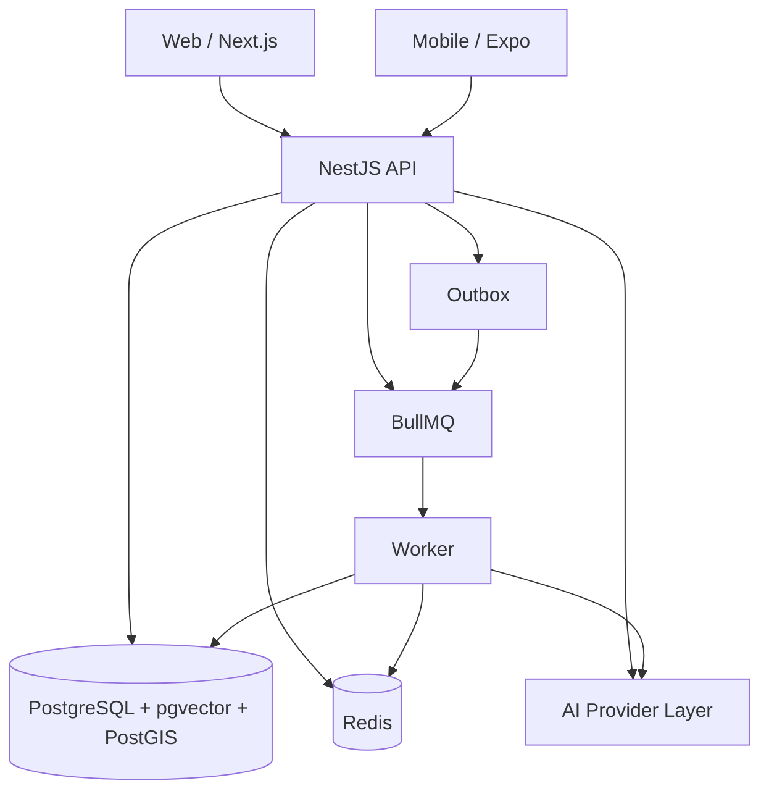

# AVEN 技术设计文档（TDD）

版本：1.0 · 日期：2026-11-10 · 状态：M0-01 基线
需求来源：[原始产品与工程规格](../../Origin%20Plan.md)
产品契约：[PRD](../product/PRD.md) · [设计系统](../design/DESIGN_SYSTEM.md) · [SCHEMA](../database/SCHEMA.md)

本文定义 AVEN 的模块边界、身份与授权、状态机、事务、异步、API 和测试契约。实现与本文不一致时，先更新本文和 ADR，再改代码。

## 1. 目的与范围

本文覆盖 M0–M5 的工程基础与首条业务闭环，并为 M6–M7 预留边界。它不替代具体模块的 API 文档和数据库迁移；表结构以 [SCHEMA](../database/SCHEMA.md) 为准，决策以 [ADR](decisions/) 为准。

## 2. 架构原则

1. **模块化单体**：先保证模块边界和事务一致性，不拆微服务。
2. **API-first**：Web 和 Mobile 的业务读写都经过 NestJS API，不直接连接数据库。
3. **默认拒绝**：权限在 API 和数据库层同时检查；客户端传入的组织 ID、主体 ID 不可信。
4. **服务端权威**：业务状态、授权有效性、匹配解释和行动确认由服务端重新校验。
5. **确定性优先**：匹配先做硬条件过滤和可解释排序，向量检索和 LLM 是增量，不是唯一依据。
6. **人类确认**：发布、发送引荐、共享资料、执行高影响行动必须经过明确确认。
7. **可撤销**：授权撤销后，读取入口立即拒绝；缓存、索引和异步任务不能绕过。
8. **可验证**：每个核心权限、并发和状态转换都有能实际失败的测试。
9. **Mock 明示**：开发数据、Mock Provider 和未实现能力必须明确标识，不能伪装完成。

## 3. 系统上下文



- Web 和 Mobile 只调用 API；API 是业务状态权威入口。
- Worker 消费队列，调用与 API 相同的领域服务；不复制业务规则。
- PostgreSQL 是唯一可信数据结构来源；Redis 只做缓存、队列和短期状态。
- AI Provider 通过统一接口接入；Mock 与真实 Provider 可切换。

## 4. 仓库结构与依赖规则

```text
aven/
├── apps/
│   ├── web/                 # Next.js App Router
│   ├── mobile/              # Expo + React Native
│   ├── api/                 # NestJS HTTP 入口
│   └── worker/              # BullMQ / Outbox 消费者
├── packages/
│   ├── contracts/           # Zod Schema、DTO、事件、权限常量
│   ├── database/            # Drizzle Schema、迁移、Repository
│   ├── domain/              # 领域服务（M0-07 验证后创建）
│   ├── api-client/          # HTTP/SSE 客户端
│   ├── design-tokens/       # 颜色、间距、字号、圆角
│   ├── ai-core/             # Provider 与工具契约（M3）
│   ├── ui-web/              # 复用 Web 组件（M1）
│   └── config/              # TS、lint、环境加载
├── infra/
│   ├── compose/             # 开发 Compose
│   ├── scripts/             # 初始化、迁移、备份脚本
│   └── deployment/          # 部署配置（后续）
├── docs/
│   ├── product/
│   ├── design/
│   ├── architecture/
│   ├── database/
│   ├── api/
│   ├── security/
│   ├── testing/
│   └── operations/
├── .github/workflows/
├── AGENTS.md
├── README.md
├── pnpm-workspace.yaml
├── turbo.json
└── package.json
```

依赖方向：

```text
contracts  ←  database  ←  domain  ←  api
     ↑            ↑          ↑        ←  worker
     └────────────┴──────────┴──────────  web / mobile (仅 contracts, api-client, design-tokens)
```

规则：

- `contracts` 只依赖 Zod 和标准库，不依赖数据库、Nest、React。
- `database` 可以依赖 `contracts`，是唯一迁移来源；其他包不得直接写 SQL 或建连接池。
- `domain` 依赖 `contracts` 和 `database`，不依赖 Nest、HTTP、React；API 和 Worker 共享它。
- `api` 只做 HTTP 适配、鉴权、DTO 校验、事务边界和错误映射；复杂逻辑在 `domain`。
- `worker` 只做队列适配、重试、幂等和上下文恢复；业务规则在 `domain`。
- `web`/`mobile` 不依赖 `database`/`domain`；只通过 `api-client` 调用 API。
- `ai-core` 不直接访问数据库；工具通过 `domain` 的服务接口执行。
- 禁止循环依赖；M0-02 引入依赖检查（dependency-cruiser 或 ESLint 规则）。

## 5. 模块边界

| 模块 | 负责 | 拥有的表 | 对外服务 |
|---|---|---|---|
| Identity | 主体、用户、凭据、会话、邮箱验证 | `principals`、`users`、`user_private`、`credentials`、`sessions`、`email_verification_tokens`、`password_reset_tokens` | `IdentityService`、`SessionService` |
| Campus | 学校与校园成员认证 | `campuses`、`campus_memberships` | `CampusService` |
| Organization | 组织、成员、邀请、角色 | `organizations`、`organization_memberships`、`organization_invitations` | `OrganizationService`、`MembershipService` |
| Memory | 个人上下文、来源、确认状态 | `memory_items`、`memory_sources`、`memory_embeddings` | `MemoryService` |
| Consent | 用途授权、快照、撤销 | `consent_grants`、`consent_grant_items`、`consent_events` | `ConsentService` |
| Intent | 个人寻找需求 | `intents` | `IntentService` |
| Opportunity | 组织机会与生命周期 | `opportunities` | `OpportunityService` |
| Matching | 候选、决定、匹配画像、引荐状态 | `match_profiles`、`match_candidates`、`match_decisions` | `MatchingService`、`ReferralService` |
| Relationship | 关系空间、成员、共享上下文、会话 | `relationships`、`relationship_members`、`shared_context_items`、`conversations`、`conversation_members`、`messages` | `RelationshipService`、`ConversationService`、`SharedContextService` |
| Agent | Agent 配置、Run/Step、工具调用、行动确认 | `agent_profiles`、`agent_runs`、`agent_steps`、`tool_invocations`、`actions` | `AgentRuntime`、`ActionService` |
| Calendar/Event | 日历连接、忙闲、活动与提案 | `calendar_connections`、`availability_blocks`、`events`、`event_participants`、`event_proposals` | `CalendarService`、`EventService` |
| Notification | 站内/推送通知 | `notifications` | `NotificationService` |
| Platform | 审计、Outbox、幂等、屏蔽、举报 | `audit_logs`、`outbox_events`、`idempotency_keys`、`block_lists`、`reports` | `AuditService`、`OutboxService`、`IdempotencyService`、`BlockService`、`ReportService` |

模块规则：

- 一个模块不能直接读写另一个模块的表；通过服务接口或同事务的领域服务调用。
- 跨模块一致性用同步服务调用 + 事务；跨模块最终一致性用 Outbox 事件。
- 控制器不写业务逻辑；DTO 只做输入校验和映射。
- 领域服务接收 `ActorContext` 和 `TransactionContext`，不读取全局请求状态。
- 事件 payload 只包含 ID、版本和必要元数据，不包含私人正文。

## 6. 身份与会话

决策见 [ADR-002](decisions/0002-identity-and-sessions.md)。采用自建邮箱 + 密码，不依赖外部身份 SaaS。

### 6.1 主体模型

- `principals` 是统一主体锚点；`users`、`organizations`、`projects`、`relationships` 的主键都引用 `principals.id`。
- `principals.type` 必须与子表一致；用外键 + 触发器/约束保证，不能只靠应用代码。
- 个人主体类型为 `user`；组织为 `organization`；项目为 `project`；关系空间为 `relationship`；系统为 `system`。
- 主体删除采用状态 + 软删除；审计和授权事件保留必要元数据。

### 6.2 注册与邮箱验证

- 邮箱规范化：去首尾空格、转小写、统一 Unicode；存 `user_private.email_normalized`，唯一索引。
- 密码策略：12–128 字符，允许空格和 Unicode；不强制字符组合；拒绝常见泄露密码（后续接入列表）。
- 哈希：Argon2id；参数在 M2 用基准测试确定并记录（建议 memory 64 MiB、iterations 3、parallelism 1），登录成功时按需 rehash。
- 注册创建 `principals` + `users` + `user_private` + `credentials`，同一事务。
- 邮箱验证 token：32 字节随机值，数据库只存 SHA-256；24 小时过期；单次使用。
- 未验证邮箱可以浏览公开内容，但不能发布机会、发送引荐或代表组织操作；具体限制在 M2 实现并测试。
- 密码找回 token：30 分钟过期；单次使用；重置后撤销所有会话。

### 6.3 登录与会话

- 登录失败返回统一错误，不区分“邮箱不存在”和“密码错误”；按 IP + 邮箱限流。
- 会话 token：32 字节随机值，base64url；数据库只存 SHA-256；不写日志。
- Web：`aven_session` httpOnly、Secure（生产）、SameSite=Lax、Path=/；通过 Next 代理保持第一方 cookie。
- Mobile：token 存 Expo SecureStore，通过 `Authorization: Bearer <token>` 发送；不使用 URL 参数。
- 会话有效期：绝对 30 天，空闲 7 天；活动时更新 `last_seen_at`，不无限滑动。
- 登录成功创建新会话；可选撤销旧会话；修改密码、重置密码、账号停用撤销全部会话。
- 会话列表只展示设备类型、User-Agent 摘要、IP 哈希、最后活跃时间；不展示完整 IP。
- 登出撤销当前会话；`logout-all` 撤销全部。

### 6.4 CSRF 与 CORS

- Cookie 认证的状态变更请求必须校验 `Origin`/`Referer` 允许列表，并使用双提交 CSRF token：`aven_csrf` cookie（非 httpOnly，供前端读取）+ `X-CSRF-Token` header；会话 cookie 仍为 httpOnly。
- Bearer 认证不要求 CSRF，但必须限制 CORS 允许来源；移动端不使用浏览器 CORS。
- Web 通过 Next rewrites 将 `/api/*` 代理到 API，保持同站 cookie；生产使用同父域或反向代理。
- 不允许 `Access-Control-Allow-Origin: *` 配合 credentials。

### 6.5 开发身份

- 仅当 `APP_ENV=development` 且 `AUTH_DEV_MODE=true` 时启用 `/auth/dev-login`。
- 生产构建必须拒绝启动或禁用该路由；不能作为鉴权失败的回退。
- UI 明确显示“开发身份”；种子用户只在开发 seed 中存在。
- 集成测试使用真实注册/登录流程或显式测试会话，不依赖生产后门。

### 6.6 校园认证

- 注册或选择学校不等于通过校园认证。
- `campus_memberships.status`：`pending`、`verified`、`rejected`、`revoked`。
- 认证方式：`email_domain`（信号）、`manual`（人工审核）、`student_id`（后续）。
- 首版建议：学校邮箱域名作为辅助信号，人工审核作为认证；UI 不得把域名匹配写成“官方认证”。
- 认证状态与组织成员身份独立；组织认证也独立记录。

### 6.7 组织角色与代表权

| 角色 | 权限 |
|---|---|
| `owner` | 全部组织权限；转让所有权；删除组织；管理管理员 |
| `admin` | 管理成员（除 owner）、创建/发布/关闭机会、查看和决定引荐、管理组织资料 |
| `member` | 查看组织与已发布机会；默认不能发布、不能决定引荐；可被授予 `can_represent` |

- 最后一名 `owner`/`admin` 不能被移除或降级；转让所有权是显式操作。
- 普通成员只有 `can_represent=true` 才能代表组织接受/拒绝引荐；授予和撤销需要 admin。
- 组织操作必须显式携带组织上下文；服务端验证成员身份和角色，不能信任客户端传入的组织 ID。
- 成员被移除后，已生成的草稿不能继续执行；会话中的组织上下文立即失效。

## 7. 授权模型

### 7.1 参与者与上下文

```ts
type ActorContext = {
  principalId: string;      // 当前用户主体
  userId: string;
  organizationId?: string;  // 组织操作时显式绑定
  roles: string[];          // 组织角色或平台角色
  isPlatformAdmin: boolean;
  isWorker: boolean;
  requestId: string;
  sessionId?: string;
};
```

- 服务端从会话派生 `principalId`/`userId`；客户端不能设置。
- 组织上下文来自路由或显式 header，服务端验证成员身份。
- Worker 使用系统主体 + 作业携带的 actor 信息；执行时重新校验权限和授权。
- AI Agent 使用发起用户的 `ActorContext`，工具权限是用户权限与工具允许范围的交集。

### 7.2 权限矩阵

| 操作 | 本人 | 组织成员 | 组织管理员 | 平台管理员 | Worker |
|---|---|---|---|---|---|
| 查看自己的资料/记忆/需求 | ✓ | — | — | 仅元数据 | 按作业与用途 |
| 修改自己的资料/记忆/需求 | ✓ | — | — | — | — |
| 查看组织公开资料 | ✓ | ✓ | ✓ | ✓ | ✓ |
| 查看组织私有资料 | — | ✓ | ✓ | 仅审计需要 | 按作业 |
| 创建/发布/关闭机会 | — | — | ✓ | — | — |
| 查看已发布机会 | ✓ | ✓ | ✓ | ✓ | ✓ |
| 搜索匹配（自己的需求） | ✓ | — | — | — | 匹配作业 |
| 查看组织的引荐候选 | — | 仅 `can_represent` | ✓ | 仅审计需要 | 按作业 |
| 发送引荐 | ✓ | — | — | — | — |
| 决定引荐（个人侧） | ✓ | — | — | — | — |
| 决定引荐（组织侧） | — | 仅 `can_represent` | ✓ | — | — |
| 查看授权 | ✓ 授权人 | 接收组织成员按权限 | ✓ | 仅元数据 | 授权检查 |
| 撤销授权 | ✓ 授权人 | — | — | — | — |
| 查看关系空间 | ✓ 成员 | ✓ 成员 | ✓ 成员 | 仅元数据 | 按作业 |
| 读取共享上下文 | ✓ 成员 + 有效授权 | 同左 | 同左 | — | 授权检查 |
| 关闭关系 | ✓ 代表成员 | 按角色 | ✓ | — | — |
| 查看审计 | — | — | — | ✓ | — |
| 校园认证审核 | — | — | — | ✓ | — |

“仅元数据”表示不能读取私人正文、消息内容或授权快照值。

### 7.3 可见性策略

可见性是用途，不是等级。完整字段矩阵见 [PRD 第 7 节](../product/PRD.md#7-可见性与授权)。

| 策略 | 读取者 | 用途 | 备注 |
|---|---|---|---|
| `private` | 本人 | 自我管理 | 不进入发现、匹配、共享 |
| `discoverable` | 本人 + 发现检索 | 让人找到 | 只返回允许展示的字段 |
| `match_only` | 匹配服务 | 计算候选 | 不直接展示给其他用户 |
| `relationship_shared` | 关系成员 | 关系空间 | 只读授权快照 |
| `public` | 任何人 | 公开资料/机会 | 必须显式发布 |

规则：

- 一个字段可以同时允许 `discoverable` 和 `match_only`，但不能因为允许发现就自动允许匹配。
- 匹配服务读取的是 `match_profiles` 派生数据，不是原始私人记忆。
- 关系空间读取 `shared_context_items` 快照，不直接连接 `memory_items`。
- 公开机会只包含组织愿意公开的字段；不包含个人资料。

### 7.4 授权（ConsentGrant）

授权包含：

- 授权主体（grantor）与接收主体（grantee）。
- 用途：`referral`、`relationship_context`、`event_coordination`。
- 字段集合与来源版本。
- 有效期、版本、状态。
- 撤销时间、撤销人、原因。

创建授权：

1. 校验 grantor 拥有来源，字段允许该用途。
2. 校验 grantee 存在且类型匹配。
3. 校验有效期不超过业务上限（引荐默认 14 天，关系上下文默认 90 天）。
4. 在同一事务写入 `consent_grants`、`consent_grant_items`、`consent_events`。
5. 快照只保存授权字段的值，不保存完整记录。

读取授权：

- 校验 grant 状态为 `active`、未过期。
- 校验 actor 是 grantor 或 grantee 范围内的成员。
- 校验用途匹配、字段在授权集合内。
- 关系空间读取额外校验 `shared_context_items.status='active'` 和关系成员身份。
- 敏感读取对 grant 行加 `FOR SHARE`，撤销使用 `FOR UPDATE`，避免撤销提交后仍返回旧内容。

撤销授权：

- 只有 grantor 可以撤销；重复撤销幂等。
- 写 `consent_events`，状态改为 `revoked`，立即提交。
- 读取入口在同一查询检查状态；缓存键包含 grant 版本；异步任务执行前复核。
- 撤销一个授权不影响其他独立授权。
- 来源删除/失效/可见性变更时，依赖项标记 `stale`，读取拒绝；用户可重新授权。

### 7.5 RLS 与数据库角色

- 迁移角色 `aven_migrator`：拥有 schema，可 DDL；不用于应用请求。
- 应用角色 `aven_app`：`NOSUPERUSER`、`NOBYPASSRLS`，只有 DML 权限；普通请求必须使用它。
- 所有多租户/私人表启用 `ROW LEVEL SECURITY` 并 `FORCE ROW LEVEL SECURITY`。
- 每个事务开始时 `SET LOCAL app.principal_id`、`app.user_id`、`app.organization_id`、`app.is_platform_admin`、`app.is_worker`、`app.request_id`。
- 禁止 session 级 `SET`；连接池复用前必须清理上下文；用事务包装器保证。
- 策略默认拒绝；只对明确角色开放。
- 辅助函数放在 `app` schema：`current_principal_id()`、`current_user_id()`、`is_org_member(uuid)`、`is_org_admin(uuid)`、`can_represent(uuid)`、`is_relationship_member(uuid)`、`is_platform_admin()`。
- Worker 使用 `app.is_worker=true` 和系统主体；只对明确表开放读取；作业携带的 actor 仍由领域服务复核。
- 迁移和 RLS 测试必须用 `aven_app` 连接执行，不能只用超级用户验证。

## 8. 数据模型与状态机

表结构见 [SCHEMA](../database/SCHEMA.md)。本节定义合法转换和业务规则。

### 8.1 记忆

| 当前 | 事件 | 下一状态 | 操作者 | 守卫 |
|---|---|---|---|---|
| `pending_confirmation` | 确认 | `confirmed` | 所有者 | 内容非空、来源有效 |
| `pending_confirmation` | 拒绝 | `rejected` | 所有者 | — |
| `confirmed` | 过期 | `expired` | 系统/所有者 | `valid_until` 已到 |
| `confirmed` | 删除 | `deleted` | 所有者 | 关联授权项标记 stale |
| `rejected` | 删除 | `deleted` | 所有者 | — |
| `expired` | 删除 | `deleted` | 所有者 | — |

只有 `confirmed` 且未过期、可见性允许的记忆参与对应用途。删除是软删除；索引清理异步执行，但读取立即拒绝。

### 8.2 机会

| 当前 | 事件 | 下一状态 | 操作者 | 守卫 |
|---|---|---|---|---|
| `draft` | 发布 | `open` | 组织管理员 | 必填字段完整、截止时间未过 |
| `open` | 暂停 | `paused` | 组织管理员 | — |
| `open` | 关闭 | `closed` | 组织管理员 | — |
| `open` | 到期 | `expired` | 系统 | `deadline` 已到 |
| `paused` | 恢复 | `open` | 组织管理员 | 未过期 |
| `paused` | 关闭 | `closed` | 组织管理员 | — |

编辑机会递增 `version`；已发送引荐在组织接受时复核机会状态、截止时间和人数。关闭/过期机会不能接受新引荐。

### 8.3 引荐与决定

| 当前 | 事件 | 下一状态 | 操作者 | 守卫 |
|---|---|---|---|---|
| `candidate` | 发送 | `sent` | 个人 | 有效授权、机会开放、未屏蔽 |
| `sent` | 请求补充 | `info_requested` | 组织 | 有权代表组织 |
| `sent` | 接受 | `accepted` | 组织 | 个人侧已接受、授权有效、机会可用 |
| `sent` | 拒绝 | `declined` | 组织 | — |
| `sent` | 撤回 | `withdrawn` | 个人 | — |
| `sent`/`info_requested` | 过期 | `expired` | 系统 | 超过有效期 |
| `info_requested` | 补充后重发 | `sent` | 个人 | 新授权预览、新版本 |
| `info_requested` | 接受/拒绝 | `accepted`/`declined` | 组织 | 同 `sent` |

- 个人侧和组织侧决定分别记录在 `match_decisions`，唯一约束 `(match_id, side)`。
- 个人发送引荐时，个人侧决定记为 `accepted`；组织接受是另一方决定。双方都接受才建立关系，组织接受时个人侧必须已接受。
- 拒绝、撤回、过期是终态；重新发起需要新的引荐/授权。
- 引荐状态与授权状态独立；授权撤销不自动改变引荐状态，但会阻止接受和读取。

### 8.4 授权

| 当前 | 事件 | 下一状态 | 操作者 | 守卫 |
|---|---|---|---|---|
| `active` | 撤销 | `revoked` | grantor | — |
| `active` | 到期 | `expired` | 系统 | `expires_at` 已到 |
| `active` | 来源失效 | `active` + 项 `stale` | 系统 | 来源删除/可见性变更 |

范围变更创建新授权版本；旧版本保留审计，不原地扩大。

### 8.5 关系

| 当前 | 事件 | 下一状态 | 操作者 | 守卫 |
|---|---|---|---|---|
| `active` | 关闭 | `closed` | 双方代表成员 | 二次确认 |
| `closed` | — | 终态 | — | 不再新增共享 |

关系关闭后保留必要历史；共享上下文读取按授权状态决定，不自动全部开放。

### 8.6 行动

| 当前 | 事件 | 下一状态 | 操作者 | 守卫 |
|---|---|---|---|---|
| `draft` | 提交预览 | `pending_confirmation` | 用户/AI | 参数校验、权限检查 |
| `pending_confirmation` | 确认 | `executing` | 用户 | 草稿版本匹配、未过期、一次性 token |
| `pending_confirmation` | 取消/过期 | `cancelled`/`expired` | 用户/系统 | — |
| `executing` | 成功 | `succeeded` | 系统 | 业务结果成功 |
| `executing` | 失败 | `failed` | 系统 | 记录错误、可重试性 |
| `failed` | 重试 | `executing` | 用户/系统 | 同一幂等键、权限复核 |

草稿内容变化必须使旧确认失效；重复确认返回同一结果，不重复执行。

### 8.7 活动（M6）

| 当前 | 事件 | 下一状态 | 操作者 | 守卫 |
|---|---|---|---|---|
| `draft` | 提案 | `proposed` | 组织者 | 时间、参与者、时区合法 |
| `proposed` | 发起确认 | `pending_confirmation` | 组织者 | 候选版本 |
| `pending_confirmation` | 全部确认 | `confirmed` | 参与者 | 提案版本未变 |
| `draft`/`proposed`/`pending_confirmation` | 取消 | `cancelled` | 组织者 | — |
| `confirmed` | 取消 | `cancelled` | 组织者/参与者 | 通知参与者 |
| `confirmed` | 结束 | `ended` | 系统/组织者 | 结束时间已到 |

候选变化使旧确认失效。

## 9. 事务、并发与幂等

### 9.1 通用规则

- 所有写操作在事务内完成；业务写入与 Outbox 事件同事务。
- 乐观锁：`UPDATE ... WHERE id = $1 AND version = $2`；0 行返回 `VERSION_CONFLICT`。
- 唯一约束防止重复：关系、决定、成员、授权项、幂等键。
- 事务隔离默认 `READ COMMITTED`；敏感读取使用行锁或显式版本检查。
- 外部调用（AI、邮件、推送）不在数据库事务内执行；通过 Outbox/队列异步。
- 错误在事务边界映射为统一错误码；不泄露内部 SQL 或堆栈。

### 9.2 接受引荐事务

```text
BEGIN
  SET LOCAL actor context
  SELECT match FOR UPDATE
  IF status NOT IN ('sent','info_requested') -> MATCH_NOT_AVAILABLE
  IF expired -> MATCH_EXPIRED
  SELECT opportunity FOR UPDATE
  IF status != 'open' OR deadline < now() -> OPPORTUNITY_CLOSED/EXPIRED
  IF headcount reached -> OPPORTUNITY_FULL
  verify actor is org admin or can_represent
  verify individual decision = accepted
  verify consent active, not expired, scope matches
  IF relationship exists for match -> return existing (idempotent)
  INSERT relationship (unique match_id)
  INSERT relationship_members
  INSERT shared_context_items from consent snapshot
  UPDATE match status = accepted, version++
  INSERT outbox event relationship.created
  INSERT audit log
COMMIT
```

- 并发接受：`SELECT ... FOR UPDATE` + `relationships.match_id` 唯一约束；第二个请求返回已存在关系或 `RELATIONSHIP_EXISTS`，不产生重复。
- 重复请求：`Idempotency-Key` + 请求哈希；同键同内容返回原响应，同键不同内容返回 `IDEMPOTENCY_CONFLICT`。
- 人数约束：机会 `headcount` 与已接受关系数在同一事务检查；必要时对机会行加锁。

### 9.3 撤销与读取竞争

- 撤销事务：`UPDATE consent_grants SET status='revoked' ... WHERE id=$1 AND grantor=$2`，写事件，提交。
- 共享上下文读取：在同一事务对 grant 行 `SELECT ... FOR SHARE`，再读快照；撤销的 `FOR UPDATE` 会阻塞读取，提交后读取看到 `revoked` 并拒绝。
- 缓存键包含 `grant_id + version + status`；撤销时递增版本/删除缓存；读取仍回源检查。
- 异步任务在开始和写入前复核授权；撤销后任务不得继续产生外部可见内容。

### 9.4 幂等键

- 表 `idempotency_keys`：`(principal_id, key)` 唯一，保存 method、path、request_hash、response_status、response_body、expires_at。
- 适用：发送引荐、接受/拒绝、确认行动、确认活动、创建授权等高影响写操作。
- TTL 24 小时；清理任务删除过期记录。
- 同键同请求返回缓存响应；同键不同请求返回 `IDEMPOTENCY_CONFLICT`。
- 幂等键不能跨主体复用；不能作为授权凭证。

## 10. 异步与可靠性

决策见 [ADR-005](decisions/0005-async-and-outbox.md)。

### 10.1 Outbox

- 业务事务写入 `outbox_events`：`aggregate_type`、`aggregate_id`、`event_type`、`payload`、`status`、`attempts`、`available_at`。
- 派发器用 `SELECT ... FOR UPDATE SKIP LOCKED` 取待处理事件，标记 `processing`，投递到 BullMQ，成功后标记 `processed`。
- 失败按指数退避重试；超过上限进入 `dead`，需要人工处理。
- 事件 ID 作为 BullMQ `jobId`，消费端去重。
- 派发器可以多实例运行；锁和状态保证不重复投递业务副作用。

### 10.2 Worker

- NestJS standalone 应用，组合 `packages/domain` 的领域服务；不启动 HTTP 业务路由。
- 每个作业携带 `actor`/`request_id`/`idempotency_key`；执行前恢复上下文并复核权限与授权。
- 处理器必须幂等；外部副作用使用 Provider 幂等键或去重表。
- 失败区分可重试（网络、限流、超时）和不可重试（权限、业务冲突、参数错误）。
- 提供健康/就绪检查、优雅停机、并发限制和指标。
- Worker 不复制 API Service；共享领域服务是唯一业务规则来源。

### 10.3 队列与任务类型

| 队列 | 任务 | 重试 | 幂等 |
|---|---|---|---|
| `memory` | 生成/更新 embedding | 指数退避，最多 5 次 | 按 memory_id + version |
| `matching` | 重算候选 | 最多 3 次 | 按 intent_id + algorithm_version |
| `consent` | 失效缓存/索引/快照 | 最多 5 次 | 按 grant_id + version |
| `notification` | 站内/推送 | 最多 5 次 | 按 notification_id |
| `calendar` | 同步/提醒 | 最多 5 次 | 按连接 + 游标 |
| `event` | 活动提醒/到期 | 最多 3 次 | 按 event_id + version |

普通 CRUD 不异步化；只有确实需要后台执行、重试或解耦的任务进入队列。

### 10.4 失败与死信

- 死信保留原始 payload（脱敏）、错误码、尝试次数和时间。
- 管理入口只允许平台管理员查看/重放；重放需要审计。
- 队列失败不能损坏业务状态；业务状态以数据库为准。
- 告警：队列积压、Outbox 延迟、死信增长、任务失败率。

## 11. API 契约

### 11.1 基本规范

- 前缀 `/api/v1`；JSON；UTF-8。
- 请求 ID：接受 `X-Request-Id`，无则生成；错误响应包含 `request_id`。
- 认证：Web cookie；Mobile bearer；CORS 允许列表。
- 成功响应：资源对象直接返回；列表返回 `{ "data": [...], "next_cursor": "..." }`。
- 错误响应：

```json
{
  "error": {
    "code": "MATCH_NOT_AVAILABLE",
    "message": "This opportunity is no longer available.",
    "request_id": "uuid",
    "retryable": false,
    "details": {}
  }
}
```

- 分页：cursor，`limit` 默认 20，最大 100；不使用 offset。
- 过滤/排序：显式允许列表；不拼接原始 SQL。
- 幂等：高影响写操作支持 `Idempotency-Key`；同键不同内容返回冲突。
- 版本：URL 主版本；新增字段向后兼容；破坏性变更升版本并写迁移说明。
- 限流：认证端点更严格；返回 429 + `Retry-After`。

### 11.2 错误码

| 错误码 | HTTP | 含义 | 可重试 |
|---|---|---|---|
| `UNAUTHENTICATED` | 401 | 未登录/会话失效 | 否 |
| `FORBIDDEN` | 403 | 无权限 | 否 |
| `NOT_FOUND` | 404 | 资源不存在或无权知晓 | 否 |
| `VALIDATION_ERROR` | 422 | 输入不合法 | 否 |
| `CONFLICT` | 409 | 业务冲突 | 否 |
| `VERSION_CONFLICT` | 409 | 版本已变化 | 是（重新读取后） |
| `IDEMPOTENCY_CONFLICT` | 409 | 同键不同内容 | 否 |
| `CONSENT_REVOKED` | 403 | 授权已撤销 | 否 |
| `CONSENT_EXPIRED` | 403 | 授权已过期 | 否 |
| `CONSENT_SCOPE_MISMATCH` | 403 | 字段/用途不在授权内 | 否 |
| `OPPORTUNITY_CLOSED` | 409 | 机会已关闭 | 否 |
| `OPPORTUNITY_EXPIRED` | 409 | 机会已过期 | 否 |
| `OPPORTUNITY_FULL` | 409 | 机会人数已满 | 否 |
| `MATCH_NOT_AVAILABLE` | 409 | 引荐状态不允许 | 否 |
| `MATCH_ALREADY_DECIDED` | 409 | 已决定 | 否 |
| `RELATIONSHIP_EXISTS` | 409 | 关系已存在 | 否 |
| `RATE_LIMITED` | 429 | 限流 | 是 |
| `PROVIDER_UNAVAILABLE` | 503 | AI/外部服务不可用 | 是 |
| `PROVIDER_TIMEOUT` | 504 | 外部服务超时 | 是 |
| `INTERNAL` | 500 | 未预期错误 | 视情况 |

### 11.3 首条闭环接口

| 能力 | 方法与路径 |
|---|---|
| 注册/登录 | `POST /auth/register`、`POST /auth/login`、`POST /auth/logout`、`POST /auth/logout-all` |
| 邮箱验证/找回 | `POST /auth/verify-email`、`POST /auth/resend-verification`、`POST /auth/forgot-password`、`POST /auth/reset-password` |
| 会话 | `GET /auth/sessions`、`DELETE /auth/sessions/:id` |
| 本人 | `GET /me`、`PATCH /me`、`GET /me/permissions` |
| 校园 | `GET /campuses`、`GET /me/campus-memberships`、`POST /me/campus-memberships` |
| 组织 | `POST /organizations`、`GET /organizations`、`GET/PATCH /organizations/:id` |
| 成员 | `GET/POST /organizations/:id/members`、`DELETE /organizations/:id/members/:userId` |
| 邀请 | `POST /organizations/:id/invitations`、`POST /invitations/accept`（token 放请求体）、`DELETE /organizations/:id/invitations/:id` |
| 记忆 | `GET/POST /memories`、`PATCH/DELETE /memories/:id`、`POST /memories/extract`、`GET /memories/:id/sources` |
| 需求 | `GET/POST /intents`、`PATCH /intents/:id` |
| 机会 | `GET/POST /opportunities`、`GET/PATCH /opportunities/:id`、`POST /opportunities/:id/publish`、`POST /opportunities/:id/pause`、`POST /opportunities/:id/close` |
| 匹配 | `POST /matches/search`、`GET /matches`、`GET /matches/:id`、`POST /matches/:id/decisions` |
| 授权 | `POST/GET /consents`、`GET /consents/:id`、`POST /consents/:id/revoke` |
| 关系 | `GET /relationships`、`GET /relationships/:id`、`GET/POST /relationships/:id/context`、`POST /relationships/:id/close` |
| 任务 | `GET /tasks/:id` |
| Agent | `POST /agent/turns`、`GET /agent/runs/:id`、`POST /agent/runs/:id/cancel` |
| 行动 | `POST /actions/:id/confirm`、`POST /actions/:id/cancel` |

具体请求/响应在 `docs/api/` 中补充；M0-01 只锁定路径、错误和权限语义。

### 11.4 SSE 契约

`POST /api/v1/agent/turns`，`Accept: text/event-stream`，支持请求体、鉴权和取消。

事件：

```text
event: turn.started
data: {"schema_version":1,"run_id":"...","sequence":1,"timestamp":"..."}

event: message.delta
data: {"schema_version":1,"run_id":"...","sequence":2,"text":"..."}

event: tool.started
event: tool.progress
event: tool.completed
event: action.proposed
event: turn.completed
event: turn.failed
event: turn.cancelled
event: heartbeat
```

规则：

- 每个事件有 `id`（单调递增，按 run）；`data` 包含 `schema_version`、`run_id`、`sequence`。
- 心跳每 15 秒；终止事件后关闭连接。
- 客户端用 `Last-Event-ID` 恢复；服务端从持久化的 run 事件重放，不重新执行写操作。
- 写操作（发送引荐、确认行动）不能通过重连隐式重放；必须走幂等确认接口。
- 事件保留窗口 24 小时；过期后返回明确错误，不伪造续传。
- 客户端必须支持 POST body、Authorization/Cookie、AbortController；不能只用 `EventSource`。
- 错误区分权限拒绝、业务冲突、Provider 限流、超时和网络断开；不返回密钥、内部提示词或私人上下文。

## 12. Web 架构

- Next.js App Router；Server Components 默认，交互/流式组件才用 Client Components。
- 业务数据通过 `packages/api-client` 调用 NestJS API；不直接连接数据库。
- 服务端组件读取 cookie 并转发到 API；客户端请求 `credentials: 'include'`。
- Next rewrites 将 `/api/*` 代理到 API，保持第一方 cookie；生产同父域或反向代理。
- 数据状态用 TanStack Query；Zustand 只放本地 UI 状态；表单用 React Hook Form + Zod。
- 路由保护在服务端布局/页面检查；middleware 只做辅助，不作为唯一鉴权。
- 每个页面实现 loading、empty、error、success、disabled、permission denied。
- 不在客户端暴露密钥；`NEXT_PUBLIC_*` 只放非敏感配置。
- 流式消费用 fetch + ReadableStream 解析 SSE；支持中止和恢复。

## 13. 移动端架构

- Expo + React Native + Expo Router；Android 优先，iOS 条件允许时验证。
- 会话 token 存 SecureStore；不放 AsyncStorage；不写日志。
- API client 与 Web 共享契约；`EXPO_PUBLIC_API_URL` 配置；真机使用局域网 IP，不能用 localhost。
- TanStack Query 管理服务端状态；离线/弱网只重试幂等请求，显示待处理状态，避免重复写入。
- 底部导航 + Stack；Safe Area、键盘避让、输入焦点、返回手势。
- 开发期用 Expo Go 真机验证；发布构建用 EAS；不把 Web 页面塞进 WebView。
- 推送、日历、文件等原生能力在 M6/M7 接入；权限被拒绝时有明确降级。

## 14. AI 架构

决策见 [ADR-006](decisions/0006-ai-provider.md)。

### 14.1 Provider 抽象

```ts
interface AIProvider {
  generateText(input: GenerateTextInput): Promise<GenerateTextResult>;
  generateObject<T>(input: GenerateObjectInput<T>): Promise<T>;
  streamText(input: StreamTextInput): AsyncIterable<StreamEvent>;
  generateEmbedding(input: string[]): Promise<number[][]>;
}
```

- 默认 `MockProvider`：确定性输出、固定样例、明确标识；不需要真实密钥即可开发。
- `OpenAICompatibleProvider`：base URL、API key、model、timeout 可配置；不把供应商逻辑写进业务模块。
- 模型按任务路由（意图提取、分类、记忆整理、解释、Embedding）；具体模型由配置决定。
- 真实 Provider 接入后单独验证成功、限流、超时、错误和取消；Mock 结果不能证明智能能力完成。

### 14.2 工作流

```text
User Input
  → Intent Extraction
  → Context Retrieval
  → Permission Check
  → Planning
  → Tool Execution
  → Result Validation
  → Action Preview
  → User Confirmation
  → Execution
  → Audit & Memory Update
```

- 每一步有状态、输入/输出摘要、错误和超时。
- 权限检查在检索前和执行前都发生；不能先取数据再判断。
- 工具只能调用领域服务，不能直接 SQL、任意 HTTP 或文件系统。
- 工具定义包含：名称、描述、Zod 参数、所需权限、超时、重试、幂等、审计。
- 工具参数伪造、Prompt Injection、越权检索必须有测试。

### 14.3 行动确认

- 草稿包含 `action_type`、`payload`、`draft_version`、`expires_at`、`principal_id`。
- 确认接口校验：草稿版本、有效期、权限、授权、业务状态、幂等键。
- 一次性确认 token 只存哈希；重复确认返回同一结果，不重复执行。
- 草稿内容变化使旧确认失效；执行失败可重试，但遵守业务幂等。
- 高影响操作（发布、发送引荐、共享资料、关闭关系）必须人工确认。

### 14.4 数据最小化

- 只向 Provider 发送当前用途允许的字段；不发送完整私人记忆或对话历史。
- 来源引用只保存必要 ID、类型、版本和时间；不把私人正文写入日志或分析事件。
- Provider 数据保留、地域和出境要求在上线前确认；默认不把敏感数据发给海外服务。
- 提示词和模型输出不包含密钥、内部系统提示或未授权上下文。

## 15. 可观测性与审计

- 结构化 JSON 日志：`timestamp`、`level`、`service`、`request_id`、`principal_id`（伪匿名）、`run_id`、`job_id`、`route`、`status`、`latency_ms`、`error_code`。
- 不记录：密码、token、完整邮箱（按需脱敏）、私人正文、消息内容、模型提示词、密钥。
- 审计日志：actor、action、resource_type/id、decision、version、request_id、result、metadata；不可由普通业务角色修改；不保存私人正文。
- 指标：HTTP 延迟/错误率、数据库连接池、队列深度、Outbox 延迟、任务失败率、授权撤销数、匹配接受率。
- 追踪：后续接入 OpenTelemetry；传播 request_id/run_id/job_id。
- 告警：就绪失败、错误率、队列积压、Outbox 延迟、认证失败激增。
- 健康检查：`/health/live` 进程存活；`/health/ready` 检查数据库和 Redis；Worker 就绪检查依赖；依赖故障时就绪失败。

## 16. 测试策略

| 层级 | 内容 | 阶段 |
|---|---|---|
| 单元 | 权限、授权有效性、状态转换、匹配过滤、时间求交、幂等 | M2–M6 |
| 数据/集成 | 非特权 RLS、连接池隔离、事务并发、Outbox、队列、迁移、索引 | M0–M6 |
| 契约 | Zod 输入输出、统一错误、SSE 事件、版本与重连 | 各 API |
| Web E2E | 注册、资料、组织发布、引荐、撤销、活动、错误恢复 | M3–M7 |
| Android | 登录、主线、键盘、Safe Area、弱网、重复点击、会话失效 | M1/M5–M7 |
| AI 评估 | 来源支持、结构化输出、注入、工具参数伪造、权限、取消、Provider 失败 | M3–M7 |

必须包含的反向用例：

- 第三方猜测 ID、跨组织读取、同组织低权限成员、被移除成员。
- 过期机会、重复确认、同时接受、过期行动。
- 撤销与读取竞争、任务重试、文件链接越权。
- 伪造主体、客户端传入组织 ID、连接池复用残留身份。
- Prompt Injection、工具参数伪造、模型输出越权。

测试规则：

- 核心权限、并发和状态转换必须有能实际失败的测试，不只验证函数被调用。
- 集成测试使用真实 PostgreSQL/Redis；RLS 用 `aven_app` 角色。
- 测试数据用工厂；不使用生产数据；seed 只在开发环境。
- CI 必须实际执行 lint、类型、单元、集成、迁移检查和构建；未执行的检查不能标绿。

## 17. 部署与环境

### 17.1 开发环境

- Docker Compose：PostgreSQL 17 + pgvector + PostGIS、Redis 7。
- API/Worker/Web 本地运行；Expo Go 真机连接局域网 API。
- Mock AI 默认；邮件用本地捕获；不要求真实密钥。
- `.env.example` 列出变量，不提交真实值。

### 17.2 环境变量

```text
APP_ENV=development
DATABASE_URL=
REDIS_URL=
AUTH_SECRET=
SESSION_COOKIE_DOMAIN=
WEB_ORIGIN=
API_ORIGIN=
AUTH_DEV_MODE=false
AI_DEFAULT_PROVIDER=mock
AI_DEFAULT_MODEL=
AI_API_KEY=
AI_BASE_URL=
EMBEDDING_PROVIDER=
EMBEDDING_MODEL=
STORAGE_ENDPOINT=
STORAGE_BUCKET=
STORAGE_ACCESS_KEY=
STORAGE_SECRET_KEY=
SENTRY_DSN=
```

### 17.3 生产

- 部署位置待定；必须验证校园网、移动网络、数据位置、备案和个人信息保护要求。
- 不默认海外 SaaS 在校园网络可用；业务层保持可迁移。
- 迁移由 `aven_migrator` 在发布前执行；应用使用 `aven_app`。
- 备份、恢复演练、前向修复和回滚手册在 M7 完成。
- 密钥放 Secret Manager；最小权限；定期轮换。

## 18. ADR 索引

| ADR | 决策 | 状态 |
|---|---|---|
| [ADR-001](decisions/0001-runtime-and-toolchain.md) | 运行时与工具链 | 提议，M0-02 验证 |
| [ADR-002](decisions/0002-identity-and-sessions.md) | 自建邮箱密码与会话 | 已接受，M2 实现 |
| [ADR-003](decisions/0003-data-runtime.md) | Docker Compose 数据运行 | 已接受，M0-04 验证 |
| [ADR-004](decisions/0004-data-authorization.md) | RLS 与运行角色 | 已接受，M0-05 验证 |
| [ADR-005](decisions/0005-async-and-outbox.md) | Outbox + BullMQ + 共享领域服务 | 提议，M0-07 验证 |
| [ADR-006](decisions/0006-ai-provider.md) | Mock + OpenAI-compatible Provider | 已接受，M3 验证 |

## 19. 开放问题与验证门

| 问题 | 关闭阶段 | 验证方式 |
|---|---|---|
| Node/Next/Nest/Expo/TS 版本兼容 | M0-02 | 官方要求 + 最小构建 |
| PostgreSQL 镜像同时含 pgvector/PostGIS | M0-04 | 启动、`CREATE EXTENSION`、迁移 |
| Argon2id 参数与登录性能 | M2 | 基准测试与安全评审 |
| 邮件发送服务 | M2 | 开发捕获 + 生产供应商验证 |
| RLS 连接池隔离 | M0-05 | 两用户/两组织集成测试 |
| Outbox 投递与消费去重 | M0-07 | 故障注入、重试、死信 |
| 真实 AI Provider | M3 | 成功/限流/超时/取消测试 |
| 部署位置与合规 | M7 | 校园网/移动网络实测 |
| Android 真机 Expo Go | M0/M5 | 设备连接、弱网、安全区域 |
| 文件存储与签名链接 | M5/M7 | 越权下载测试 |
