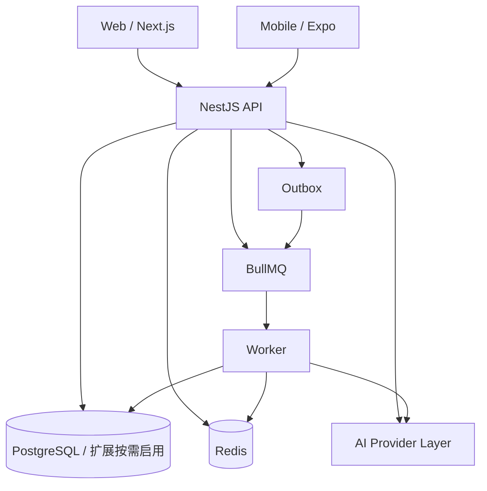

# AVEN 技术设计文档（TDD）

版本：1.1 · 日期：2026-11-10 · 状态：M0-01 修订契约（未实现）
需求来源：[原始产品与工程规格](../../Origin%20Plan.md)
产品契约：[PRD](../product/PRD.md) · [设计系统](../design/DESIGN_SYSTEM.md) · [SCHEMA](../database/SCHEMA.md)

本文定义 AVEN 的模块边界、身份与授权、状态机、事务、异步、API 和测试契约。实现与本文不一致时，先更新本文和 ADR，再改代码。

## 1. 目的与范围

M6-06A1 按 [ADR-013](decisions/0013-in-app-connection-notifications.md) 为个人连接事件追加同事务 Outbox，以独立通知队列和数据库回执投递无正文站内通知。支持当前业务/偏好过滤、5 次重试、pending 对账、平台管理员按代数重排和 90 天收件箱清理。活动通知、移动推送、UI 和生产运维仍未交付，不能关闭完整 M6-06。

P2P-03 按 [ADR-012](decisions/0012-connection-retention.md) 补齐个人邀请的正文保留：预览过期满 24 小时清空 manifest，授权项首次失效满 30 天清空正文；Worker 受控函数分批处理，保留幂等/连接元数据。来源到期后延长有效期不复活旧共享。本轮不交付生产调度与全系统保留清理。

P2P-02 接入层使用 `packages/api-client` 承载类型化连接请求与逐次认证，不持有 UI 状态或私人正文缓存。小组件读取在同一受限事务先读取并锁定实时授权快照，再读取元数据；角色来自服务端会话，任何后续写入仍独立校验版本与权限。该协议不代表产品组件、Agent 工具或通知已实现。

2026-11-12 个人连接扩展遵循 [ADR-011](decisions/0011-personal-connections.md)：个人到个人邀请不套用绑定组织/机会的引荐；独立预览、用途授权、接收方决定与无序用户对唯一建联，同事务审计、FORCE RLS、幂等和实时撤销。端点见 [CONNECTIONS.md](../api/CONNECTIONS.md)。本轮不实现 UI、发现、通知与共同会话。

本文覆盖 M0–M5 的工程基础与首条业务闭环，并为 M6–M7 预留边界。它不替代具体模块的 API 文档和数据库迁移；表结构以 [SCHEMA](../database/SCHEMA.md) 为准，决策以 [ADR](decisions/) 为准。1.1 在无已发布代码/客户端的阶段调整候选、引荐和流式路径，不需要兼容未实施的旧接口；不能将本轮文档修订算作实现验收。

2026-11-13 个人真实模型按 [ADR-019](decisions/0019-personal-live-provider.md) 接入：只外发当前提问及本次获准上下文，组织与旧 Mock run 不升级。Worker 在上游调用前通过受限应用池重核来源与期限；运行信息端点只返回模式和能力，失败不回退 Mock。真实成功取决于上游验收。

## 2. 架构原则

1. **模块化单体**：先保证模块边界和事务一致性，不拆微服务。
2. **API-first**：Web 和 Mobile 的业务读写都经过 NestJS API，不直接连接数据库。
3. **默认拒绝**：权限在 API 和数据库层同时检查；客户端传入的组织 ID、主体 ID 不可信。
4. **服务端权威**：业务状态、授权有效性、匹配解释和行动确认由服务端重新校验。
5. **确定性优先**：匹配先做硬条件过滤和可解释排序，向量检索和 LLM 是增量，不是唯一依据。
6. **人类确认**：发布、发送引荐、共享资料、执行高影响行动必须经过明确确认。
7. **可撤销**：撤销提交后在主库授权检查点开始的新读取立即拒绝；缓存、重放和异步任务不能绕过，已在途或已送达内容的限制必须明示。
8. **可验证**：每个核心权限、并发和状态转换都有能实际失败的测试。
9. **Mock 明示**：开发数据、Mock Provider 和未实现能力必须明确标识，不能伪装完成。

## 3. 系统上下文



- Web 和 Mobile 只调用 API；API 是业务状态权威入口。
- Worker 消费队列，调用与 API 相同的领域服务；不复制业务规则。
- PostgreSQL 是唯一可信数据结构来源；Redis 只做缓存、队列和短期状态。
- AI Provider 通过统一接口接入；Mock 与真实 Provider 可切换。

## 4. 仓库结构与依赖规则

```text
aven/
├── apps/
│   ├── web/                 # Next.js App Router
│   ├── mobile/              # Expo + React Native
│   ├── api/                 # NestJS HTTP 入口
│   └── worker/              # BullMQ / Outbox 消费者
├── packages/
│   ├── contracts/           # Zod Schema、DTO、事件、权限常量
│   ├── database/            # Drizzle Schema、迁移、Repository
│   ├── service-health/      # API/Worker 共享存活/就绪探针
│   ├── domain/              # 框架无关领域服务
│   ├── api-client/          # HTTP/SSE 客户端
│   ├── design-tokens/       # 颜色、间距、字号、圆角
│   ├── ai-core/             # Provider 与工具契约（M3）
│   ├── ui-web/              # 复用 Web 组件（M1）
│   └── config/              # TS、lint、环境加载
├── infra/
│   ├── compose/             # 开发 Compose
│   ├── scripts/             # 初始化、迁移、备份脚本
│   └── deployment/          # 部署配置（后续）
├── docs/
│   ├── product/
│   ├── design/
│   ├── architecture/
│   ├── database/
│   ├── api/
│   ├── security/
│   ├── testing/
│   └── operations/
├── .github/workflows/
├── AGENTS.md
├── README.md
├── pnpm-workspace.yaml
├── turbo.json
└── package.json
```

依赖方向：

```text
api / worker  →  domain  →  database  →  contracts
api / worker  →  service-health  →  database / config
web / mobile  →  api-client  →  contracts
web / mobile  →  design-tokens
web           →  ui-web
所有单元       →  config（仅工程配置）
```

规则：

- `contracts` 只依赖 Zod 和标准库，不依赖数据库、Nest、React。
- `database` 可以依赖 `contracts`，是唯一迁移来源；其他包不得直接写 SQL 或建连接池。
- `service-health` 只提供 API/Worker 的存活/就绪探针，不包含业务规则；Web/Mobile 不得依赖。
- `domain` 依赖 `contracts` 和 `database`，不依赖 Nest、HTTP、React；API 和 Worker 共享它。
- `api` 只做 HTTP 适配、鉴权、DTO 校验、事务边界和错误映射；复杂逻辑在 `domain`。
- `worker` 只做队列适配、重试、幂等和上下文恢复；业务规则在 `domain`。
- `web`/`mobile` 不依赖 `database`/`domain`；只通过 `api-client` 调用 API。
- `ai-core` 不直接访问数据库；工具通过 `domain` 的服务接口执行。
- 禁止循环依赖；M0-02 引入依赖检查（dependency-cruiser 或 ESLint 规则）。

## 5. 模块边界

| 模块 | 负责 | 拥有的表 | 对外服务 |
|---|---|---|---|
| Identity | 主体、用户、凭据、会话、邮箱验证 | `principals`、`users`、`user_private`、`credentials`、`sessions`、`email_verification_tokens`、`password_reset_tokens` | `IdentityService`、`SessionService` |
| Campus | 学校与校园成员认证 | `campuses`、`campus_memberships` | `CampusService` |
| Organization | 组织、成员、邀请、角色 | `organizations`、`organization_memberships`、`organization_invitations` | `OrganizationService`、`MembershipService` |
| Memory | 个人/组织上下文、来源、确认状态、字段用途 | `memory_items`、`memory_sources`、`memory_embeddings`、`context_field_policies` | `MemoryService` |
| Consent | 预览、用途授权、快照、撤销 | `consent_previews`、`consent_grants`、`consent_grant_items`、`consent_events` | `ConsentService` |
| Intent | 个人寻找需求 | `intents` | `IntentService` |
| Opportunity | 组织机会与生命周期 | `opportunities` | `OpportunityService` |
| Matching | 本人候选、独立引荐与决定、匹配画像 | `match_profiles`、`match_candidates`、`referrals`、`referral_decisions` | `MatchingService`、`ReferralService` |
| Relationship | 关系空间、成员、共享上下文、会话 | `relationships`、`relationship_members`、`shared_context_items`、`conversations`、`conversation_members`、`messages` | `RelationshipService`、`ConversationService`、`SharedContextService` |
| Agent | Agent 配置、Run/Step/事件与来源、工具调用、行动确认 | `agent_profiles`、`agent_runs`、`agent_run_events`、`agent_run_sources`、`agent_steps`、`tool_invocations`、`actions` | `AgentRuntime`、`ActionService` |
| Calendar/Event | 日历连接、忙闲、活动与提案 | `calendar_connections`、`availability_blocks`、`events`、`event_participants`、`event_proposals` | `CalendarService`、`EventService` |
| Notification | 站内/推送通知 | `notifications` | `NotificationService` |
| Platform | 审计、Outbox/消费回执、平台角色、幂等、屏蔽、举报 | `audit_logs`、`outbox_events`、`job_receipts`、`platform_role_assignments`、`idempotency_keys`、`block_lists`、`reports` | `AuditService`、`OutboxService`、`IdempotencyService`、`BlockService`、`ReportService` |

模块规则：

- 一个模块不能直接读写另一个模块的表；通过服务接口或同事务的领域服务调用。
- 跨模块一致性用同步服务调用 + 事务；跨模块最终一致性用 Outbox 事件。
- 控制器不写业务逻辑；DTO 只做输入校验和映射。
- 领域服务接收 `ActorContext` 和 `TransactionContext`，不读取全局请求状态。
- Outbox/审计事件只含 ID、版本与必要元数据；SSE 的受限业务事件可含当前获准正文，不能混用为日志或队列 payload。

## 6. 身份与会话

决策见 [ADR-002](decisions/0002-identity-and-sessions.md) 与 [ADR-007](decisions/0007-authorization-boundaries.md)。采用自有数据库与会话，不依赖外部身份 SaaS；密码学使用成熟实现，不自造算法。M2 编码前评审可自托管认证库与自行维护流程的成本，若改变既定方案须新增 ADR。

### 6.1 主体模型

- `principals` 是统一主体锚点；`users`、`organizations`、`projects`、`relationships` 的主键都引用 `principals.id`。
- `principals.type` 必须与子表一致；用外键 + 触发器/约束保证，不能只靠应用代码。
- 个人主体类型为 `user`；组织为 `organization`；项目为 `project`；关系空间为 `relationship`；系统为 `system`。
- 主体删除采用状态 + 软删除；审计和授权事件保留必要元数据。

### 6.2 注册与邮箱验证

- 邮箱规范化：去首尾空格、转小写、统一 Unicode；存 `user_private.email_normalized`，唯一索引。
- 密码策略：12–128 字符，允许空格和 Unicode；不强制字符组合；拒绝常见泄露密码（后续接入列表）。
- 哈希：Argon2id；参数在 M2 用基准测试确定并记录（建议 memory 64 MiB、iterations 3、parallelism 1），登录成功时按需 rehash。
- 注册创建 `principals` + `users` + `user_private` + `credentials`，同一事务。
- 邮箱验证 token：32 字节随机值，数据库只存 SHA-256；24 小时过期；单次使用。
- 未验证邮箱可以浏览公开内容，但不能发布机会、发送引荐或代表组织操作；具体限制在 M2 实现并测试。
- 密码找回 token：30 分钟过期；单次使用；重置后撤销所有会话。

### 6.3 登录与会话

- 登录失败返回统一错误，不区分“邮箱不存在”和“密码错误”；按 IP + 邮箱限流。
- 会话 token：32 字节随机值，base64url；数据库只存 SHA-256；不写日志。
- Web：`aven_session` httpOnly、Secure（生产）、SameSite=Lax、Path=/；通过 Next 代理保持第一方 cookie。
- Mobile：token 存 Expo SecureStore，通过 `Authorization: Bearer <token>` 发送；不使用 URL 参数。
- 会话有效期：绝对 30 天，空闲 7 天；活动时更新 `last_seen_at`，不无限滑动。
- 登录成功创建新会话；可选撤销旧会话；修改密码、重置密码、账号停用撤销全部会话。
- 会话列表只展示设备类型、User-Agent 摘要、IP 哈希、最后活跃时间；不展示完整 IP。
- 登出撤销当前会话；`logout-all` 撤销全部。

### 6.4 CSRF 与 CORS

- Cookie 认证的状态变更请求（包括登录）校验严格的 Origin/Referer 允许列表，并使用与会话或短期登录前 nonce 绑定、服务端签名的双提交 CSRF token：`aven_csrf` cookie + `X-CSRF-Token`。不采用仅比较两个任意值的朴素双提交；登录/会话轮换时轮换 token。会话 cookie 保持 httpOnly，生产 cookie 优先 host-only，不能因同父域就信任任意子域。
- Bearer 认证不要求 CSRF，但必须限制 CORS 允许来源；移动端不使用浏览器 CORS。
- Web 通过 Next rewrites 将 `/api/*` 代理到 API，保持同站 cookie；生产使用同父域或反向代理。
- 不允许 `Access-Control-Allow-Origin: *` 配合 credentials。

### 6.5 开发身份

- 仅当 `APP_ENV=development` 且 `AUTH_DEV_MODE=true` 时启用 `/auth/dev-login`。
- 生产构建必须拒绝启动或禁用该路由；不能作为鉴权失败的回退。
- UI 明确显示“开发身份”；种子用户只在开发 seed 中存在。
- 集成测试使用真实注册/登录流程或显式测试会话，不依赖生产后门。

### 6.6 校园认证

- 注册或选择学校不等于通过校园认证。
- `campus_memberships.status`：`pending`、`verified`、`rejected`、`revoked`。
- 认证方式：`email_domain`（信号）、`manual`（人工审核）、`student_id`（后续）。
- 首版建议：学校邮箱域名作为辅助信号，人工审核作为认证；UI 不得把域名匹配写成“官方认证”。
- 认证状态与组织成员身份独立；组织认证也独立记录。

### 6.7 组织角色与代表权

| 角色 | 权限 |
|---|---|
| `owner` | 全部组织权限；转让所有权；删除组织；管理管理员 |
| `admin` | 管理成员（除 owner）、创建/发布/关闭机会、查看和决定引荐、管理组织资料 |
| `member` | 查看组织与已发布机会；默认不能发布、不能决定引荐；可被授予 `can_represent` |

- 最后一名 `owner`/`admin` 不能被移除或降级；转让所有权是显式操作。
- 普通成员只有 `can_represent=true` 才能代表组织接受/拒绝引荐；授予和撤销需要 admin。
- 组织操作必须显式携带组织上下文；服务端验证成员身份和角色，不能信任客户端传入的组织 ID。
- 成员被移除后，已生成的草稿不能继续执行；会话中的组织上下文立即失效。

## 7. 授权模型

### 7.1 参与者与上下文

```ts
type ActorContext = {
  principalId: string;      // 当前用户主体
  userId: string;
  organizationId?: string;  // 组织操作时显式绑定
  roles: string[];          // 组织角色或平台角色
  isPlatformAdmin: boolean;
  isWorker: boolean;
  requestId: string;
  sessionId?: string;
};
```

- 服务端从会话派生 `principalId`/`userId`；客户端不能设置。
- 组织上下文来自路由或显式 header，服务端验证成员身份。
- Worker 使用独立 `aven_worker` 池，保留原始用户与组织身份，并另记系统执行者；从已提交 Outbox/任务记录恢复 actor，不信任队列传入的角色/admin 标志。执行时复核会话相关业务权限、成员与授权。
- AI Agent 使用发起用户的 `ActorContext`，工具权限是用户权限与工具允许范围的交集。

### 7.2 权限矩阵

| 操作 | 本人 | 组织成员 | 组织管理员 | 平台管理员 | Worker |
|---|---|---|---|---|---|
| 查看自己的资料/记忆/需求 | ✓ | — | — | 仅元数据 | 按作业与用途 |
| 修改自己的资料/记忆/需求 | ✓ | — | — | — | — |
| 查看组织公开资料 | ✓ | ✓ | ✓ | ✓ | ✓ |
| 查看组织私有资料 | — | ✓ | ✓ | 仅审计需要 | 按作业 |
| 创建/发布/关闭机会 | — | — | ✓ | — | — |
| 查看已发布机会 | ✓ | ✓ | ✓ | ✓ | ✓ |
| 搜索匹配（自己的需求） | ✓ | — | — | — | 匹配作业 |
| 查看组织的已发送引荐 | — | 仅 `can_represent` | ✓ | 仅元数据 | 按作业 |
| 查看未发送推荐候选 | ✓ 需求所有者 | — | — | — | 受限匹配作业 |
| 发送引荐 | ✓ | — | — | — | — |
| 决定引荐（个人侧） | ✓ | — | — | — | — |
| 决定引荐（组织侧） | — | 仅 `can_represent` | ✓ | — | — |
| 查看授权 | ✓ 授权人 | 接收组织成员按权限 | ✓ | 仅元数据 | 授权检查 |
| 撤销授权 | ✓ 授权人 | — | — | — | — |
| 查看关系空间 | ✓ 成员 | ✓ 成员 | ✓ 成员 | 仅元数据 | 按作业 |
| 读取共享上下文 | ✓ 成员 + 有效授权 | 同左 | 同左 | — | 授权检查 |
| 关闭关系 | ✓ 代表成员 | 按角色 | ✓ | — | — |
| 查看审计 | — | — | — | ✓ | — |
| 校园认证审核 | — | — | — | ✓ | — |

“仅元数据”表示不能读取私人正文、消息内容或授权快照值。

### 7.3 可见性策略

完整字段矩阵见 [PRD 第 7 节](../product/PRD.md#7-可见性与授权)。`context_field_policies` 分别记录展示受众、发现开关和 `self_ai`/`matching`/`sharing` 用途集合；旧 visibility 名称只作 UI 预设，不作为有序或互斥权限。

- 无策略默认 owner-only、关闭用途；字段名采用服务端允许列表，不能用任意 JSON path 绕过字段限制。
- 发现仅返回明确公开/校园可见的字段投影，私人原始记忆始终通过所有者/组织范围读取；RLS 不能承担列级隐藏，公开投影由受控函数生成。
- 校园可见要求组织配置校园，访问者有该校园有效 verified membership；选择学校、邮箱域名或 pending 不能代替认证。
- 匹配只读取已确认且 matching 允许的派生 `match_profiles`，附逐来源版本与策略版本；删除/收紧用途时同步使派生数据失效，重算和物理索引清理可异步。
- 组织只读正式引荐的授权快照，不读未发送候选、原始理由证据或跨用途数据。组织接收的私人快照限当前 owner/admin/`can_represent`，关系元数据可按成员权限开放。
- 关系共享值仅存于 `consent_grant_items`，`shared_context_items` 引用它，不复制出第二份独立正文。

### 7.4 授权（ConsentGrant）

授权包含：

- 授权主体（grantor）与接收主体（grantee）。
- 用途：`referral`、`relationship_context`、`event_coordination`。
- 绑定的引荐（关系通过该引荐绑定）或活动，不能跨对象复用。
- 字段集合、来源版本与字段策略版本。
- 有效期、版本、状态。
- 撤销时间、撤销人、原因。

创建授权：

1. 校验 grantor 拥有来源，字段允许该用途。
2. 校验 grantee 存在且类型匹配。
3. 服务端预览保存短期 `consent_previews` 凭据，绑定用户、接收方、业务对象、实际字段值哈希、逐来源/策略版本、分别确认的用途与期限。凭据默认 10 分钟失效；发送时在短事务内锁定并重验来源，任何差异要求重新预览。
4. 引荐默认/上限 14 天，关系上下文默认/上限 90 天；从用户实际授权时计时，不在接受时自动延长。关系用途默认不选，不要求用户为建立关系而授权额外资料。
5. 发送事务同时写 `referrals`、已确认用途的 grants/items/events、个人决定、幂等结果及 Audit/Outbox；预览只消费一次。单独创建授权也必须预览并绑定既有业务对象。
6. `referral` 不能升级或复用于关系；未预先确认关系用途时可建立空共享上下文的关系。快照只保存所选字段，不保存完整原始记录。

读取授权：

- 校验 grant 状态为 `active`、未过期。
- 校验 actor 是 grantor 或当前有代表权限的 grantee；关系成员身份不能替代接收方权限。
- 校验用途、绑定业务对象、所选字段、grant item 状态与来源未失效；grant/item 通过复合外键关联，不能拼接另一授权。
- 关系读取额外校验共享项 active、双方属于关系、grant 的引荐等于关系的引荐，且 purpose 为 `relationship_context`。
- 对 grant、授权项及来源失效锚点按稳定 ID 顺序取共享锁，撤销/失效路径取冲突写锁；授权判断用主库、短事务和当前检查时钟，不跨网络持锁。锁只排序数据库操作，在途语义见第 9.3 节。

撤销授权：

- 只有 grantor 可以撤销；重复撤销幂等。
- 写 `consent_events`，状态改为 `revoked`，立即提交。
- 读取入口在同一查询检查状态；如缓存必要非敏感元数据，键包含 grant 版本且不得替代主库授权检查；私人快照不缓存，任务执行前复核。
- 撤销一个授权不影响其他独立授权。
- 来源删除/失效/收紧策略时，同事务标记关联授权项及匹配派生锚点 stale，读取拒绝；异步只负责清理。普通内容编辑保留已确认旧快照，不更新授权值，用户可撤销后重新授权。

### 7.5 RLS 与数据库角色

以 [ADR-007](decisions/0007-authorization-boundaries.md) 取代 ADR-004，逐表权限与函数边界见 SCHEMA 第 11 节。

- `aven_migrator` 持有表和 DDL；`aven_app` 普通业务、`aven_worker` 队列、`aven_auth` 认证池分离，均无 DDL、NOSUPERUSER、NOBYPASSRLS。运行角色之间不能 SET ROLE，凭据不下发客户端。
- 不授予全 schema DML；凭据/哈希不向普通池开放，私人字段不依赖行级策略做列隐藏。
- `aven_function_owner` 是 NOLOGIN、非表所有者、NOBYPASSRLS；只通过逐表显式策略与最小授权执行受控函数，不假定 SECURITY DEFINER 绕过 FORCE RLS。
- 私人/租户表启用并 FORCE RLS。每个事务设置 principal/user/organization/request 上下文，禁止 session 级 SET；异常、取消、回滚后必须结束事务，测试连接池复用。
- `is_worker()` 根据真实连接角色判断；平台权限来自受保护的 `platform_role_assignments`，不是客户端参数或可随意设置的布尔 GUC。辅助函数避免成员表策略递归。
- Audit/Outbox 由受控追加函数在普通业务事务写入；函数验证资源与事件、派生 actor，不通过提升为 worker 追加。权限拒绝事件在失败事务外脱敏记录。
- RLS 防遗漏过滤与上下文串用，不是任意 SQL 执行/服务端凭据失陷后的独立身份防线；仍要求参数化查询与应用权限检查。集成测试使用实际运行角色，而非超级用户。

## 8. 数据模型与状态机

表结构见 [SCHEMA](../database/SCHEMA.md)。本节定义合法转换和业务规则。

### 8.1 记忆

| 当前 | 事件 | 下一状态 | 操作者 | 守卫 |
|---|---|---|---|---|
| `pending_confirmation` | 确认 | `confirmed` | 所有者 | 内容非空、来源有效 |
| `pending_confirmation` | 拒绝 | `rejected` | 所有者 | — |
| `confirmed` | 过期 | `expired` | 系统/所有者 | `valid_until` 已到 |
| `confirmed` | 删除 | `deleted` | 所有者 | 关联授权项标记 stale |
| `rejected` | 删除 | `deleted` | 所有者 | — |
| `expired` | 删除 | `deleted` | 所有者 | — |

只有 `confirmed` 且未过期、可见性允许的记忆参与对应用途。删除是软删除；索引清理异步执行，但读取立即拒绝。

### 8.2 机会

| 当前 | 事件 | 下一状态 | 操作者 | 守卫 |
|---|---|---|---|---|
| `draft` | 发布 | `open` | 组织管理员 | 必填字段完整、截止时间未过 |
| `open` | 暂停 | `paused` | 组织管理员 | — |
| `open` | 关闭 | `closed` | 组织管理员 | — |
| `open` | 到期 | `expired` | 系统 | `deadline` 已到 |
| `paused` | 恢复 | `open` | 组织管理员 | 未过期 |
| `paused` | 关闭 | `closed` | 组织管理员 | — |

编辑机会递增 `version`；已发送引荐在组织接受时复核机会状态、截止时间和人数。关闭/过期机会不能接受新引荐。

### 8.3 引荐与决定

`match_candidates` 只有 `active`/`stale`/`dismissed`，归个人所有，不承载发送与决定。正式操作创建独立 `referrals`，可选关联候选；重算不改引荐。

| 当前 | 事件 | 下一状态 | 操作者 | 守卫 |
|---|---|---|---|---|
| 不存在 | 确认预览并发送 | `sent` | 个人 | 有效预览与授权、机会开放、未屏蔽 |
| `sent` | 请求补充 | `info_requested` | 组织 | 有权代表组织 |
| `sent` | 接受 | `accepted` | 组织 | 个人侧已接受、授权有效、机会可用 |
| `sent` | 拒绝 | `declined` | 组织 | — |
| `sent` | 撤回 | `withdrawn` | 个人 | — |
| `sent`/`info_requested` | 过期 | `expired` | 系统 | 超过有效期 |
| `info_requested` | 补充后重发 | `sent` | 个人 | 新授权预览、新版本 |
| `info_requested` | 接受/拒绝 | `accepted`/`declined` | 组织 | 同 `sent` |

- 双方决定保存在 `referral_decisions`，唯一 `(referral_id, side)`；记录实际用户、代表主体与 content_version。version 用于全部状态变更的乐观锁；content_version 仅在补充/内容变化时递增。发送即个人接受，组织接受是另一方决定，补充后重新确认。
- 拒绝、撤回、过期为终态；重发创建新引荐与授权，可通过 `supersedes_referral_id` 追溯。个人/机会一对最多一个 sent/info_requested/accepted 引荐，已建立关系不因换需求或算法版本重复创建。
- 引荐状态与授权状态独立；撤销会阻止快照读取和新接受，但不删除已形成关系。declined/withdrawn/expired 引荐在同一事务撤销其绑定授权；accepted 不自动升级任何用途。终态元数据可读不代表快照可读。

### 8.4 授权

| 当前 | 事件 | 下一状态 | 操作者 | 守卫 |
|---|---|---|---|---|
| `active` | 撤销 | `revoked` | grantor | — |
| `active` | 到期 | `expired` | 系统 | `expires_at` 已到 |
| `active` | 来源失效 | `active` + 项 `stale` | 系统 | 来源删除/可见性变更 |

范围变更创建新授权版本；旧版本保留审计，不原地扩大。

### 8.5 关系

| 当前 | 事件 | 下一状态 | 操作者 | 守卫 |
|---|---|---|---|---|
| `active` | 关闭 | `closed` | 双方代表成员 | 二次确认 |
| `closed` | — | 终态 | — | 不再新增共享 |

关系关闭后保留必要历史；共享上下文读取按授权状态决定，不自动全部开放。

### 8.6 行动

| 当前 | 事件 | 下一状态 | 操作者 | 守卫 |
|---|---|---|---|---|
| `draft` | 提交预览 | `pending_confirmation` | 用户/AI | 参数校验、权限检查 |
| `pending_confirmation` | 确认 | `executing` | 用户 | 草稿版本匹配、未过期、一次性 token |
| `pending_confirmation` | 取消/过期 | `cancelled`/`expired` | 用户/系统 | — |
| `executing` | 成功 | `succeeded` | 系统 | 业务结果成功 |
| `executing` | 失败 | `failed` | 系统 | 记录错误、可重试性 |
| `failed` | 重试 | `executing` | 用户/系统 | 同一幂等键、权限复核 |

草稿内容变化必须使旧确认失效；重复确认返回同一结果，不重复执行。

### 8.7 活动（M6）

| 当前 | 事件 | 下一状态 | 操作者 | 守卫 |
|---|---|---|---|---|
| `draft` | 提案 | `proposed` | 组织者 | 时间、参与者、时区合法 |
| `proposed` | 发起确认 | `pending_confirmation` | 组织者 | 候选版本 |
| `pending_confirmation` | 全部确认 | `confirmed` | 参与者 | 提案版本未变 |
| `draft`/`proposed`/`pending_confirmation` | 取消 | `cancelled` | 组织者 | — |
| `confirmed` | 取消 | `cancelled` | 组织者/参与者 | 通知参与者 |
| `confirmed` | 结束 | `ended` | 系统/组织者 | 结束时间已到 |

候选变化使旧确认失效。

## 9. 事务、并发与幂等

### 9.1 通用规则

- 所有写操作在事务内完成；业务写入与 Outbox 事件同事务。
- 乐观锁：`UPDATE ... WHERE id = $1 AND version = $2`；0 行返回 `VERSION_CONFLICT`。
- 唯一约束防止重复：关系、决定、成员、授权项、幂等键。
- 事务隔离默认 `READ COMMITTED`；敏感读取使用行锁或显式版本检查。
- 外部调用（AI、邮件、推送）不在数据库事务内执行；通过 Outbox/队列异步。
- 错误在事务边界映射为统一错误码；不泄露内部 SQL 或堆栈。

### 9.2 接受引荐事务

```text
BEGIN
  SET LOCAL actor context
  verify current org representative; claim idempotency key
  SELECT referral FOR UPDATE
  IF relationship already exists -> return its currently authorized metadata
  IF status NOT IN ('sent','info_requested') -> REFERRAL_NOT_AVAILABLE
  verify expected version/content_version and not expired
  SELECT opportunity FOR UPDATE
  verify open, before deadline, campus access, not blocked, headcount available
  verify individual decision = accepted for current content_version
  lock and verify bound referral consent/items/source status
  INSERT relationship (unique referral_id, unique applicant/opportunity)
  INSERT relationship_members
  INSERT shared_context_items referencing only separately confirmed,
    currently valid relationship_context grant items (may be empty)
  UPSERT organization decision = accepted for current content_version
  UPDATE referral status = accepted, version++
  append outbox/audit through controlled functions; save idempotency result IDs
COMMIT
```

- 重复接受先鉴权再返回既有关系，不先因 accepted 状态或机会已关闭拒绝合法幂等重试。
- 机会行锁保护人数与接受计数；引荐/关系唯一约束防不同需求、不同候选或不同幂等键绕过。已接受占用名额，关闭关系不自动释放，释放策略变更另行定义。
- 发送、补充、接受、撤回、关闭与来源失效使用一致锁顺序；M5 用并发与死锁重试测试验证，不在事务内调用 Provider。

### 9.3 撤销与读取竞争

- 撤销锁定 grant，改 revoked、递增版本并追加事件，提交即生效；来源失效同事务使依赖项 stale。读取端不等待 Outbox、缓存删除或索引清理。
- 受控读取在主库短事务内锁定 grant/item/来源失效锚点，再以取锁后的当前时钟重验期限、用途、接收人和来源；长等待不能沿用事务开始时的 now() 判断有效性。
- 撤销先提交：后续检查拒绝。读取先取锁：撤销等待该短事务结束，但响应可能已在途；锁不能保证撤销提交后网络上绝无旧字节，不跨网络或模型调用持锁。
- 流式任务每批输出和每次副作用前重验依赖，失效即停止后续输出；不能收回此前已发送给用户/Provider 的内容。外部调用中的撤销竞争必须说明限制，不承诺分布式原子撤回。
- 私人快照与依赖它的模型结果 `Cache-Control: private, no-store`，不使用 CDN/Next 共享缓存、授权只读副本或离线持久化。客户端收到失效、切换身份、会话过期、页面恢复时清理/复核可控缓存。

### 9.4 幂等键

- 唯一 `(principal_id, key)`，保存 method/path、规范请求哈希、执行状态、结果资源 ID、最小非敏感响应和 expires_at；不存 token、快照正文或完整 AI 输入。组织上下文计入请求哈希。
- 用于发送/补充/决定引荐、确认行动/活动、创建授权及创建 run。先原子占位，同键并发只执行一次；失败事务回滚占位，执行中返回可查询状态，不重复启动。
- TTL 24 小时；业务唯一约束和稳定副作用键必须独立存在，不能依赖 TTL 防永久重复。
- 同键同请求不重复执行，同键不同内容返回 `IDEMPOTENCY_CONFLICT`；重放前重新鉴权，再从当前资源生成可读响应，撤销后不能重放旧正文。

## 10. 异步与可靠性

决策见 [ADR-005](decisions/0005-async-and-outbox.md)。

### 10.1 Outbox

- 业务事务写入 `outbox_events`：`aggregate_type`、`aggregate_id`、`event_type`、`payload`、`status`、`attempts`、`available_at`。
- 派发器短事务用 `FOR UPDATE SKIP LOCKED` 领取事件，设置 processing、锁令牌和 `lease_expires_at` 后提交；事务外投递 BullMQ，再仅由持有有效租约的实例标记 processed。崩溃后租约过期可重新领取。
- processed 仅表示已投递，不表示业务副作用完成；允许重复投递，不能声称 exactly-once。jobId 降低重复排队，但不能替代消费幂等。
- `job_receipts` 按 `(event_id, consumer)` 记录执行租约、终态与结果 ID。数据库副作用与成功回执同事务提交；外部副作用使用稳定 Provider 幂等键。超时且外部结果未知时先查询/对账，无去重能力时进入人工处理，不盲目重试。
- Redis 队列实例配置持久化、不驱逐任务键和独立于可驱逐缓存的运行策略；对 processed 但无有效完成回执的事件周期对账并补投，覆盖入队成功后 Redis 丢失任务。
- 领取失败、入队成功但确认前崩溃、消费成功后重投、租约过期、Redis 重启均需故障注入。失败按指数退避，超过上限进入 dead；保留可重放数据库事件与脱敏错误。

### 10.2 Worker

- NestJS standalone 应用，组合 `packages/domain` 的领域服务；不启动 HTTP 业务路由。
- 每个作业携带 `actor`/`request_id`/`idempotency_key`；执行前恢复上下文并复核权限与授权。
- 处理器必须幂等；外部副作用使用稳定 Provider 幂等键，未知结果先查询/人工处理，不以本地去重表替代外部原子性。
- 失败区分可重试（网络、限流、超时）和不可重试（权限、业务冲突、参数错误）。
- 提供健康/就绪检查、优雅停机、并发限制和指标。
- Worker 不复制 API Service；共享领域服务是唯一业务规则来源。

### 10.3 队列与任务类型

| 队列 | 任务 | 重试 | 幂等 |
|---|---|---|---|
| `memory` | 生成/更新 embedding | 指数退避，最多 5 次 | 按 memory_id + version |
| `matching` | 重算候选 | 最多 3 次 | 按 intent_id + source_manifest_hash + algorithm_version |
| `consent` | 失效缓存/索引/快照 | 最多 5 次 | 按 grant_id + version |
| `notification` | 站内/推送 | 最多 5 次 | 按 notification_id |
| `calendar` | 同步/提醒 | 最多 5 次 | 按连接 + 游标 |
| `event` | 活动提醒/到期 | 最多 3 次 | 按 event_id + version |

普通 CRUD 不异步化；只有确实需要后台执行、重试或解耦的任务进入队列。

### 10.4 失败与死信

- 死信保留原始 payload（脱敏）、错误码、尝试次数和时间。
- 管理入口只允许平台管理员查看/重放；重放需要审计。
- 队列失败不能损坏业务状态；业务状态以数据库为准。
- 告警：队列积压、Outbox 延迟、死信增长、任务失败率。

## 11. API 契约

### 11.1 基本规范

- 前缀 `/api/v1`；JSON；UTF-8。
- 请求 ID：接受 `X-Request-Id`，无则生成；错误响应包含 `request_id`。
- 认证：Web cookie；Mobile bearer；CORS 允许列表。
- 成功响应：资源对象直接返回；列表返回 `{ "data": [...], "next_cursor": "..." }`。
- 错误响应：

```json
{
  "error": {
    "code": "MATCH_NOT_AVAILABLE",
    "message": "This opportunity is no longer available.",
    "request_id": "uuid",
    "retryable": false,
    "details": {}
  }
}
```

- 分页：cursor，`limit` 默认 20，最大 100；不使用 offset。
- 过滤/排序：显式允许列表；不拼接原始 SQL。
- 幂等：高影响写操作支持 `Idempotency-Key`；同键不同内容返回冲突。
- 版本：URL 主版本；新增字段向后兼容；破坏性变更升版本并写迁移说明。
- 限流：认证端点更严格；返回 429 + `Retry-After`。

### 11.2 错误码

| 错误码 | HTTP | 含义 | 可重试 |
|---|---|---|---|
| `UNAUTHENTICATED` | 401 | 未登录/会话失效 | 否 |
| `FORBIDDEN` | 403 | 无权限 | 否 |
| `NOT_FOUND` | 404 | 资源不存在或无权知晓 | 否 |
| `VALIDATION_ERROR` | 422 | 输入不合法 | 否 |
| `CONFLICT` | 409 | 业务冲突 | 否 |
| `VERSION_CONFLICT` | 409 | 版本已变化 | 是（重新读取后） |
| `IDEMPOTENCY_CONFLICT` | 409 | 同键不同内容 | 否 |
| `CONSENT_REVOKED` | 403 | 授权已撤销 | 否 |
| `CONSENT_EXPIRED` | 403 | 授权已过期 | 否 |
| `CONSENT_SCOPE_MISMATCH` | 403 | 字段/用途不在授权内 | 否 |
| `OPPORTUNITY_CLOSED` | 409 | 机会已关闭 | 否 |
| `OPPORTUNITY_EXPIRED` | 409 | 机会已过期 | 否 |
| `OPPORTUNITY_FULL` | 409 | 机会人数已满 | 否 |
| `MATCH_NOT_AVAILABLE` | 409 | 推荐候选已失效 | 否 |
| `REFERRAL_NOT_AVAILABLE` | 409 | 引荐状态不允许 | 否 |
| `REFERRAL_ALREADY_DECIDED` | 409 | 引荐已决定 | 否 |
| `REFERRAL_EXPIRED` | 409 | 引荐已过期 | 否 |
| `PREVIEW_EXPIRED` | 409 | 预览已过期，需重新确认 | 否 |
| `PREVIEW_STALE` | 409 | 来源/接收方/范围已变化 | 否 |
| `EVENT_HISTORY_EXPIRED` | 410 | 流式历史超出保留窗口 | 否 |
| `INVALID_EVENT_CURSOR` | 409 | 恢复游标无效 | 否 |
| `RELATIONSHIP_EXISTS` | 409 | 关系已存在 | 否 |
| `RATE_LIMITED` | 429 | 限流 | 是 |
| `PROVIDER_UNAVAILABLE` | 503 | AI/外部服务不可用 | 是 |
| `PROVIDER_TIMEOUT` | 504 | 外部服务超时 | 是 |
| `INTERNAL` | 500 | 未预期错误 | 视情况 |

### 11.3 首条闭环接口

| 能力 | 方法与路径 |
|---|---|
| 注册/登录 | `POST /auth/register`、`POST /auth/login`、`POST /auth/logout`、`POST /auth/logout-all` |
| 邮箱验证/找回 | `POST /auth/verify-email`、`POST /auth/resend-verification`、`POST /auth/forgot-password`、`POST /auth/reset-password` |
| 会话 | `GET /auth/sessions`、`DELETE /auth/sessions/:id` |
| 本人 | `GET /me`、`PATCH /me`、`GET /me/permissions` |
| 校园 | `GET /campuses`、`GET /me/campus-memberships`、`POST /me/campus-memberships` |
| 组织 | `POST /organizations`、`GET /organizations`、`GET/PATCH /organizations/:id` |
| 成员 | `GET/POST /organizations/:id/members`、`DELETE /organizations/:id/members/:userId` |
| 邀请 | `POST /organizations/:id/invitations`、`POST /invitations/accept`（token 放请求体）、`DELETE /organizations/:id/invitations/:id` |
| 记忆 | `GET/POST /memories`、`PATCH/DELETE /memories/:id`、`POST /memories/extract`、`GET /memories/:id/sources` |
| 需求 | `GET/POST /intents`、`PATCH /intents/:id` |
| 机会 | `GET/POST /opportunities`、`GET/PATCH /opportunities/:id`、`POST /opportunities/:id/publish`、`POST /opportunities/:id/pause`、`POST /opportunities/:id/close` |
| 匹配 | `POST /matches/search`、`GET /matches`、`GET /matches/:id`（本人候选） |
| 引荐 | `POST/GET /referrals`、`GET /referrals/:id`、`POST /referrals/:id/decisions`、`POST /referrals/:id/supplements`、`POST /referrals/:id/withdraw` |
| 授权 | `POST /consents/preview`、`POST/GET /consents`、`GET /consents/:id`、`POST /consents/:id/revoke` |
| 关系 | `GET /relationships`、`GET /relationships/:id`、`GET /relationships/:id/context`、`POST /relationships/:id/close`；新增共享通过预览后的 POST /consents 原子绑定 |
| 任务 | `GET /tasks/:id` |
| Agent | `POST /agent/turns`、`GET /agent/runs/:id`、`GET /agent/runs/:id/events`、`POST /agent/runs/:id/cancel` |
| 行动 | `POST /actions/:id/confirm`、`POST /actions/:id/cancel` |

具体请求/响应在 `docs/api/` 中补充；M0-01 只锁定路径、错误和权限语义。

### 11.4 SSE 契约

先 `POST /api/v1/agent/turns`（JSON + Idempotency-Key）同事务保存输入消息、绑定 input_message_id 的 run、幂等结果与启动 Outbox，返回 201 与 `{run_id, status, stream_url}`；再 `GET /api/v1/agent/runs/:id/events`（`Accept: text/event-stream`）订阅或恢复同一 run。创建、读取、取消分离，重连不重发输入或执行工具。

事件：

```text
event: turn.started
data: {"schema_version":1,"run_id":"...","sequence":1,"timestamp":"..."}

event: message.delta
data: {"schema_version":1,"run_id":"...","sequence":2,"text":"..."}

event: tool.started
event: tool.progress
event: tool.completed
event: action.proposed
event: turn.completed
event: turn.failed
event: turn.cancelled
```

规则：

- 持久事件有按 run 单调递增的 id/sequence，写入 `agent_run_events` 后才能发送；完成状态与唯一终止事件同事务保存。心跳每 15 秒使用 SSE 注释，不分配序号或持久化。
- GET 使用 Last-Event-ID，仅重放大于游标的事件，再接实时事件；客户端按 `(run_id, sequence)` 去重，服务端补查高水位防历史/实时切换漏事件。越界游标返回 INVALID_EVENT_CURSOR。
- 事件保留 24 小时，含正文的事件是受保护业务数据，不是日志；到期返回 EVENT_HISTORY_EXPIRED，可从 run 查询终态但不能伪造全文续传。
- run 记录发起用户与组织；订阅、重放、取消都重验当前权限及 `agent_run_sources` 中的来源/授权依赖，失效内容不因重放变得可读。正文不存进 Outbox、日志或分析。
- 写操作仍走独立幂等确认接口。断开订阅不等于取消；显式 cancel 传播 AbortSignal，阻止尚未提交动作，不承诺回滚已提交或已送达外部的结果。
- Web 与原生客户端都要实测 fetch 流、Cookie/Bearer、AbortController 和分块解析；不假定浏览器 ReadableStream 在所有原生运行时等价。代理禁用 SSE 缓冲与缓存，验证首批事件延迟。
- 出流前用 HTTP 错误；出流后用明确终止事件，敏感数据失效时只给安全状态，不返回内部提示词或未授权内容。

## 12. Web 架构

- Next.js App Router；Server Components 默认，交互/流式组件才用 Client Components。
- 业务数据通过 `packages/api-client` 调用 NestJS API；不直接连接数据库。
- 服务端组件读取 cookie 并转发到 API；客户端请求 `credentials: 'include'`。
- Next rewrites 将 `/api/*` 代理到 API，保持第一方 cookie；生产同父域或反向代理。
- 数据状态用 TanStack Query；Zustand 只放本地 UI 状态；表单用 React Hook Form + Zod。
- 路由保护在服务端布局/页面检查；middleware 只做辅助，不作为唯一鉴权。
- 每个页面交付适用状态矩阵，按设计系统实现；关键页面先通过双端设计评审。
- 私人 RSC/API 响应禁用共享缓存，TanStack Query key 包含用户/组织范围；SSR 预取与 hydration 不跨请求共享 QueryClient。登出、身份切换与授权失效清理旧数据，受授权快照不持久化离线。
- 不在客户端暴露密钥；`NEXT_PUBLIC_*` 只放非敏感配置。
- 流式消费用 fetch + ReadableStream 解析 SSE；支持中止和恢复。

## 13. 移动端架构

- Expo + React Native + Expo Router；Android 优先，iOS 条件允许时验证。
- 会话 token 存 SecureStore；不放 AsyncStorage；不写日志。
- API client 与 Web 共享契约；`EXPO_PUBLIC_API_URL` 配置；真机使用局域网 IP，不能用 localhost。
- TanStack Query 管理服务端状态；离线/弱网只重试幂等请求，显示待处理状态，避免重复写入。
- 底部导航 + Stack；Safe Area、键盘避让、输入焦点、返回手势。
- Expo Go 仅用于早期健康/布局。自定义原生能力或 M5 主线验收前建立 development build；M7 使用实际发布安装包，EAS/本地构建路径与设备证据分开记录。不把 Web 页面塞进 WebView。
- 测试系统字体放大、Android 返回、深链、前后台恢复、权限拒绝；切换身份清理查询缓存。受授权私人数据不提供离线缓存降级。
- 推送、日历、文件等原生能力在 M6/M7 接入；权限被拒绝时有明确降级。

## 14. AI 架构

决策见 [ADR-006](decisions/0006-ai-provider.md)。

### 14.1 Provider 抽象

```ts
interface AIProvider {
  generateText(input: GenerateTextInput): Promise<GenerateTextResult>;
  generateObject<T>(input: GenerateObjectInput<T>): Promise<T>;
  streamText(input: StreamTextInput): AsyncIterable<StreamEvent>;
  generateEmbedding(input: string[]): Promise<number[][]>;
}
```

- 默认 `MockProvider`：确定性输出、固定样例、明确标识；不需要真实密钥即可开发。
- `OpenAICompatibleProvider`：base URL、API key、model、timeout 可配置；不把供应商逻辑写进业务模块。
- 模型按任务路由（意图提取、分类、记忆整理、解释、Embedding）；具体模型由配置决定。
- 真实 Provider 接入后单独验证成功、限流、超时、错误和取消；Mock 结果不能证明智能能力完成。
- 可在适配器内复用成熟 AI SDK，不把供应商 SDK 类型泄露给 domain。结构化输出的泛型必须由运行时 Schema 校验，不以类型断言证明正确。
- M3 在真实接入前登记脱敏评估集、结构化成功率/来源支持/越权拒绝阈值，以及单 run 时间、工具次数、token/费用、并发预算；无依据的理由和越权执行为阻断项。结果保存模型/配置/样例版本与失败案例，不记录私人 Prompt。
  - 已登记：`packages/ai-core/src/eval/dataset.ts`（版本 `2026-11-11.2`，10 个合成用例（含结构化输出与取消））、`docs/development/M3-07_EVALUATION.md`；`corepack pnpm ai:eval` 以 `minBlockingPassRate=1`、`minOverallPassRate=0.9`、结构化成功率 1、取消处理率 1、p95 ≤ 15s、平均工具 ≤ 1、平均 token ≤ 4000、平均费用 ≤ $0.02 判定并输出不含正文的报告。并发预算与真实 Provider 费用校准仍未实现。

### 14.2 工作流

```text
User Input
  → Intent Extraction
  → Permission-scoped Retrieval
  → Planning
  → Tool Execution
  → Result Validation
  → Action Preview
  → User Confirmation
  → Execution
  → Audit & Memory Update
```

- 每一步有状态、输入/输出摘要、错误和超时。
- 权限检查在检索前和执行前都发生；不能先取数据再判断。
- 工具只能调用领域服务，不能直接 SQL、任意 HTTP 或文件系统。
- 工具定义包含：名称、描述、Zod 参数、所需权限、超时、重试、幂等、审计。
- 工具参数伪造、Prompt Injection、越权检索必须有测试。

### 14.3 行动确认

- 草稿包含 action_type、payload、draft_version、expires_at、principal_id，以及服务端绑定的 organization_id（如适用）；不能因切换组织而在错误范围执行。
- 确认接口校验：草稿版本、有效期、权限、授权、业务状态、幂等键。
- 一次性确认 token 只存哈希；重复确认返回同一结果，不重复执行。
- 草稿内容变化使旧确认失效；执行失败可重试，但遵守业务幂等。
- 高影响操作（发布、发送引荐、共享资料、关闭关系）必须人工确认。

### 14.4 数据最小化

- 只向 Provider 发送当前用途允许的字段与最小会话片段；不发送完整私人记忆库或全量历史。当前用户输入不等于授权检索全部资料；选中上下文须有 self_ai 或对应合法用途。
- 来源引用只保存必要 ID、类型、版本和时间；不把私人正文写入日志或分析事件。
- Provider 数据保留、地域和出境要求在上线前确认；默认不把敏感数据发给海外服务。
- 提示词和模型输出不包含密钥、内部系统提示或未授权上下文。

## 15. 可观测性与审计

- 结构化 JSON 日志：`timestamp`、`level`、`service`、`request_id`、`principal_id`（伪匿名）、`run_id`、`job_id`、`route`、`status`、`latency_ms`、`error_code`。
- 不记录：密码、token、完整邮箱（按需脱敏）、私人正文、消息内容、模型提示词、密钥。
- 审计日志：actor、action、resource_type/id、decision、version、request_id、result、metadata；不可由普通业务角色修改；不保存私人正文。
- 指标：HTTP 延迟/错误率、数据库连接池、队列深度、Outbox 延迟、任务失败率、授权撤销数、匹配接受率。
- 追踪：后续接入 OpenTelemetry；传播 request_id/run_id/job_id。
- 告警：就绪失败、错误率、队列积压、Outbox 延迟、认证失败激增。
- 健康检查：`/health/live` 进程存活；`/health/ready` 检查数据库和 Redis；Worker 就绪检查依赖；依赖故障时就绪失败。

## 16. 测试策略

| 层级 | 内容 | 阶段 |
|---|---|---|
| 单元 | 权限、授权有效性、状态转换、匹配过滤、时间求交、幂等 | M2–M6 |
| 数据/集成 | 非特权 RLS、连接池隔离、事务并发、Outbox、队列、迁移、索引 | M0–M6 |
| 契约 | Zod 输入输出、统一错误、SSE 事件、版本与重连 | 各 API |
| Web E2E | 注册、资料、组织发布、引荐、撤销、活动、错误恢复 | M3–M7 |
| Android | 登录、主线、键盘、Safe Area、弱网、重复点击、会话失效 | M1/M5–M7 |
| AI 评估 | 来源支持、结构化输出、注入、工具参数伪造、权限、取消、Provider 失败 | M3–M7 |

必须包含的反向用例：

- 第三方猜测 ID、跨组织/校园读取、pending 校园认证、同组织低权限成员、被移除成员、普通池读取哈希/伪造认证与事件。
- 过期机会、重复确认、同时接受、过期行动。
- 未发送候选组织不可读、错配 grant/item/业务对象、预览变更、独立关系授权、内容版本、撤销与读取竞争、幂等/SSE 重放、任务重试、文件链接越权。
- 伪造主体、客户端传入组织 ID、连接池复用残留身份。
- Prompt Injection、工具参数伪造、模型输出越权。

测试规则：

- 核心权限、并发和状态转换必须有能实际失败的测试，不只验证函数被调用。
- 集成测试使用真实 PostgreSQL/Redis；RLS 用 `aven_app` 角色。
- 测试数据用工厂；不使用生产数据；seed 只在开发环境。
- CI 必须实际执行 lint、类型、单元、集成、迁移检查和构建；未执行的检查不能标绿。

## 17. 部署与环境

### 17.1 开发环境

- Docker Compose：PostgreSQL 17（或验证后的稳定版本）、Redis 7。pgvector 在语义模块前单独验证，PostGIS 等实际地理需求出现再启用；基础迁移不依赖可选扩展，见 ADR-008。
- API/Worker/Web 本地运行；Expo Go 真机连接局域网 API。
- Mock AI 默认；邮件用本地捕获；不要求真实密钥。
- `.env.example` 列出变量，不提交真实值。

### 17.2 环境变量

```text
APP_ENV=development
DATABASE_URL=
AUTH_DATABASE_URL=
WORKER_DATABASE_URL=
REDIS_URL=
AUTH_SECRET=
SESSION_COOKIE_DOMAIN=
WEB_ORIGIN=
API_ORIGIN=
AUTH_DEV_MODE=false
AI_DEFAULT_PROVIDER=mock
AI_DEFAULT_MODEL=
AI_API_KEY=
AI_BASE_URL=
EMBEDDING_PROVIDER=
EMBEDDING_MODEL=
STORAGE_ENDPOINT=
STORAGE_BUCKET=
STORAGE_ACCESS_KEY=
STORAGE_SECRET_KEY=
SENTRY_DSN=
```

### 17.3 生产

- M0 记录候选部署地域、预算和校园/移动网络结果；M2 前验证生产邮件。真实数据试点或 Provider 数据发送前确认数据位置、告知同意、适用备案与个人信息处理要求，M7 最终复验。
- 不默认海外 SaaS 在校园网络可用；业务层保持可迁移。
- 迁移由 `aven_migrator` 在发布前执行；普通业务使用 `aven_app`，认证/Worker 分别使用受限池。
- 备份、恢复演练、前向修复与发布顺序在接纳真实用户数据前完成，M7 再验证。
- 首条 Web 关键页性能目标：p75 LCP ≤ 2.5s、INP ≤ 200ms、CLS ≤ 0.1；记录设备/网络/样本，无真实样本时只报告实验室结果。M3 为 AI 首个有效状态/文字延迟与成本另设预算，不以空心跳冒充响应。
- 原生在指定中端 Android 设备检查长列表、输入和流式滚动，记录帧耗时/卡顿与内存；阈值在 M1 实测后登记。以上是待验证目标，不是当前性能结果。
- 密钥放 Secret Manager；最小权限；定期轮换。

## 18. ADR 索引

| ADR | 决策 | 状态 |
|---|---|---|
| [ADR-017](decisions/0017-personal-web-increment.md) | 个人 Web 限定接入、同源认证与无正文缓存 | 本轮用户授权实施；整体设计验收保持待审 |
| [ADR-001](decisions/0001-runtime-and-toolchain.md) | 运行时与工具链 | 已接受，M0-02/03 验证 |
| [ADR-002](decisions/0002-identity-and-sessions.md) | 自建邮箱密码与会话 | 已接受，M2 实现 |
| [ADR-003](decisions/0003-data-runtime.md) | Docker Compose 数据运行 | 部分被 ADR-008 取代 |
| [ADR-004](decisions/0004-data-authorization.md) | RLS 与运行角色 | 被 ADR-007 取代 |
| [ADR-005](decisions/0005-async-and-outbox.md) | Outbox + BullMQ + 共享领域服务 | 已接受，M0-07 样例验证 |
| [ADR-006](decisions/0006-ai-provider.md) | Mock + OpenAI-compatible Provider | 已接受，M3 验证 |
| [ADR-007](decisions/0007-authorization-boundaries.md) | 字段用途、引荐隔离、最小权限与撤销语义 | 已接受，未实现 |
| [ADR-008](decisions/0008-progressive-delivery.md) | 按需扩展、双端设计与渐进验证门 | 已接受，未验证 |
| [ADR-009](decisions/0009-authentication-implementation.md) | Argon2id、不透明会话、CSRF、限流与认证函数边界 | 已接受，M2-01 验证 |
| [ADR-010](decisions/0010-availability-authorization.md) | 忙闲用途授权共享、默认拒绝与撤销即时生效 | 已接受，M6-01R 验证 |
| [ADR-011](decisions/0011-personal-connections.md) | 个人邀请、用途授权与唯一建联 | P2P-01 后端已验证，UI 未实现 |
| [ADR-012](decisions/0012-connection-retention.md) | 个人邀请正文保留与受控清除 | P2P-03，自动调度另行交付 |
| [ADR-013](decisions/0013-in-app-connection-notifications.md) | 个人连接站内通知、事务回执与按代数重排 | M6-06A1 后端；活动/推送/UI 待交付 |

| [ADR-019](decisions/0019-personal-live-provider.md) | 个人真实模型、外发边界与配置绑定 | 用户已授权；上游成功另验 |

| [ADR-020](decisions/0020-personal-provider-settings.md) | 个人渠道配置页与 Worker 配置版本绑定 | 已实现，用户实际渠道待实测 |

## 19. 开放问题与验证门

| 问题 | 关闭阶段 | 验证方式 |
|---|---|---|
| Node/Next/Nest/Expo/TS 版本兼容 | M0-02/03 | 先查官方矩阵锁定，再由实际骨架构建验证 |
| 数据扩展 | 各模块启用前 | M0 只验 PostgreSQL/Redis；pgvector/PostGIS 单独迁移验证 |
| Argon2id 参数与登录性能 | M2 | 基准测试与安全评审 |
| 邮件发送服务 | M2 | 开发捕获 + 生产供应商验证 |
| RLS 连接池隔离 | M0-05 | 两用户/两组织集成测试 |
| Outbox 投递与消费去重 | M0-07 | 故障注入、重试、死信 |
| 真实 AI Provider | M3 | 成功/限流/超时/取消测试 |
| 部署位置与合规 | M0 初查 / 真实数据前 / M7 复验 | 记录地域、网络、告知同意与处理边界 |
| Android 构建与真机 | M0/M1/M5/M7 | Expo Go 早期连接、development build 主线、发布包复验 |
| 文件存储与签名链接 | M5/M7 | 越权下载测试 |
