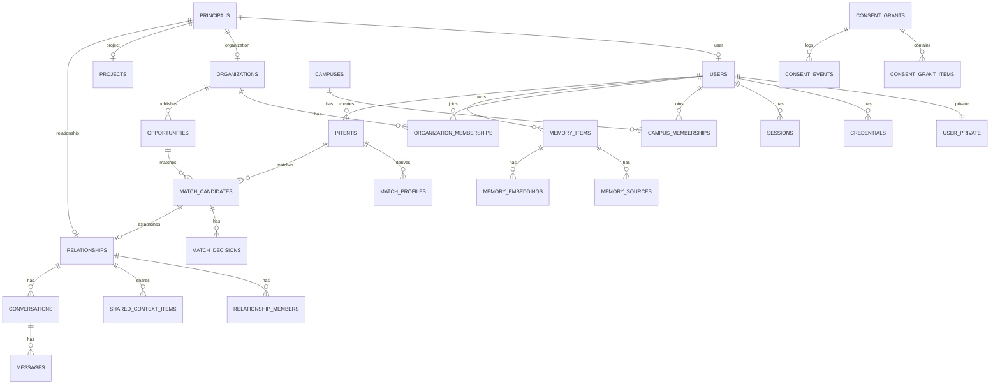

# AVEN 数据库设计（SCHEMA）

版本：1.0 · 日期：2026-11-10 · 状态：M0-01 基线
需求来源：[原始产品与工程规格](../../Origin%20Plan.md) 第 7 节
工程契约：[TDD](../architecture/TDD.md) · [PRD](../product/PRD.md)

本文定义首批表、约束、索引、RLS 和迁移规则。表结构以本文和实际迁移为准；实现与本文不一致时，先更新本文并补充迁移说明。

## 1. 原则

- PostgreSQL 是唯一可信数据结构来源；不使用 Dashboard 手工改 schema。
- 所有变更通过版本化 SQL 迁移；迁移放在 `packages/database/migrations`。
- 普通请求使用不绕过 RLS 的 `aven_app` 角色；迁移使用 `aven_migrator`。
- 先交付业务表、约束、索引和 RLS，再写业务代码。
- 不一次建齐全部实体；按 D1–D6 分批，但 Audit/Outbox 随首个业务写操作落地。
- 私人数据与公开数据分表或分列；不依赖前端隐藏字段。
- 迁移可审查、可前向修复；破坏性变更必须分阶段。

## 2. 通用约定

| 项 | 约定 |
|---|---|
| 表名 | `snake_case`，复数 |
| 列名 | `snake_case` |
| 主键 | `uuid`，默认 `gen_random_uuid()` |
| 时间 | `timestamptz`，UTC 存储；日期用 `date` |
| 布尔 | `boolean not null default false` |
| 枚举 | PostgreSQL enum；值用 `snake_case` |
| 金额 | 首版无金额；后续用 `numeric(14,2)` |
| 版本 | `version integer not null default 1`，乐观锁 |
| 审计列 | `created_at`、`updated_at`、`created_by`（可空） |
| 软删除 | `deleted_at timestamptz`，仅用于需要保留历史的表 |
| JSON | `jsonb`，只放结构化扩展，不替代明确列 |
| 外键 | 默认 `ON DELETE RESTRICT`；需要级联时显式说明 |
| 命名索引 | `idx_<table>_<columns>`；唯一约束 `uq_<table>_<columns>` |
| 命名策略 | `chk_<table>_<rule>`、`fk_<table>_<ref>` |

`updated_at` 由触发器 `app.set_updated_at()` 维护；应用也可以显式更新，但触发器是兜底。

## 3. ERD（首批）



## 4. 枚举

| 枚举 | 值 |
|---|---|
| `principal_type` | `user`、`organization`、`project`、`relationship`、`system` |
| `principal_status` | `active`、`suspended`、`deleted` |
| `credential_type` | `password` |
| `session_client` | `web`、`mobile` |
| `campus_membership_status` | `pending`、`verified`、`rejected`、`revoked` |
| `campus_verification_method` | `email_domain`、`manual`、`student_id` |
| `organization_type` | `lab`、`research_group`、`club`、`department`、`company`、`other` |
| `organization_verification_status` | `unverified`、`pending`、`verified`、`rejected` |
| `organization_role` | `owner`、`admin`、`member` |
| `organization_membership_status` | `invited`、`active`、`removed`、`left` |
| `invitation_status` | `pending`、`accepted`、`revoked`、`expired` |
| `memory_kind` | `interest`、`skill`、`project`、`goal`、`preference`、`experience`、`education`、`other` |
| `sensitivity` | `low`、`normal`、`high` |
| `visibility_policy` | `private`、`discoverable`、`match_only`、`relationship_shared`、`public` |
| `memory_status` | `pending_confirmation`、`confirmed`、`rejected`、`expired`、`deleted` |
| `memory_source_type` | `user_input`、`conversation`、`file`、`import`、`agent_extraction` |
| `intent_status` | `draft`、`active`、`paused`、`closed`、`expired` |
| `opportunity_stage` | `undergraduate`、`master`、`phd`、`postdoc`、`any` |
| `opportunity_status` | `draft`、`open`、`paused`、`closed`、`expired` |
| `opportunity_visibility` | `organization`、`campus`、`public` |
| `match_status` | `candidate`、`sent`、`info_requested`、`accepted`、`declined`、`withdrawn`、`expired` |
| `match_side` | `individual`、`organization` |
| `decision_type` | `pending`、`accepted`、`declined`、`info_requested` |
| `consent_purpose` | `referral`、`relationship_context`、`event_coordination` |
| `consent_status` | `active`、`revoked`、`expired` |
| `consent_source_type` | `profile`、`memory_item`、`intent`、`opportunity`、`custom` |
| `consent_item_status` | `active`、`stale`、`revoked` |
| `consent_event_type` | `created`、`revoked`、`expired`、`source_invalidated`、`snapshot_read` |
| `relationship_status` | `active`、`closed` |
| `relationship_member_role` | `individual`、`organization_representative`、`observer` |
| `shared_context_status` | `active`、`stale`、`revoked` |
| `conversation_status` | `active`、`archived`、`closed` |
| `message_content_type` | `text`、`system`、`card` |
| `agent_run_status` | `queued`、`running`、`waiting_confirmation`、`completed`、`failed`、`cancelled` |
| `agent_step_type` | `intent_extraction`、`context_retrieval`、`planning`、`tool_call`、`validation`、`action_preview`、`execution`、`response` |
| `step_status` | `pending`、`running`、`completed`、`failed`、`skipped` |
| `tool_invocation_status` | `pending`、`running`、`completed`、`failed`、`timed_out` |
| `action_status` | `draft`、`pending_confirmation`、`executing`、`succeeded`、`failed`、`cancelled`、`expired` |
| `outbox_status` | `pending`、`processing`、`processed`、`failed`、`dead` |
| `notification_channel` | `in_app`、`push` |
| `notification_status` | `pending`、`sent`、`failed`、`read` |
| `calendar_provider` | `google`、`microsoft`、`caldav`、`manual` |
| `calendar_connection_status` | `active`、`revoked`、`error` |
| `availability_status` | `busy`、`free`、`tentative` |
| `availability_source` | `manual`、`calendar` |
| `event_status` | `draft`、`proposed`、`pending_confirmation`、`confirmed`、`cancelled`、`ended` |
| `participant_response` | `pending`、`accepted`、`declined`、`tentative` |
| `proposal_status` | `proposed`、`accepted`、`rejected`、`expired` |

## 5. D1：身份与组织

### 5.1 `principals`

统一主体锚点。`users`、`organizations`、`projects`、`relationships` 的主键都引用本表。个人和组织的显示名统一存 `principals.display_name`，子表不重复存储；组织公开资料只补充 slug、简介、类型和认证状态。

| 列 | 类型 | 约束/说明 |
|---|---|---|
| `id` | `uuid` | PK，`gen_random_uuid()` |
| `type` | `principal_type` | 非空；创建后不可变 |
| `display_name` | `text` | 非空；1–120 字符 |
| `status` | `principal_status` | 非空，默认 `active` |
| `created_at` | `timestamptz` | 非空，默认 `now()` |
| `updated_at` | `timestamptz` | 非空，默认 `now()` |

约束/索引：

- `chk_principals_display_name`：`length(trim(display_name)) between 1 and 120`。
- `idx_principals_type_status`：`(type, status)`。
- 子表类型一致性由触发器 `app.enforce_principal_type()` 保证：插入/更新子表时校验对应 `principals.type`。

### 5.2 `users`

| 列 | 类型 | 约束/说明 |
|---|---|---|
| `id` | `uuid` | PK，FK → `principals(id)`，`ON DELETE CASCADE` |
| `avatar_url` | `text` | 可空；只允许 https 或受控存储 |
| `locale` | `text` | 非空，默认 `zh-CN` |
| `timezone` | `text` | 非空，默认 `Asia/Shanghai` |
| `last_seen_at` | `timestamptz` | 可空 |
| `created_at` | `timestamptz` | 非空，默认 `now()` |
| `updated_at` | `timestamptz` | 非空，默认 `now()` |

索引：`idx_users_last_seen`。

### 5.3 `user_private`

邮箱等 PII 与 `users` 分表，避免组织成员读取。

| 列 | 类型 | 约束/说明 |
|---|---|---|
| `user_id` | `uuid` | PK，FK → `users(id)`，`ON DELETE CASCADE` |
| `email_normalized` | `text` | 非空，唯一；小写、去空格 |
| `email_verified_at` | `timestamptz` | 可空 |
| `phone` | `text` | 可空；后续使用 |
| `created_at` | `timestamptz` | 非空，默认 `now()` |
| `updated_at` | `timestamptz` | 非空，默认 `now()` |

索引：`uq_user_private_email` 唯一；`idx_user_private_unverified` 部分索引（`email_verified_at IS NULL`）。

### 5.4 `credentials`

| 列 | 类型 | 约束/说明 |
|---|---|---|
| `id` | `uuid` | PK |
| `user_id` | `uuid` | 非空，FK → `users(id)`，`ON DELETE CASCADE` |
| `type` | `credential_type` | 非空，默认 `password` |
| `password_hash` | `text` | 非空；Argon2id |
| `password_updated_at` | `timestamptz` | 非空 |
| `failed_attempts` | `integer` | 非空，默认 0 |
| `locked_until` | `timestamptz` | 可空 |
| `created_at` | `timestamptz` | 非空，默认 `now()` |
| `updated_at` | `timestamptz` | 非空，默认 `now()` |

约束：`uq_credentials_user_type` 唯一 `(user_id, type)`。

安全：`aven_app` 不可 `SELECT password_hash`；只允许通过 `app.auth_lookup(email)` 安全定义函数读取。密码更新通过受控函数或列级授权。

### 5.5 `sessions`

| 列 | 类型 | 约束/说明 |
|---|---|---|
| `id` | `uuid` | PK |
| `user_id` | `uuid` | 非空，FK → `users(id)`，`ON DELETE CASCADE` |
| `token_hash` | `text` | 非空，唯一；SHA-256 |
| `client` | `session_client` | 非空 |
| `user_agent` | `text` | 可空，截断 512 |
| `ip_hash` | `text` | 可空；不存原始 IP |
| `created_at` | `timestamptz` | 非空，默认 `now()` |
| `last_seen_at` | `timestamptz` | 非空，默认 `now()` |
| `expires_at` | `timestamptz` | 非空 |
| `revoked_at` | `timestamptz` | 可空 |
| `revoked_reason` | `text` | 可空 |

索引：`uq_sessions_token_hash` 唯一；`idx_sessions_user_active`（`user_id, expires_at`，`revoked_at IS NULL`）。

安全：`aven_app` 不可 `SELECT token_hash`；会话查找通过 `app.session_lookup(token_hash)` 安全定义函数。

### 5.6 `email_verification_tokens` / `password_reset_tokens`

| 列 | 类型 | 说明 |
|---|---|---|
| `id` | `uuid` | PK |
| `user_id` | `uuid` | FK → `users(id)`，`ON DELETE CASCADE` |
| `token_hash` | `text` | 唯一；SHA-256 |
| `expires_at` | `timestamptz` | 非空 |
| `consumed_at` | `timestamptz` | 可空 |
| `created_at` | `timestamptz` | 非空 |

索引：`(user_id, expires_at)`；清理过期 token。

### 5.7 `campuses`

| 列 | 类型 | 说明 |
|---|---|---|
| `id` | `uuid` | PK |
| `name` | `text` | 非空 |
| `slug` | `text` | 唯一 |
| `city` | `text` | 可空 |
| `country` | `text` | 非空，默认 `CN` |
| `email_domains` | `text[]` | 可空；仅作认证信号 |
| `status` | `text` | 非空，默认 `active`；后续枚举 |
| `created_at` | `timestamptz` | 非空 |
| `updated_at` | `timestamptz` | 非空 |

### 5.8 `campus_memberships`

| 列 | 类型 | 说明 |
|---|---|---|
| `id` | `uuid` | PK |
| `campus_id` | `uuid` | FK → `campuses(id)` |
| `user_id` | `uuid` | FK → `users(id)` |
| `status` | `campus_membership_status` | 非空，默认 `pending` |
| `verification_method` | `campus_verification_method` | 可空 |
| `verified_at` | `timestamptz` | 可空 |
| `verified_by` | `uuid` | 可空，FK → `users(id)` |
| `evidence_ref` | `text` | 可空；不存证件原件 |
| `created_at` | `timestamptz` | 非空 |
| `updated_at` | `timestamptz` | 非空 |

约束：`uq_campus_memberships_campus_user` 唯一 `(campus_id, user_id)`；`chk_campus_membership_verified`：`status='verified'` 时 `verified_at` 非空。

### 5.9 `organizations`

| 列 | 类型 | 说明 |
|---|---|---|
| `id` | `uuid` | PK，FK → `principals(id)`，`ON DELETE CASCADE` |
| `slug` | `text` | 唯一；URL 使用 |
| `description` | `text` | 可空 |
| `type` | `organization_type` | 非空 |
| `campus_id` | `uuid` | 可空，FK → `campuses(id)` |
| `website_url` | `text` | 可空 |
| `logo_url` | `text` | 可空 |
| `verification_status` | `organization_verification_status` | 非空，默认 `unverified` |
| `verified_at` | `timestamptz` | 可空 |
| `verified_by` | `uuid` | 可空，FK → `users(id)` |
| `created_at` | `timestamptz` | 非空 |
| `updated_at` | `timestamptz` | 非空 |

索引：`uq_organizations_slug`；`idx_organizations_campus_type`；`idx_organizations_verification`。

### 5.10 `organization_memberships`

| 列 | 类型 | 说明 |
|---|---|---|
| `id` | `uuid` | PK |
| `organization_id` | `uuid` | FK → `organizations(id)`，`ON DELETE CASCADE` |
| `user_id` | `uuid` | FK → `users(id)` |
| `role` | `organization_role` | 非空，默认 `member` |
| `status` | `organization_membership_status` | 非空，默认 `invited` |
| `can_represent` | `boolean` | 非空，默认 false |
| `invited_by` | `uuid` | 可空，FK → `users(id)` |
| `invited_at` | `timestamptz` | 可空 |
| `joined_at` | `timestamptz` | 可空 |
| `removed_at` | `timestamptz` | 可空 |
| `created_at` | `timestamptz` | 非空 |
| `updated_at` | `timestamptz` | 非空 |

约束/索引：

- `uq_org_memberships_org_user` 唯一 `(organization_id, user_id)`。
- `uq_org_memberships_one_owner` 唯一部分索引 `(organization_id) WHERE role='owner' AND status='active'`。
- `idx_org_memberships_user_status`：`(user_id, status)`。
- `idx_org_memberships_org_role`：`(organization_id, role)`。
- 最后一名 owner/admin 保护由领域服务 + 事务锁实现；数据库触发器可作为兜底，但不能替代业务检查。

### 5.11 `organization_invitations`

| 列 | 类型 | 说明 |
|---|---|---|
| `id` | `uuid` | PK |
| `organization_id` | `uuid` | FK → `organizations(id)`，`ON DELETE CASCADE` |
| `email_normalized` | `text` | 非空 |
| `role` | `organization_role` | 非空，默认 `member` |
| `token_hash` | `text` | 唯一 |
| `status` | `invitation_status` | 非空，默认 `pending` |
| `invited_by` | `uuid` | FK → `users(id)` |
| `expires_at` | `timestamptz` | 非空 |
| `accepted_at` | `timestamptz` | 可空 |
| `created_at` | `timestamptz` | 非空 |
| `updated_at` | `timestamptz` | 非空 |

约束：`chk_org_invitation_role`：`role <> 'owner'`（所有权通过显式转让，不通过邀请）。
索引：`idx_org_invitations_org_status`；部分唯一索引 `(organization_id, email_normalized) WHERE status='pending'`。

## 6. D2：个人上下文、需求与机会

### 6.1 `memory_items`

| 列 | 类型 | 说明 |
|---|---|---|
| `id` | `uuid` | PK |
| `owner_principal_id` | `uuid` | FK → `principals(id)`；必须是 `user` |
| `kind` | `memory_kind` | 非空 |
| `title` | `text` | 非空，1–160 |
| `content` | `text` | 非空；私人正文 |
| `structured_value` | `jsonb` | 可空；结构化字段 |
| `sensitivity` | `sensitivity` | 非空，默认 `normal` |
| `visibility` | `visibility_policy` | 非空，默认 `private` |
| `status` | `memory_status` | 非空，默认 `pending_confirmation` |
| `valid_from` | `timestamptz` | 可空 |
| `valid_until` | `timestamptz` | 可空 |
| `confirmed_at` | `timestamptz` | 可空 |
| `version` | `integer` | 非空，默认 1 |
| `deleted_at` | `timestamptz` | 可空 |
| `created_at` | `timestamptz` | 非空 |
| `updated_at` | `timestamptz` | 非空 |

约束/索引：

- `chk_memory_content`：`length(trim(content)) > 0`。
- `chk_memory_validity`：`valid_until IS NULL OR valid_from IS NULL OR valid_until > valid_from`。
- `idx_memory_owner_status`：`(owner_principal_id, status)`。
- `idx_memory_owner_visibility`：`(owner_principal_id, visibility)`。
- `idx_memory_valid_until`：部分索引 `WHERE status='confirmed' AND valid_until IS NOT NULL`。
- GIN：`structured_value`（后续按查询需要）。

### 6.2 `memory_sources`

| 列 | 类型 | 说明 |
|---|---|---|
| `id` | `uuid` | PK |
| `memory_item_id` | `uuid` | FK → `memory_items(id)`，`ON DELETE CASCADE` |
| `source_type` | `memory_source_type` | 非空 |
| `source_id` | `uuid` | 可空；对话/文件/导入的 ID |
| `source_version` | `text` | 可空 |
| `excerpt` | `text` | 可空；最小必要片段，不存完整对话 |
| `created_at` | `timestamptz` | 非空 |

索引：`idx_memory_sources_memory`；`idx_memory_sources_source`。

### 6.3 `memory_embeddings`

| 列 | 类型 | 说明 |
|---|---|---|
| `id` | `uuid` | PK |
| `memory_item_id` | `uuid` | FK → `memory_items(id)`，`ON DELETE CASCADE` |
| `model` | `text` | 非空 |
| `dimensions` | `integer` | 非空 |
| `embedding` | `vector(1536)` | 非空；模型维度变化时新建列/表 |
| `created_at` | `timestamptz` | 非空 |

约束：`uq_memory_embeddings_item_model` 唯一 `(memory_item_id, model)`。
索引：HNSW `USING hnsw (embedding vector_cosine_ops)`；数据量小时可先不建。

### 6.4 `match_profiles`

匹配服务读取的派生数据，不直接读取私人记忆。由已确认记忆和需求生成，用户可 opt-in。

| 列 | 类型 | 说明 |
|---|---|---|
| `id` | `uuid` | PK |
| `intent_id` | `uuid` | FK → `intents(id)`，唯一 |
| `principal_id` | `uuid` | FK → `users(id)` |
| `domains` | `text[]` | 非空，默认 `{}` |
| `skills` | `text[]` | 非空，默认 `{}` |
| `stage` | `opportunity_stage` | 可空 |
| `availability` | `jsonb` | 可空；时间投入/地点偏好 |
| `embedding` | `vector(1536)` | 可空 |
| `source_version` | `integer` | 非空；对应 intent/memory 版本 |
| `created_at` | `timestamptz` | 非空 |
| `updated_at` | `timestamptz` | 非空 |

约束/索引：`uq_match_profiles_intent` 唯一 `intent_id`；`idx_match_profiles_principal`；GIN `domains`、`skills`；HNSW `embedding`。

### 6.5 `intents`

| 列 | 类型 | 说明 |
|---|---|---|
| `id` | `uuid` | PK |
| `owner_principal_id` | `uuid` | FK → `users(id)` |
| `title` | `text` | 非空，1–160 |
| `description` | `text` | 非空 |
| `domains` | `text[]` | 非空，默认 `{}` |
| `desired_stages` | `opportunity_stage[]` | 非空，默认 `{}` |
| `location_preference` | `text` | 可空 |
| `remote_ok` | `boolean` | 非空，默认 false |
| `commitment_hours_per_week` | `integer` | 可空；1–40 |
| `deadline` | `date` | 可空 |
| `status` | `intent_status` | 非空，默认 `draft` |
| `visibility` | `visibility_policy` | 非空，默认 `match_only` |
| `version` | `integer` | 非空，默认 1 |
| `created_at` | `timestamptz` | 非空 |
| `updated_at` | `timestamptz` | 非空 |

索引：`idx_intents_owner_status`；`idx_intents_status_deadline`；GIN `domains`。

### 6.6 `projects` / `project_memberships`

`projects`：

| 列 | 类型 | 说明 |
|---|---|---|
| `id` | `uuid` | PK，FK → `principals(id)` |
| `slug` | `text` | 唯一 |
| `summary` | `text` | 可空 |
| `status` | `text` | 非空，默认 `active`；后续枚举 |
| `owner_organization_id` | `uuid` | 可空，FK → `organizations(id)` |
| `owner_user_id` | `uuid` | 可空，FK → `users(id)` |
| `start_date` | `date` | 可空 |
| `end_date` | `date` | 可空 |
| `created_at` | `timestamptz` | 非空 |
| `updated_at` | `timestamptz` | 非空 |

约束：`chk_projects_owner`：`num_nonnulls(owner_organization_id, owner_user_id) = 1`。

`project_memberships`：`id`、`project_id`、`user_id`、`role`、`created_at`；唯一 `(project_id, user_id)`。

### 6.7 `opportunities`

| 列 | 类型 | 说明 |
|---|---|---|
| `id` | `uuid` | PK |
| `organization_id` | `uuid` | FK → `organizations(id)`，`ON DELETE CASCADE` |
| `title` | `text` | 非空，1–200 |
| `summary` | `text` | 非空 |
| `description` | `text` | 非空 |
| `domains` | `text[]` | 非空，默认 `{}` |
| `requirements` | `text[]` | 非空，默认 `{}` |
| `stage` | `opportunity_stage` | 非空，默认 `any` |
| `commitment_hours_per_week` | `integer` | 可空；1–40 |
| `location` | `text` | 可空 |
| `remote_ok` | `boolean` | 非空，默认 false |
| `headcount` | `integer` | 非空，默认 1；1–100 |
| `deadline` | `date` | 可空 |
| `status` | `opportunity_status` | 非空，默认 `draft` |
| `visibility` | `opportunity_visibility` | 非空，默认 `campus` |
| `version` | `integer` | 非空，默认 1 |
| `created_by` | `uuid` | FK → `users(id)` |
| `published_at` | `timestamptz` | 可空 |
| `closed_at` | `timestamptz` | 可空 |
| `created_at` | `timestamptz` | 非空 |
| `updated_at` | `timestamptz` | 非空 |

约束/索引：

- `chk_opportunity_headcount`：`headcount between 1 and 100`。
- `chk_opportunity_hours`：`commitment_hours_per_week IS NULL OR commitment_hours_per_week between 1 and 40`。
- `idx_opportunities_org_status`：`(organization_id, status)`。
- `idx_opportunities_open_deadline`：部分索引 `WHERE status='open'`。
- GIN `domains`、`requirements`。

## 7. D3：引荐与授权

### 7.1 `match_candidates`

| 列 | 类型 | 说明 |
|---|---|---|
| `id` | `uuid` | PK |
| `intent_id` | `uuid` | FK → `intents(id)`，`ON DELETE CASCADE` |
| `opportunity_id` | `uuid` | FK → `opportunities(id)`，`ON DELETE CASCADE` |
| `algorithm_version` | `text` | 非空 |
| `score` | `numeric(5,4)` | 可空；0–1 |
| `feature_scores` | `jsonb` | 非空，默认 `{}` |
| `reasons` | `jsonb` | 非空，默认 `[]`；可验证理由 |
| `evidence` | `jsonb` | 非空，默认 `[]`；来源 ID/版本/字段 |
| `status` | `match_status` | 非空，默认 `candidate` |
| `computed_at` | `timestamptz` | 非空 |
| `expires_at` | `timestamptz` | 可空 |
| `version` | `integer` | 非空，默认 1 |
| `created_at` | `timestamptz` | 非空 |
| `updated_at` | `timestamptz` | 非空 |

约束/索引：

- `chk_match_score`：`score IS NULL OR score between 0 and 1`。
- `uq_match_candidates_intent_opportunity_version` 唯一 `(intent_id, opportunity_id, algorithm_version)`。
- `idx_match_candidates_opportunity_status`：`(opportunity_id, status)`。
- `idx_match_candidates_intent_status`：`(intent_id, status)`。

### 7.2 `match_decisions`

| 列 | 类型 | 说明 |
|---|---|---|
| `id` | `uuid` | PK |
| `match_id` | `uuid` | FK → `match_candidates(id)`，`ON DELETE CASCADE` |
| `side` | `match_side` | 非空 |
| `decider_principal_id` | `uuid` | FK → `principals(id)` |
| `decision` | `decision_type` | 非空，默认 `pending` |
| `reason` | `text` | 可空；用户填写 |
| `version` | `integer` | 非空，默认 1 |
| `decided_at` | `timestamptz` | 可空 |
| `created_at` | `timestamptz` | 非空 |
| `updated_at` | `timestamptz` | 非空 |

约束：`uq_match_decisions_match_side` 唯一 `(match_id, side)`；`chk_decision_decided_at`：`decision != 'pending'` 时 `decided_at` 非空。

### 7.3 `consent_grants`

| 列 | 类型 | 说明 |
|---|---|---|
| `id` | `uuid` | PK |
| `grantor_principal_id` | `uuid` | FK → `principals(id)` |
| `grantee_principal_id` | `uuid` | FK → `principals(id)` |
| `purpose` | `consent_purpose` | 非空 |
| `status` | `consent_status` | 非空，默认 `active` |
| `expires_at` | `timestamptz` | 非空 |
| `version` | `integer` | 非空，默认 1 |
| `supersedes_grant_id` | `uuid` | 可空，FK → `consent_grants(id)`；范围变更时指向旧版本 |
| `revoked_at` | `timestamptz` | 可空 |
| `revoked_by` | `uuid` | 可空，FK → `principals(id)` |
| `revoke_reason` | `text` | 可空 |
| `created_at` | `timestamptz` | 非空 |
| `updated_at` | `timestamptz` | 非空 |

约束/索引：

- `chk_consent_parties`：`grantor_principal_id <> grantee_principal_id`。
- `chk_consent_expiry`：`expires_at > created_at`。
- `chk_consent_revoked`：`status='revoked'` 时 `revoked_at` 非空。
- `chk_consent_supersedes`：`supersedes_grant_id IS NULL OR supersedes_grant_id <> id`。
- `idx_consent_grants_grantor_status`：`(grantor_principal_id, status)`。
- `idx_consent_grants_grantee_status`：`(grantee_principal_id, status)`。
- `idx_consent_grants_expiry`：部分索引 `WHERE status='active'`。
- 范围变更创建新 grant 行，`supersedes_grant_id` 指向旧行；旧行状态改为 `revoked`，`revoke_reason='superseded'`，不原地扩大已确认内容。

### 7.4 `consent_grant_items`

| 列 | 类型 | 说明 |
|---|---|---|
| `id` | `uuid` | PK |
| `grant_id` | `uuid` | FK → `consent_grants(id)`，`ON DELETE CASCADE` |
| `source_type` | `consent_source_type` | 非空 |
| `source_id` | `uuid` | 可空 |
| `source_version` | `integer` | 可空 |
| `field_key` | `text` | 非空；如 `display_name`、`memory.content` |
| `value_snapshot` | `jsonb` | 非空；授权时的值 |
| `sensitivity` | `sensitivity` | 非空，默认 `normal` |
| `status` | `consent_item_status` | 非空，默认 `active` |
| `created_at` | `timestamptz` | 非空 |

约束/索引：

- `uq_consent_items_grant_source_field` 唯一 `(grant_id, source_type, source_id, field_key)`；`source_id` 可空（如 profile 字段），唯一索引必须使用 `NULLS NOT DISTINCT`（PostgreSQL 15+）或对 `source_id` 使用 `COALESCE` 哨兵值，避免重复项。
- `idx_consent_items_grant`：`grant_id`。
- `idx_consent_items_source`：`(source_type, source_id)`。

### 7.5 `consent_events`

| 列 | 类型 | 说明 |
|---|---|---|
| `id` | `uuid` | PK |
| `grant_id` | `uuid` | FK → `consent_grants(id)`，`ON DELETE CASCADE` |
| `event_type` | `consent_event_type` | 非空 |
| `actor_principal_id` | `uuid` | 可空，FK → `principals(id)` |
| `metadata` | `jsonb` | 非空，默认 `{}`；不含私人正文 |
| `created_at` | `timestamptz` | 非空 |

索引：`idx_consent_events_grant_created`：`(grant_id, created_at)`。
本表只追加，不更新/删除（除非数据保留策略要求）。

## 8. D4：关系与对话

### 8.1 `relationships`

| 列 | 类型 | 说明 |
|---|---|---|
| `id` | `uuid` | PK，FK → `principals(id)` |
| `match_id` | `uuid` | 非空，FK → `match_candidates(id)`，唯一 |
| `status` | `relationship_status` | 非空，默认 `active` |
| `established_at` | `timestamptz` | 非空 |
| `closed_at` | `timestamptz` | 可空 |
| `closed_by` | `uuid` | 可空，FK → `principals(id)` |
| `version` | `integer` | 非空，默认 1 |
| `created_at` | `timestamptz` | 非空 |
| `updated_at` | `timestamptz` | 非空 |

约束：`uq_relationships_match` 唯一 `match_id`；`chk_relationship_closed`：`status='closed'` 时 `closed_at` 非空。

### 8.2 `relationship_members`

| 列 | 类型 | 说明 |
|---|---|---|
| `id` | `uuid` | PK |
| `relationship_id` | `uuid` | FK → `relationships(id)`，`ON DELETE CASCADE` |
| `principal_id` | `uuid` | FK → `principals(id)` |
| `role` | `relationship_member_role` | 非空 |
| `joined_at` | `timestamptz` | 非空 |
| `left_at` | `timestamptz` | 可空 |

约束：`uq_relationship_members` 唯一 `(relationship_id, principal_id)`；索引 `idx_relationship_members_principal`。

### 8.3 `shared_context_items`

| 列 | 类型 | 说明 |
|---|---|---|
| `id` | `uuid` | PK |
| `relationship_id` | `uuid` | FK → `relationships(id)`，`ON DELETE CASCADE` |
| `consent_grant_id` | `uuid` | FK → `consent_grants(id)`；冗余用于 RLS |
| `consent_grant_item_id` | `uuid` | FK → `consent_grant_items(id)` |
| `source_type` | `consent_source_type` | 非空 |
| `source_id` | `uuid` | 可空 |
| `source_version` | `integer` | 可空 |
| `field_key` | `text` | 非空 |
| `value_snapshot` | `jsonb` | 非空 |
| `status` | `shared_context_status` | 非空，默认 `active` |
| `created_at` | `timestamptz` | 非空 |
| `updated_at` | `timestamptz` | 非空 |

约束：`uq_shared_context_relationship_grant_item` 唯一 `(relationship_id, consent_grant_item_id)`；索引 `idx_shared_context_relationship_status`。

### 8.4 `conversations` / `conversation_members` / `messages`

`conversations`：`id`、`relationship_id`（可空）、`organization_id`（可空）、`status`、`created_by`、`created_at`、`updated_at`；约束 `chk_conversations_owner`：`num_nonnulls(relationship_id, organization_id) >= 1`。

`conversation_members`：`id`、`conversation_id`、`principal_id`、`role`、`joined_at`、`last_read_at`；唯一 `(conversation_id, principal_id)`。

`messages`：

| 列 | 类型 | 说明 |
|---|---|---|
| `id` | `uuid` | PK |
| `conversation_id` | `uuid` | FK → `conversations(id)`，`ON DELETE CASCADE` |
| `sender_principal_id` | `uuid` | FK → `principals(id)` |
| `body` | `text` | 非空 |
| `content_type` | `message_content_type` | 非空，默认 `text` |
| `metadata` | `jsonb` | 非空，默认 `{}` |
| `created_at` | `timestamptz` | 非空 |
| `edited_at` | `timestamptz` | 可空 |
| `deleted_at` | `timestamptz` | 可空 |

约束：`chk_messages_body`：`length(trim(body)) > 0`。
索引：`idx_messages_conversation_created`：`(conversation_id, created_at)`。

## 9. D5：智能与可靠性

### 9.1 `agent_profiles` / `agent_runs`

`agent_profiles`：`id`、`principal_id`（用户或组织，唯一）、`settings`（JSONB：主动推荐频率、确认偏好、AI 自主权级别）、`created_at`、`updated_at`；唯一 `principal_id`。RLS：本人/组织管理员可读写。

`agent_runs`：`id`、`principal_id`、`conversation_id`（可空）、`status`、`provider`、`model`、`input_summary`、`output_summary`、`error_code`、`started_at`、`completed_at`、`created_at`、`updated_at`。

索引：`idx_agent_runs_principal_created`；`idx_agent_runs_status`。

### 9.2 `agent_steps`

`id`、`run_id`、`sequence`、`type`、`status`、`input_summary`、`output_summary`、`started_at`、`completed_at`、`error_code`；唯一 `(run_id, sequence)`。

### 9.3 `tool_invocations`

`id`、`run_id`、`step_id`（可空）、`tool_name`、`arguments_redacted`、`result_summary`、`status`、`error_code`、`idempotency_key`、`started_at`、`completed_at`。

### 9.4 `actions`

| 列 | 类型 | 说明 |
|---|---|---|
| `id` | `uuid` | PK |
| `run_id` | `uuid` | 可空，FK → `agent_runs(id)` |
| `principal_id` | `uuid` | FK → `users(id)` |
| `action_type` | `text` | 非空 |
| `draft_version` | `integer` | 非空 |
| `draft_payload` | `jsonb` | 非空；脱敏存储 |
| `status` | `action_status` | 非空，默认 `draft` |
| `confirmation_token_hash` | `text` | 可空 |
| `expires_at` | `timestamptz` | 非空 |
| `confirmed_at` | `timestamptz` | 可空 |
| `executed_at` | `timestamptz` | 可空 |
| `result` | `jsonb` | 可空 |
| `idempotency_key` | `text` | 可空 |
| `created_at` | `timestamptz` | 非空 |
| `updated_at` | `timestamptz` | 非空 |

索引：`idx_actions_principal_status`；`idx_actions_expires`。

### 9.5 `outbox_events`

| 列 | 类型 | 说明 |
|---|---|---|
| `id` | `uuid` | PK |
| `aggregate_type` | `text` | 非空 |
| `aggregate_id` | `uuid` | 非空 |
| `event_type` | `text` | 非空 |
| `payload` | `jsonb` | 非空；不含私人正文 |
| `status` | `outbox_status` | 非空，默认 `pending` |
| `attempts` | `integer` | 非空，默认 0 |
| `available_at` | `timestamptz` | 非空，默认 `now()` |
| `locked_at` | `timestamptz` | 可空 |
| `locked_by` | `text` | 可空 |
| `last_error` | `text` | 可空 |
| `created_at` | `timestamptz` | 非空 |
| `processed_at` | `timestamptz` | 可空 |

索引：`idx_outbox_pending`：`(status, available_at)` 部分索引 `WHERE status IN ('pending','failed')`；`idx_outbox_aggregate`。

### 9.6 `audit_logs`

| 列 | 类型 | 说明 |
|---|---|---|
| `id` | `uuid` | PK |
| `actor_principal_id` | `uuid` | 可空 |
| `actor_type` | `text` | 非空 |
| `action` | `text` | 非空 |
| `resource_type` | `text` | 非空 |
| `resource_id` | `uuid` | 可空 |
| `decision` | `text` | 可空 |
| `request_id` | `text` | 可空 |
| `ip_hash` | `text` | 可空 |
| `user_agent` | `text` | 可空 |
| `metadata` | `jsonb` | 非空，默认 `{}`；不含私人正文 |
| `created_at` | `timestamptz` | 非空 |

索引：`idx_audit_actor_created`；`idx_audit_resource`；`idx_audit_created`。只追加。

### 9.7 `notifications`

`id`、`recipient_principal_id`、`type`、`title`、`body`、`data`、`channel`、`status`、`read_at`、`created_at`、`sent_at`；索引 `(recipient_principal_id, status, created_at)`。

### 9.8 `idempotency_keys`

| 列 | 类型 | 说明 |
|---|---|---|
| `id` | `uuid` | PK |
| `principal_id` | `uuid` | FK → `principals(id)` |
| `key` | `text` | 非空 |
| `method` | `text` | 非空 |
| `path` | `text` | 非空 |
| `request_hash` | `text` | 非空 |
| `response_status` | `integer` | 可空 |
| `response_body` | `jsonb` | 可空 |
| `created_at` | `timestamptz` | 非空 |
| `expires_at` | `timestamptz` | 非空 |

约束：`uq_idempotency_principal_key` 唯一 `(principal_id, key)`；索引 `idx_idempotency_expires`。

### 9.9 `block_lists` / `reports`

`block_lists`：`id`、`owner_principal_id`、`blocked_principal_id`、`reason`、`created_at`；唯一 `(owner_principal_id, blocked_principal_id)`。

`reports`：`id`、`reporter_principal_id`、`target_type`、`target_id`、`reason`、`status`（`open`、`reviewing`、`resolved`、`dismissed`）、`resolution`、`created_at`、`resolved_at`；索引 `(status, created_at)`。RLS：举报人可读自己的记录；平台管理员可读全部；不把举报内容写入普通日志。

## 10. D6：日程与活动

### 10.1 `calendar_connections`

`id`、`principal_id`、`provider`、`credentials_ciphertext`、`key_version`、`sync_cursor`、`status`、`last_synced_at`、`created_at`、`updated_at`。凭据加密存储；不在日志中输出。

### 10.2 `availability_blocks`

`id`、`principal_id`、`start_at`、`end_at`、`timezone`、`status`、`source`、`visibility`、`created_at`、`updated_at`；约束 `end_at > start_at`；索引 `(principal_id, start_at)`。

### 10.3 `events`

`id`、`organizer_principal_id`、`relationship_id`（可空）、`organization_id`（可空）、`title`、`description`、`location`、`start_at`、`end_at`、`timezone`、`status`、`version`、`created_at`、`updated_at`；约束 `end_at > start_at`。

### 10.4 `event_participants` / `event_proposals`

`event_participants`：`id`、`event_id`、`principal_id`、`response`、`responded_at`；唯一 `(event_id, principal_id)`。

`event_proposals`：`id`、`event_id`、`version`、`start_at`、`end_at`、`timezone`、`status`、`created_at`；唯一 `(event_id, version)`。

## 11. RLS 策略

### 11.1 角色与上下文

```sql
-- 迁移角色：拥有 schema，可 DDL
CREATE ROLE aven_migrator LOGIN PASSWORD '...';
-- 应用角色：普通请求使用，不能绕过 RLS
CREATE ROLE aven_app LOGIN PASSWORD '...' NOSUPERUSER NOBYPASSRLS;

GRANT USAGE ON SCHEMA public, app TO aven_app;
GRANT SELECT, INSERT, UPDATE, DELETE ON ALL TABLES IN SCHEMA public TO aven_app;
GRANT USAGE, SELECT ON ALL SEQUENCES IN SCHEMA public TO aven_app;
```

每个请求事务：

```sql
BEGIN;
SET LOCAL app.principal_id = '...';
SET LOCAL app.user_id = '...';
SET LOCAL app.organization_id = '...';
SET LOCAL app.is_platform_admin = 'false';
SET LOCAL app.is_worker = 'false';
SET LOCAL app.request_id = '...';
-- 业务查询
COMMIT;
```

禁止 session 级 `SET`；连接池归还前必须结束事务。事务包装器在 `packages/database` 统一实现。

辅助函数（`app` schema，`STABLE`）：

```sql
CREATE FUNCTION app.current_principal_id() RETURNS uuid
LANGUAGE sql STABLE AS $$
  SELECT nullif(current_setting('app.principal_id', true), '')::uuid
$$;

CREATE FUNCTION app.current_user_id() RETURNS uuid
LANGUAGE sql STABLE AS $$
  SELECT nullif(current_setting('app.user_id', true), '')::uuid
$$;

CREATE FUNCTION app.is_platform_admin() RETURNS boolean
LANGUAGE sql STABLE AS $$
  SELECT coalesce(current_setting('app.is_platform_admin', true) = 'true', false)
$$;

CREATE FUNCTION app.is_worker() RETURNS boolean
LANGUAGE sql STABLE AS $$
  SELECT coalesce(current_setting('app.is_worker', true) = 'true', false)
$$;
```

`app.is_org_member(org uuid)`、`app.is_org_admin(org uuid)`、`app.can_represent(org uuid)`、`app.is_relationship_member(rel uuid)` 同理，内部查询成员表。`app.is_relationship_member` 同时处理个人成员和组织成员：组织成员需通过 `organization_memberships` 关联到关系成员中的组织主体。

### 11.2 策略矩阵

| 表 | SELECT | INSERT/UPDATE/DELETE |
|---|---|---|
| `principals` | 本人、活跃组织、同组织成员、平台管理员、worker | 本人/系统创建；不能改类型 |
| `users` | 本人、同组织成员、平台管理员、worker | 本人更新非敏感字段 |
| `user_private` | 本人；认证函数受控读取 | 本人插入/更新；密码流程受控 |
| `credentials` | 不直接开放 `password_hash`；认证函数读取 | 本人通过受控函数更新 |
| `sessions` | 本人；认证函数按 token 查找 | 本人创建/撤销；系统清理 |
| `campuses` | 所有已认证用户 | 平台管理员 |
| `campus_memberships` | 本人、平台管理员 | 本人申请；平台管理员审核 |
| `organizations` | 公开字段所有人；成员读私有字段 | 组织管理员 |
| `organization_memberships` | 同组织成员、本人、平台管理员 | 组织管理员；本人离开 |
| `organization_invitations` | 组织管理员；被邀请人按邮箱 | 组织管理员；被邀请人接受 |
| `memory_items` | 本人 | 本人 |
| `memory_sources` | 本人 | 本人 |
| `memory_embeddings` | 本人、worker | 本人/worker |
| `match_profiles` | 本人、worker | 本人/worker |
| `intents` | 本人、worker（匹配用途） | 本人 |
| `opportunities` | 公开开放机会、组织成员、平台管理员 | 组织管理员 |
| `match_candidates` | 个人（自己的需求）、组织管理员/代表、worker | 系统/worker；决定通过服务 |
| `match_decisions` | 同候选可见范围 | 对应侧决定人 |
| `consent_grants` | grantor、grantee 管理员/代表、worker | grantor 创建/撤销；系统过期 |
| `consent_grant_items` | 同 grant 可见范围 | 同 grant |
| `consent_events` | grantor、grantee 成员、平台管理员 | 系统追加 |
| `relationships` | 关系成员、平台管理员（元数据） | 系统/代表成员关闭 |
| `relationship_members` | 关系成员 | 系统 |
| `shared_context_items` | 关系成员 + 有效授权 | 系统 |
| `conversations` / `messages` | 会话成员 | 会话成员 |
| `agent_runs` / `agent_steps` / `tool_invocations` | 本人、平台管理员（元数据） | 系统 |
| `actions` | 本人 | 本人确认/取消；系统执行 |
| `outbox_events` | worker/系统 | 系统 |
| `audit_logs` | 平台管理员 | 系统追加 |
| `notifications` | 接收人 | 系统 |
| `idempotency_keys` | 本人 | 本人/系统 |
| `block_lists` | 本人 | 本人 |
| `calendar_connections` | 本人 | 本人 |
| `availability_blocks` | 本人、授权范围内的关系/活动参与者 | 本人 |
| `events` / `event_participants` | 参与者、组织成员 | 组织者/参与者响应 |

### 11.3 示例策略

`memory_items`：

```sql
ALTER TABLE memory_items ENABLE ROW LEVEL SECURITY;
ALTER TABLE memory_items FORCE ROW LEVEL SECURITY;

CREATE POLICY memory_items_owner_select ON memory_items
FOR SELECT TO aven_app
USING (owner_principal_id = app.current_principal_id());

CREATE POLICY memory_items_owner_insert ON memory_items
FOR INSERT TO aven_app
WITH CHECK (owner_principal_id = app.current_principal_id());

CREATE POLICY memory_items_owner_update ON memory_items
FOR UPDATE TO aven_app
USING (owner_principal_id = app.current_principal_id())
WITH CHECK (owner_principal_id = app.current_principal_id());

CREATE POLICY memory_items_owner_delete ON memory_items
FOR DELETE TO aven_app
USING (owner_principal_id = app.current_principal_id());
```

`match_profiles`：

```sql
ALTER TABLE match_profiles ENABLE ROW LEVEL SECURITY;
ALTER TABLE match_profiles FORCE ROW LEVEL SECURITY;

CREATE POLICY match_profiles_owner_select ON match_profiles
FOR SELECT TO aven_app
USING (principal_id = app.current_principal_id());

CREATE POLICY match_profiles_worker_select ON match_profiles
FOR SELECT TO aven_app
USING (app.is_worker());
```

`opportunities`：

```sql
ALTER TABLE opportunities ENABLE ROW LEVEL SECURITY;
ALTER TABLE opportunities FORCE ROW LEVEL SECURITY;

CREATE POLICY opportunities_public_select ON opportunities
FOR SELECT TO aven_app
USING (
  status = 'open'
  AND visibility IN ('campus','public')
  AND (deadline IS NULL OR deadline >= current_date)
);

CREATE POLICY opportunities_member_select ON opportunities
FOR SELECT TO aven_app
USING (app.is_org_member(organization_id));

CREATE POLICY opportunities_admin_write ON opportunities
FOR ALL TO aven_app
USING (app.is_org_admin(organization_id))
WITH CHECK (app.is_org_admin(organization_id));
```

`consent_grants`：

```sql
ALTER TABLE consent_grants ENABLE ROW LEVEL SECURITY;
ALTER TABLE consent_grants FORCE ROW LEVEL SECURITY;

CREATE POLICY consent_grants_grantor_select ON consent_grants
FOR SELECT TO aven_app
USING (grantor_principal_id = app.current_principal_id());

CREATE POLICY consent_grants_grantee_select ON consent_grants
FOR SELECT TO aven_app
USING (
  grantee_principal_id = app.current_principal_id()
  OR EXISTS (
    SELECT 1 FROM organization_memberships m
    WHERE m.organization_id = consent_grants.grantee_principal_id
      AND m.user_id = app.current_user_id()
      AND m.status = 'active'
      AND (m.role IN ('owner','admin') OR m.can_represent = true)
  )
);

CREATE POLICY consent_grants_worker_select ON consent_grants
FOR SELECT TO aven_app
USING (app.is_worker());
```

`shared_context_items`：

```sql
ALTER TABLE shared_context_items ENABLE ROW LEVEL SECURITY;
ALTER TABLE shared_context_items FORCE ROW LEVEL SECURITY;

CREATE POLICY shared_context_items_member_select ON shared_context_items
FOR SELECT TO aven_app
USING (
  app.is_relationship_member(relationship_id)
  AND status = 'active'
  AND EXISTS (
    SELECT 1 FROM consent_grants g
    WHERE g.id = shared_context_items.consent_grant_id
      AND g.status = 'active'
      AND g.expires_at > now()
  )
);
```

`match_candidates`：

```sql
ALTER TABLE match_candidates ENABLE ROW LEVEL SECURITY;
ALTER TABLE match_candidates FORCE ROW LEVEL SECURITY;

CREATE POLICY match_candidates_individual_select ON match_candidates
FOR SELECT TO aven_app
USING (
  EXISTS (
    SELECT 1 FROM intents i
    WHERE i.id = match_candidates.intent_id
      AND i.owner_principal_id = app.current_principal_id()
  )
);

CREATE POLICY match_candidates_org_select ON match_candidates
FOR SELECT TO aven_app
USING (
  EXISTS (
    SELECT 1 FROM opportunities o
    WHERE o.id = match_candidates.opportunity_id
      AND (app.is_org_admin(o.organization_id) OR app.can_represent(o.organization_id))
  )
);

CREATE POLICY match_candidates_worker_select ON match_candidates
FOR SELECT TO aven_app
USING (app.is_worker());
```

`audit_logs`：

```sql
ALTER TABLE audit_logs ENABLE ROW LEVEL SECURITY;
ALTER TABLE audit_logs FORCE ROW LEVEL SECURITY;

CREATE POLICY audit_logs_admin_select ON audit_logs
FOR SELECT TO aven_app
USING (app.is_platform_admin());

CREATE POLICY audit_logs_system_insert ON audit_logs
FOR INSERT TO aven_app
WITH CHECK (app.is_worker() OR app.is_platform_admin());
```

`outbox_events`：

```sql
ALTER TABLE outbox_events ENABLE ROW LEVEL SECURITY;
ALTER TABLE outbox_events FORCE ROW LEVEL SECURITY;

CREATE POLICY outbox_worker_all ON outbox_events
FOR ALL TO aven_app
USING (app.is_worker())
WITH CHECK (app.is_worker());
```

### 11.4 认证函数

登录/会话查找不能依赖普通 RLS，因为请求尚未建立用户上下文。使用最小权限的 `SECURITY DEFINER` 函数：

```sql
CREATE FUNCTION app.auth_lookup(p_email text)
RETURNS TABLE (
  user_id uuid,
  password_hash text,
  principal_status principal_status,
  email_verified_at timestamptz
)
LANGUAGE sql
SECURITY DEFINER
SET search_path = app, public
AS $$
  SELECT u.id, c.password_hash, p.status, up.email_verified_at
  FROM user_private up
  JOIN users u ON u.id = up.user_id
  JOIN principals p ON p.id = u.id
  JOIN credentials c ON c.user_id = u.id AND c.type = 'password'
  WHERE up.email_normalized = lower(trim(p_email))
  LIMIT 1
$$;

REVOKE ALL ON FUNCTION app.auth_lookup(text) FROM PUBLIC;
GRANT EXECUTE ON FUNCTION app.auth_lookup(text) TO aven_app;
```

会话查找同理：`app.session_lookup(p_token_hash text)` 返回 `session_id`、`user_id`、`expires_at`、`revoked_at`、`client`。函数只返回必要字段，不返回 token。

密码更新通过 `app.update_password(p_hash text)` 或受控列级授权；函数内部使用 `app.current_user_id()`，不接受任意用户 ID。`aven_app` 不能 `SELECT password_hash`。

组织邀请接受同样通过安全定义函数 `app.accept_invitation(p_token_hash text)` 校验 token、当前用户邮箱和状态；邀请 token 只放请求体，不放 URL 或日志。

## 12. 索引与约束清单

首批必须有的索引：

- 所有外键列。
- `organization_memberships (organization_id, user_id)` 唯一。
- `opportunities (organization_id, status)`、开放机会部分索引。
- `match_candidates (intent_id, status)`、`(opportunity_id, status)`。
- `match_decisions (match_id, side)` 唯一。
- `consent_grants (grantor_principal_id, status)`、`(grantee_principal_id, status)`、活跃过期部分索引。
- `consent_grant_items (grant_id)`、`(source_type, source_id)`。
- `relationships (match_id)` 唯一。
- `shared_context_items (relationship_id, status)`。
- `messages (conversation_id, created_at)`。
- `outbox_events (status, available_at)` 部分索引。
- `audit_logs (actor_principal_id, created_at)`、`(resource_type, resource_id)`。
- `idempotency_keys (principal_id, key)` 唯一、`expires_at`。
- `sessions (user_id, expires_at)` 活跃部分索引。
- `user_private (email_normalized)` 唯一。

向量索引：

- `memory_embeddings` 和 `match_profiles` 使用 HNSW `vector_cosine_ops`。
- 数据量小或模型未定时可先不建；建索引前记录 pgvector 版本和维度。
- 维度变化通过新表/新列迁移，不原地改维度。

## 13. 迁移与角色

### 13.1 迁移流程

- 唯一迁移目录：`packages/database/migrations`。
- 使用 Drizzle Kit 生成 SQL，人工审查后提交；生产不使用 `drizzle-kit push`。
- 每个迁移包含：schema 变更、索引、约束、RLS、权限、必要的存量数据处理。
- 迁移文件按序号命名：`0001_identity.sql`、`0002_memory_opportunity.sql` 等。
- 迁移前检查：空库执行、上一版本升级、重复执行安全（幂等/事务）。
- 破坏性变更采用 expand/contract：先加新列/表，回填，切读写，最后删除旧结构。
- 大表回填分批执行，避免长事务和锁表；记录耗时和回滚/前向修复方案。
- CI 执行 `drizzle-kit check`、空库迁移、schema diff 和关键约束测试。

### 13.2 角色与权限

| 角色 | 权限 |
|---|---|
| `aven_migrator` | schema owner；DDL；创建/修改 RLS；不用于应用请求 |
| `aven_app` | DML；受 RLS 约束；无 DDL；无 `BYPASSRLS` |
| `aven_readonly`（可选） | 只读分析；不含 PII；后续按需 |

- 迁移在部署前由 `aven_migrator` 执行。
- 应用启动时检查迁移版本；未迁移则就绪失败。
- 应用连接串不得使用 `aven_migrator`。
- 数据库扩展（pgvector、PostGIS）由迁移或基础设施脚本创建；应用角色无 `CREATE EXTENSION` 权限。

### 13.3 Seed

- `pnpm db:seed` 只用于开发/测试；生产禁止。
- Seed 包含：一个校园、两个用户、两个组织、一个机会、一个需求、一个匹配样例。
- Seed 数据明确标记为开发数据；不伪装真实用户或官方认证。
- 测试使用工厂，不依赖 seed 的具体 ID。

## 14. 数据保留与删除

| 数据 | 保留 | 删除方式 |
|---|---|---|
| 会话 | 过期后 30 天 | 定时清理 |
| 邮箱/重置 token | 过期后 7 天 | 定时清理 |
| 已删除记忆 | 软删除 30 天 | 硬删除 + 清理 embedding；授权项立即 stale |
| 授权事件 | 授权结束后 1 年（可配置） | 只保留元数据，不含正文 |
| 审计日志 | 1 年（可配置） | 只保留元数据，不含正文 |
| 消息 | 关系关闭后 90 天（待定） | 软删除；用户可请求删除 |
| 通知 | 90 天 | 定时清理 |
| 幂等键 | 24 小时 | 定时清理 |
| Outbox | 处理成功 30 天 | 定时清理；死信保留至人工处理 |

原则：

- 私人正文不进入审计、分析事件或普通日志。
- 删除请求要覆盖缓存、索引、异步任务和共享快照。
- 授权撤销/来源删除立即阻止新读取；物理删除可以异步，但不能继续返回内容。
- 备份中的删除遵循备份保留策略；恢复演练必须验证删除状态。

## 15. 开放问题

1. `match_profiles` 的 embedding 维度和模型：Mock 阶段可空；真实 Provider 接入前确定。
2. 消息保留期限和关系关闭后的访问规则需要产品确认。
3. 组织认证材料是否上传文件；如果上传，需要存储、签名链接和删除策略。
4. 校园认证证据的最小化存储方式；首版只存引用，不存证件原件。
5. 是否需要 `aven_readonly` 分析角色；如需要，必须排除 PII。
6. PostGIS 的实际使用场景；首版不建地理索引，等地理需求出现再迁移。
7. 备份与恢复演练的具体 RPO/RTO；M7 前确定。
