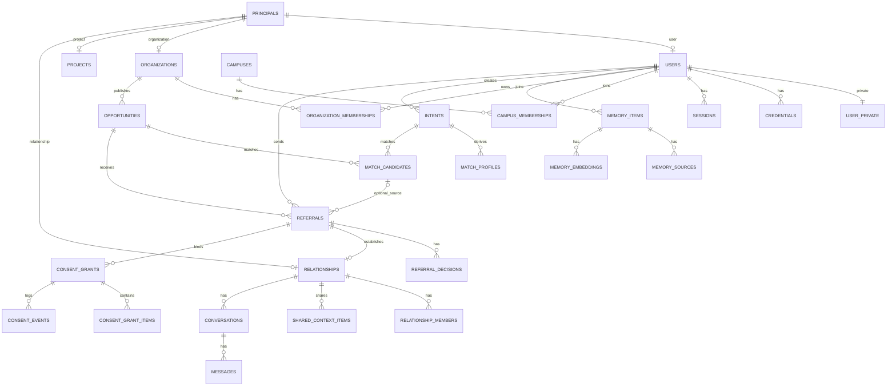

# AVEN 数据库设计（SCHEMA）

版本：1.1 · 日期：2026-11-10 · 状态：M0-01 修订契约（无实际迁移）
需求来源：[原始产品与工程规格](../../Origin%20Plan.md) 第 7 节
工程契约：[TDD](../architecture/TDD.md) · [PRD](../product/PRD.md)

本文定义首批表、约束、索引、RLS 和迁移规则。表结构以本文和实际迁移为准；实现与本文不一致时，先更新本文并补充迁移说明。

## 1. 原则

- PostgreSQL 是唯一可信数据结构来源；不使用 Dashboard 手工改 schema。
- 所有变更通过版本化 SQL 迁移；迁移放在 `packages/database/migrations`。
- 普通请求使用不绕过 RLS 的 `aven_app` 角色；迁移使用 `aven_migrator`。
- 先交付业务表、约束、索引和 RLS，再写业务代码。
- 不一次建齐全部实体；按 D1–D6 分批，但 Audit/Outbox 随首个业务写操作落地。
- 私人数据与公开数据分表或使用受控字段投影；RLS 控制行，不自动隐藏列，不能依赖前端隐藏字段。
- 本文是待实施结构，不是可直接执行的整套迁移；扩展、函数、约束与角色必须在所属工作包中用真实数据库验证。
- 迁移可审查、可前向修复；破坏性变更必须分阶段。

## 2. 通用约定

| 项 | 约定 |
|---|---|
| 表名 | `snake_case`，复数 |
| 列名 | `snake_case` |
| 主键 | `uuid`，默认 `gen_random_uuid()` |
| 时间 | `timestamptz`，UTC 存储；日期用 `date` |
| 布尔 | `boolean not null default false` |
| 枚举 | PostgreSQL enum；值用 `snake_case` |
| 金额 | 首版无金额；后续用 `numeric(14,2)` |
| 版本 | `version integer not null default 1`，乐观锁 |
| 审计列 | `created_at`、`updated_at`、`created_by`（可空） |
| 软删除 | `deleted_at timestamptz`，仅用于需要保留历史的表 |
| JSON | `jsonb`，只放结构化扩展，不替代明确列 |
| 外键 | 默认 `ON DELETE RESTRICT`；需要级联时显式说明 |
| 命名索引 | `idx_<table>_<columns>`；唯一约束 `uq_<table>_<columns>` |
| 命名策略 | `chk_<table>_<rule>`、`fk_<table>_<ref>` |

`updated_at` 由触发器 `app.set_updated_at()` 维护；应用也可以显式更新，但触发器是兜底。

## 3. ERD（首批）



## 4. 枚举

| 枚举 | 值 |
|---|---|
| `principal_type` | `user`、`organization`、`project`、`relationship`、`system` |
| `principal_status` | `active`、`suspended`、`deleted` |
| `credential_type` | `password` |
| `session_client` | `web`、`mobile` |
| `campus_membership_status` | `pending`、`verified`、`rejected`、`revoked` |
| `campus_verification_method` | `email_domain`、`manual`、`student_id` |
| `organization_type` | `lab`、`research_group`、`club`、`department`、`company`、`other` |
| `organization_verification_status` | `unverified`、`pending`、`verified`、`rejected` |
| `organization_role` | `owner`、`admin`、`member` |
| `organization_membership_status` | `invited`、`active`、`removed`、`left` |
| `invitation_status` | `pending`、`accepted`、`revoked`、`expired` |
| `memory_kind` | `interest`、`skill`、`project`、`goal`、`preference`、`experience`、`education`、`other` |
| `sensitivity` | `low`、`normal`、`high` |
| `display_audience` | `owner`、`campus`、`public` |
| `context_use` | `self_ai`、`matching`、`sharing` |
| `memory_status` | `pending_confirmation`、`confirmed`、`rejected`、`expired`、`deleted` |
| `memory_source_type` | `user_input`、`conversation`、`file`、`import`、`agent_extraction` |
| `intent_status` | `draft`、`active`、`paused`、`closed`、`expired` |
| `opportunity_stage` | `undergraduate`、`master`、`phd`、`postdoc`、`any` |
| `opportunity_status` | `draft`、`open`、`paused`、`closed`、`expired` |
| `opportunity_visibility` | `organization`、`campus`、`public` |
| `candidate_status` | `active`、`stale`、`dismissed` |
| `referral_status` | `sent`、`info_requested`、`accepted`、`declined`、`withdrawn`、`expired` |
| `referral_side` | `individual`、`organization` |
| `decision_type` | `pending`、`accepted`、`declined`、`info_requested` |
| `consent_purpose` | `referral`、`relationship_context`、`event_coordination` |
| `consent_status` | `active`、`revoked`、`expired` |
| `consent_source_type` | `profile`、`memory_item`、`intent`、`opportunity`、`custom` |
| `consent_item_status` | `active`、`stale`、`revoked` |
| `consent_event_type` | `created`、`revoked`、`expired`、`source_invalidated`、`snapshot_read` |
| `relationship_status` | `active`、`closed` |
| `relationship_member_role` | `individual`、`organization_representative`、`observer` |
| `shared_context_status` | `active`、`stale`、`revoked` |
| `conversation_status` | `active`、`archived`、`closed` |
| `message_content_type` | `text`、`system`、`card` |
| `agent_run_status` | `queued`、`running`、`waiting_confirmation`、`completed`、`failed`、`cancelled` |
| `agent_step_type` | `intent_extraction`、`context_retrieval`、`planning`、`tool_call`、`validation`、`action_preview`、`execution`、`response` |
| `step_status` | `pending`、`running`、`completed`、`failed`、`skipped` |
| `tool_invocation_status` | `pending`、`running`、`completed`、`failed`、`timed_out` |
| `action_status` | `draft`、`pending_confirmation`、`executing`、`succeeded`、`failed`、`cancelled`、`expired` |
| `outbox_status` | `pending`、`processing`、`processed`、`failed`、`dead` |
| `notification_channel` | `in_app`、`push` |
| `notification_status` | `pending`、`sent`、`failed`、`read` |
| `calendar_provider` | `google`、`microsoft`、`caldav`、`manual` |
| `calendar_connection_status` | `active`、`revoked`、`error` |
| `availability_status` | `busy`、`free`、`tentative` |
| `availability_source` | `manual`、`calendar` |
| `event_status` | `draft`、`proposed`、`pending_confirmation`、`confirmed`、`cancelled`、`ended` |
| `participant_response` | `pending`、`accepted`、`declined`、`tentative` |
| `proposal_status` | `proposed`、`accepted`、`rejected`、`expired` |

## 5. D1：身份与组织

### 5.1 `principals`

统一主体锚点。`users`、`organizations`、`projects`、`relationships` 的主键都引用本表。个人和组织的显示名统一存 `principals.display_name`，子表不重复存储；组织公开资料只补充 slug、简介、类型和认证状态。

| 列 | 类型 | 约束/说明 |
|---|---|---|
| `id` | `uuid` | PK，`gen_random_uuid()` |
| `type` | `principal_type` | 非空；创建后不可变 |
| `display_name` | `text` | 非空；1–120 字符 |
| `status` | `principal_status` | 非空，默认 `active` |
| `created_at` | `timestamptz` | 非空，默认 `now()` |
| `updated_at` | `timestamptz` | 非空，默认 `now()` |

约束/索引：

- `chk_principals_display_name`：`length(trim(display_name)) between 1 and 120`。
- `idx_principals_type_status`：`(type, status)`。
- 子表类型一致性由触发器 `app.enforce_principal_type()` 保证：插入/更新子表时校验对应 `principals.type`。
- 增加 `version integer not null default 1` 作为 profile 聚合版本；users/user_private/组织资料的相关变更同事务递增，供预览与授权来源追溯。主体停用、类型和平台角色不开放本人直接修改。

### 5.2 `users`

| 列 | 类型 | 约束/说明 |
|---|---|---|
| `id` | `uuid` | PK，FK → `principals(id)`，`ON DELETE CASCADE` |
| `avatar_url` | `text` | 可空；只允许 https 或受控存储 |
| `locale` | `text` | 非空，默认 `zh-CN` |
| `timezone` | `text` | 非空，默认 `Asia/Shanghai` |
| `last_seen_at` | `timestamptz` | 可空 |
| `created_at` | `timestamptz` | 非空，默认 `now()` |
| `updated_at` | `timestamptz` | 非空，默认 `now()` |

索引：`idx_users_last_seen`。

### 5.3 `user_private`

邮箱等 PII 与 `users` 分表，避免组织成员读取。

| 列 | 类型 | 约束/说明 |
|---|---|---|
| `user_id` | `uuid` | PK，FK → `users(id)`，`ON DELETE CASCADE` |
| `email_normalized` | `text` | 非空，唯一；小写、去空格 |
| `email_verified_at` | `timestamptz` | 可空 |
| `phone` | `text` | 可空；后续使用 |
| `created_at` | `timestamptz` | 非空，默认 `now()` |
| `updated_at` | `timestamptz` | 非空，默认 `now()` |

索引：`uq_user_private_email` 唯一；`idx_user_private_unverified` 部分索引（`email_verified_at IS NULL`）。

### 5.4 `credentials`

| 列 | 类型 | 约束/说明 |
|---|---|---|
| `id` | `uuid` | PK |
| `user_id` | `uuid` | 非空，FK → `users(id)`，`ON DELETE CASCADE` |
| `type` | `credential_type` | 非空，默认 `password` |
| `password_hash` | `text` | 非空；Argon2id |
| `password_updated_at` | `timestamptz` | 非空 |
| `failed_attempts` | `integer` | 非空，默认 0 |
| `locked_until` | `timestamptz` | 可空 |
| `created_at` | `timestamptz` | 非空，默认 `now()` |
| `updated_at` | `timestamptz` | 非空，默认 `now()` |

约束：`uq_credentials_user_type` 唯一 `(user_id, type)`。

安全：普通 `aven_app` 无本表直接读写权限；只有 Identity 的 `aven_auth` 池可执行受控查找/更新函数。Argon2id 校验在 Identity 完成，函数执行权限不向普通池开放，见第 11.4 节。

### 5.5 `sessions`

| 列 | 类型 | 约束/说明 |
|---|---|---|
| `id` | `uuid` | PK |
| `user_id` | `uuid` | 非空，FK → `users(id)`，`ON DELETE CASCADE` |
| `token_hash` | `text` | 非空，唯一；SHA-256 |
| `client` | `session_client` | 非空 |
| `user_agent` | `text` | 可空，截断 512 |
| `ip_hash` | `text` | 可空；不存原始 IP |
| `created_at` | `timestamptz` | 非空，默认 `now()` |
| `last_seen_at` | `timestamptz` | 非空，默认 `now()` |
| `expires_at` | `timestamptz` | 非空 |
| `revoked_at` | `timestamptz` | 可空 |
| `revoked_reason` | `text` | 可空 |

索引：`uq_sessions_token_hash` 唯一；`idx_sessions_user_active`（`user_id, expires_at`，`revoked_at IS NULL`）。

安全：`aven_app` 仅通过 `app.session_lookup(token_hash)` 验证会话、通过受控接口读会话元数据/撤销本人会话；不能读 token_hash 或创建任意用户会话。创建与密码恢复使用独立认证池。

### 5.6 `email_verification_tokens` / `password_reset_tokens`

| 列 | 类型 | 说明 |
|---|---|---|
| `id` | `uuid` | PK |
| `user_id` | `uuid` | FK → `users(id)`，`ON DELETE CASCADE` |
| `token_hash` | `text` | 唯一；SHA-256 |
| `expires_at` | `timestamptz` | 非空 |
| `consumed_at` | `timestamptz` | 可空 |
| `created_at` | `timestamptz` | 非空 |

索引：`(user_id, expires_at)`；清理过期 token。

### 5.7 `campuses`

| 列 | 类型 | 说明 |
|---|---|---|
| `id` | `uuid` | PK |
| `name` | `text` | 非空 |
| `slug` | `text` | 唯一 |
| `city` | `text` | 可空 |
| `country` | `text` | 非空，默认 `CN` |
| `email_domains` | `text[]` | 可空；仅作认证信号 |
| `status` | `text` | 非空，默认 `active`；后续枚举 |
| `created_at` | `timestamptz` | 非空 |
| `updated_at` | `timestamptz` | 非空 |

### 5.8 `campus_memberships`

| 列 | 类型 | 说明 |
|---|---|---|
| `id` | `uuid` | PK |
| `campus_id` | `uuid` | FK → `campuses(id)` |
| `user_id` | `uuid` | FK → `users(id)` |
| `status` | `campus_membership_status` | 非空，默认 `pending` |
| `verification_method` | `campus_verification_method` | 可空 |
| `verified_at` | `timestamptz` | 可空 |
| `verified_by` | `uuid` | 可空，FK → `users(id)` |
| `evidence_ref` | `text` | 可空；不存证件原件 |
| `created_at` | `timestamptz` | 非空 |
| `updated_at` | `timestamptz` | 非空 |

约束：`uq_campus_memberships_campus_user` 唯一 `(campus_id, user_id)`；`chk_campus_membership_verified`：`status='verified'` 时 `verified_at` 非空。

### 5.9 `organizations`

| 列 | 类型 | 说明 |
|---|---|---|
| `id` | `uuid` | PK，FK → `principals(id)`，`ON DELETE CASCADE` |
| `slug` | `text` | 唯一；URL 使用 |
| `description` | `text` | 可空 |
| `type` | `organization_type` | 非空 |
| `campus_id` | `uuid` | 可空，FK → `campuses(id)` |
| `website_url` | `text` | 可空 |
| `logo_url` | `text` | 可空 |
| `verification_status` | `organization_verification_status` | 非空，默认 `unverified` |
| `verified_at` | `timestamptz` | 可空 |
| `verified_by` | `uuid` | 可空，FK → `users(id)` |
| `created_at` | `timestamptz` | 非空 |
| `updated_at` | `timestamptz` | 非空 |

索引：`uq_organizations_slug`；`idx_organizations_campus_type`；`idx_organizations_verification`。

### 5.10 `organization_memberships`

| 列 | 类型 | 说明 |
|---|---|---|
| `id` | `uuid` | PK |
| `organization_id` | `uuid` | FK → `organizations(id)`，`ON DELETE CASCADE` |
| `user_id` | `uuid` | FK → `users(id)` |
| `role` | `organization_role` | 非空，默认 `member` |
| `status` | `organization_membership_status` | 非空，默认 `invited` |
| `can_represent` | `boolean` | 非空，默认 false |
| `invited_by` | `uuid` | 可空，FK → `users(id)` |
| `invited_at` | `timestamptz` | 可空 |
| `joined_at` | `timestamptz` | 可空 |
| `removed_at` | `timestamptz` | 可空 |
| `created_at` | `timestamptz` | 非空 |
| `updated_at` | `timestamptz` | 非空 |

约束/索引：

- `uq_org_memberships_org_user` 唯一 `(organization_id, user_id)`。
- `uq_org_memberships_one_owner` 唯一部分索引 `(organization_id) WHERE role='owner' AND status='active'`。
- `idx_org_memberships_user_status`：`(user_id, status)`。
- `idx_org_memberships_org_role`：`(organization_id, role)`。
- 最后一名 owner/admin 保护由领域服务 + 事务锁实现；数据库触发器可作为兜底，但不能替代业务检查。

### 5.11 `organization_invitations`

| 列 | 类型 | 说明 |
|---|---|---|
| `id` | `uuid` | PK |
| `organization_id` | `uuid` | FK → `organizations(id)`，`ON DELETE CASCADE` |
| `email_normalized` | `text` | 非空 |
| `role` | `organization_role` | 非空，默认 `member` |
| `token_hash` | `text` | 唯一 |
| `status` | `invitation_status` | 非空，默认 `pending` |
| `invited_by` | `uuid` | FK → `users(id)` |
| `expires_at` | `timestamptz` | 非空 |
| `accepted_at` | `timestamptz` | 可空 |
| `created_at` | `timestamptz` | 非空 |
| `updated_at` | `timestamptz` | 非空 |

约束：`chk_org_invitation_role`：`role <> 'owner'`（所有权通过显式转让，不通过邀请）。
索引：`idx_org_invitations_org_status`；部分唯一索引 `(organization_id, email_normalized) WHERE status='pending'`。

### 5.12 `platform_role_assignments`

`id`、`user_id`（FK users）、`role`（首版仅 platform_admin）、`status`（active/revoked）、`expires_at`、`created_by`、`created_at`、`revoked_at`；唯一活跃 `(user_id, role)`。无普通角色直接写权限，初始化/变更走受审计运维流程；权限函数读取当前有效分配，不能信任客户端或布尔 GUC。

## 6. D2：个人上下文、需求与机会

### 6.1 `memory_items`

| 列 | 类型 | 说明 |
|---|---|---|
| `id` | `uuid` | PK |
| `owner_principal_id` | `uuid` | FK → `principals(id)`；必须是 user 或 organization；类型由触发器校验 |
| `kind` | `memory_kind` | 非空 |
| `title` | `text` | 非空，1–160 |
| `content` | `text` | 非空；私人正文 |
| `structured_value` | `jsonb` | 可空；结构化字段 |
| `sensitivity` | `sensitivity` | 非空，默认 `normal` |
| `status` | `memory_status` | 非空，默认 `pending_confirmation`；字段用途在 context_field_policies |
| `valid_from` | `timestamptz` | 可空 |
| `valid_until` | `timestamptz` | 可空 |
| `confirmed_at` | `timestamptz` | 可空 |
| `version` | `integer` | 非空，默认 1 |
| `deleted_at` | `timestamptz` | 可空 |
| `created_at` | `timestamptz` | 非空 |
| `updated_at` | `timestamptz` | 非空 |

约束/索引：

- `chk_memory_content`：`length(trim(content)) > 0`。
- `chk_memory_validity`：`valid_until IS NULL OR valid_from IS NULL OR valid_until > valid_from`。
- `idx_memory_owner_status`：`(owner_principal_id, status)`。
- `uq_memory_pending_candidate`：唯一部分索引 `(owner_principal_id, kind, title, content) WHERE status='pending_confirmation'`，使重复提取返回同一候选。
- 个人记忆仅本人直接读写；组织成员读取 confirmed 内容，owner/admin 另可读本组织待确认候选并确认/写入；组织上下文不能读取成员的个人记忆。
- `idx_memory_valid_until`：部分索引 `WHERE status='confirmed' AND valid_until IS NOT NULL`。
- GIN：`structured_value`（后续按查询需要）。
- 状态机：`pending_confirmation --confirm--> confirmed`、`pending_confirmation --reject--> rejected`、`confirmed --expire--> expired`、任一非删除状态 `--delete--> deleted`；`rejected`/`expired` 不可编辑。
- 检索门：`app.list_memory_for_use(use)` 只返回 `confirmed`、未删除、未过期且 `context_field_policies.allowed_uses` 包含该用途的记忆；候选、拒绝、过期与空用途不进入检索范围。

### 6.1.1 `context_field_policies`

| 列 | 类型 | 说明 |
|---|---|---|
| `id` | `uuid` | PK |
| `owner_principal_id` | `uuid` | FK principals；与来源所有者一致 |
| `source_type` / `source_id` | `consent_source_type` / `uuid` | 非空；profile 使用主体 ID；首条闭环不启用 custom |
| `field_key` | `text` | 非空；服务端字段允许列表，不接受任意 JSON path |
| `display_audience` | `display_audience` | 非空，默认 owner |
| `campus_id` | `uuid` | FK campuses；仅校园展示时必填 |
| `discoverable` | `boolean` | 默认 false；启用时 audience 不能为 owner |
| `allowed_uses` | `context_use[]` | 非空，默认空集合；拒绝重复元素 |
| `version` / `created_at` / `updated_at` | 通用类型 | 乐观锁、审计 |

唯一 `(source_type, source_id, field_key)`；索引 owner/source。来源多态所有权由约束触发器和受控写入验证，不接受伪造 owner。缺失策略默认拒绝；收紧策略/删除来源与授权项、匹配画像失效同事务。原始私人记忆不直接开放 RLS 给发现者，发现通过受控字段投影读取。公开、matching、self_ai、sharing 不互相推导；实际对外共享还需 ConsentGrant。

### 6.2 `memory_sources`

| 列 | 类型 | 说明 |
|---|---|---|
| `id` | `uuid` | PK |
| `memory_item_id` | `uuid` | FK → `memory_items(id)`，`ON DELETE CASCADE` |
| `source_type` | `memory_source_type` | 非空 |
| `source_id` | `uuid` | 可空；对话/文件/导入的 ID |
| `source_version` | `text` | 可空 |
| `excerpt` | `text` | 可空；最小必要片段，不存完整对话 |
| `created_at` | `timestamptz` | 非空 |

索引：`idx_memory_sources_memory`；`idx_memory_sources_source`。

### 6.2.1 `memory_events`

| 列 | 类型 | 说明 |
|---|---|---|
| `id` | `uuid` | PK |
| `memory_item_id` | `uuid` | 非空；不设 FK，正文物理清理后事件仍保留 |
| `owner_principal_id` | `uuid` | FK principals，`ON DELETE CASCADE` |
| `event_type` | `memory_event_type` | created/candidate_created/confirmed/rejected/updated/expired/deleted/purged |
| `actor_type` | `text` | user/system |
| `actor_principal_id` | `uuid` | 可空；系统事件为空 |
| `from_status` / `to_status` | `memory_status` | 可空；状态转换 |
| `version` | `integer` | 非空，>=1；对应记忆版本 |
| `metadata` | `jsonb` | 非空，默认 `{}`；只允许 reason/sourceType/allowedUses/displayAudience/changedFields/retentionDays |
| `created_at` | `timestamptz` | 非空 |

索引：`(memory_item_id, created_at DESC)`、`(owner_principal_id, created_at DESC)`、`created_at`。只追加；普通池只有本人 SELECT，无 INSERT/UPDATE/DELETE。审计触发器在 `memory_items` INSERT/UPDATE/DELETE 后记录事件；metadata 触发器拒绝未允许键，防止标题/正文/来源片段进入审计。保留期独立于正文，默认 365 天。

### 6.3 `memory_embeddings`

| 列 | 类型 | 说明 |
|---|---|---|
| `id` | `uuid` | PK |
| `memory_item_id` | `uuid` | FK → `memory_items(id)`，`ON DELETE CASCADE` |
| `model` | `text` | 非空；含可追溯版本 |
| `source_version` / `policy_version` | `integer` | 非空；防旧任务覆盖新内容 |
| `dimensions` | `integer` | 非空；必须等于模型维度 |
| `embedding` | `vector(n)` | n 在启用迁移中选定具体整数，不预设 1536 |
| `created_at` | `timestamptz` | 非空 |

本表在语义模块启用后创建，不进入无 pgvector 的基础迁移。唯一 `(memory_item_id, source_version, model)`；写入前复核来源/策略版本，读取不使用过期向量。HNSW `vector_cosine_ops` 按数据量/查询计划启用；模型维度变化新建列/表并隔离索引。

### 6.4 `match_profiles`

匹配服务读取的派生数据，不直接读取私人记忆。由已确认记忆和需求生成，用户可 opt-in。

| 列 | 类型 | 说明 |
|---|---|---|
| `id` | `uuid` | PK |
| `intent_id` | `uuid` | FK → `intents(id)`，唯一 |
| `principal_id` | `uuid` | FK → `users(id)` |
| `domains` | `text[]` | 非空，默认 `{}` |
| `skills` | `text[]` | 非空，默认 `{}` |
| `stage` | `opportunity_stage` | 可空 |
| `availability` | `jsonb` | 可空；时间投入/地点偏好 |
| `source_manifest` | `jsonb` | 非空；逐项来源 ID/字段/版本/策略版本，Zod 验证 |
| `source_manifest_hash` | `text` | 非空；规范化来源集合哈希 |
| `status` / `version` | `text` / `integer` | active/stale、乐观锁；失效先同步写锚点 |
| `created_at` | `timestamptz` | 非空 |
| `updated_at` | `timestamptz` | 非空 |

约束/索引：`uq_match_profiles_intent` 唯一 intent_id；`idx_match_profiles_principal`；GIN domains/skills。M5 语义迁移再增加 embedding/model/dimensions 和相应来源哈希，未启用前不建向量列。仅 active 且逐来源仍获准 matching 的画像可用；向量不是绕过授权的匿名数据。

### 6.5 `intents`

| 列 | 类型 | 说明 |
|---|---|---|
| `id` | `uuid` | PK |
| `owner_principal_id` | `uuid` | FK → `users(id)` |
| `title` | `text` | 非空，1–160 |
| `description` | `text` | 非空 |
| `domains` | `text[]` | 非空，默认 `{}` |
| `desired_stages` | `opportunity_stage[]` | 非空，默认 `{}` |
| `location_preference` | `text` | 可空 |
| `remote_ok` | `boolean` | 非空，默认 false |
| `commitment_hours_per_week` | `integer` | 可空；1–40 |
| `deadline` | `timestamptz` | 可空；明确用户时区下的截止瞬间 |
| `status` | `intent_status` | 非空，默认 `draft`；matching 用途另由字段策略确认 |
| `version` | `integer` | 非空，默认 1 |
| `created_at` | `timestamptz` | 非空 |
| `updated_at` | `timestamptz` | 非空 |

索引：`idx_intents_owner_status`；`idx_intents_status_deadline`；GIN `domains`。

### 6.6 `projects` / `project_memberships`

`projects`：

| 列 | 类型 | 说明 |
|---|---|---|
| `id` | `uuid` | PK，FK → `principals(id)` |
| `slug` | `text` | 唯一 |
| `summary` | `text` | 可空 |
| `status` | `text` | 非空，默认 `active`；后续枚举 |
| `owner_organization_id` | `uuid` | 可空，FK → `organizations(id)` |
| `owner_user_id` | `uuid` | 可空，FK → `users(id)` |
| `start_date` | `date` | 可空 |
| `end_date` | `date` | 可空 |
| `created_at` | `timestamptz` | 非空 |
| `updated_at` | `timestamptz` | 非空 |

约束：`chk_projects_owner`：`num_nonnulls(owner_organization_id, owner_user_id) = 1`。

`project_memberships`：`id`、`project_id`、`user_id`、`role`、`created_at`；唯一 `(project_id, user_id)`。

### 6.7 `opportunities`

| 列 | 类型 | 说明 |
|---|---|---|
| `id` | `uuid` | PK |
| `organization_id` | `uuid` | FK → `organizations(id)`，`ON DELETE CASCADE` |
| `title` | `text` | 非空，1–200 |
| `summary` | `text` | 非空 |
| `description` | `text` | 非空 |
| `domains` | `text[]` | 非空，默认 `{}` |
| `requirements` | `text[]` | 非空，默认 `{}` |
| `stage` | `opportunity_stage` | 非空，默认 `any` |
| `commitment_hours_per_week` | `integer` | 可空；1–40 |
| `location` | `text` | 可空 |
| `remote_ok` | `boolean` | 非空，默认 false |
| `headcount` | `integer` | 非空，默认 1；1–100 |
| `deadline` | `timestamptz` | 可空；UI 日期按已显示时区转换为明确截止瞬间 |
| `status` | `opportunity_status` | 非空，默认 `draft` |
| `visibility` | `opportunity_visibility` | 非空，默认 `campus` |
| `version` | `integer` | 非空，默认 1 |
| `created_by` | `uuid` | FK → `users(id)` |
| `published_at` | `timestamptz` | 可空 |
| `closed_at` | `timestamptz` | 可空 |
| `created_at` | `timestamptz` | 非空 |
| `updated_at` | `timestamptz` | 非空 |

约束/索引：

- `chk_opportunity_headcount`：`headcount between 1 and 100`。
- campus 机会要求所属组织有校园；认证访问按该校园 verified membership 检查，组织变更校园不得静默改变已发布机会受众。
- 增加 `contact_user_id uuid`（FK users，发布时必须为当前组织成员）；负责人变化递增版本，联系人不等于公开其邮箱。
- `chk_opportunity_hours`：`commitment_hours_per_week IS NULL OR commitment_hours_per_week between 1 and 40`。
- `idx_opportunities_org_status`：`(organization_id, status)`。
- `idx_opportunities_open_deadline`：部分索引 `WHERE status='open'`。
- GIN `domains`、`requirements`。

## 7. D3：引荐与授权

### 7.1 `match_candidates`

| 列 | 类型 | 说明 |
|---|---|---|
| `id` | `uuid` | PK |
| `intent_id` | `uuid` | FK → `intents(id)`，`ON DELETE CASCADE` |
| `opportunity_id` | `uuid` | FK → `opportunities(id)`，`ON DELETE CASCADE` |
| `algorithm_version` | `text` | 非空 |
| `score` | `numeric(5,4)` | 可空；0–1 |
| `feature_scores` | `jsonb` | 非空，默认 `{}` |
| `reasons` | `jsonb` | 非空，默认 `[]`；可验证理由 |
| `evidence` | `jsonb` | 非空，默认 `[]`；来源 ID/版本/字段 |
| `status` | `candidate_status` | 非空，默认 active；不承载引荐状态 |
| `source_manifest_hash` | `text` | 非空；输入/策略版本的规范哈希 |
| `computed_at` | `timestamptz` | 非空 |
| `expires_at` | `timestamptz` | 可空 |
| `version` | `integer` | 非空，默认 1 |
| `created_at` | `timestamptz` | 非空 |
| `updated_at` | `timestamptz` | 非空 |

约束/索引：

- `chk_match_score`：`score IS NULL OR score between 0 and 1`。
- 唯一 `(intent_id, opportunity_id, algorithm_version, source_manifest_hash)`，重算可保留新候选，不覆盖已发送引荐。
- 索引 `(opportunity_id, status)`、`(intent_id, status)`；仅需求所有者和受限匹配任务可读，包括 reasons/evidence。

### 7.2 `referrals` / `referral_decisions`

`referrals` 是正式引荐，不与算法候选共用状态：

| 列 | 类型 | 说明 |
|---|---|---|
| `id` | `uuid` | PK |
| `applicant_user_id` | `uuid` | FK users；真实个人，不接受客户端替换 |
| `intent_id` / `opportunity_id` | `uuid` | FK intents/opportunities，RESTRICT；来源归属/可用性校验 |
| `organization_id` | `uuid` | FK organizations；与机会组织一致且不可改 |
| `candidate_id` | `uuid` | 可空 FK match_candidates，删除设 NULL；校验相同需求/机会 |
| `supersedes_referral_id` | `uuid` | 可空 FK referrals；相同申请人/机会的终态历史，不成环 |
| `status` | `referral_status` | 非空；发送事务创建为 sent |
| `content_version` | `integer` | 非空，默认 1；补充资料递增，决定绑定此版本 |
| `version` | `integer` | 非空，默认 1；所有状态变更乐观锁 |
| `sent_at` / `expires_at` | `timestamptz` | 非空；expires_at > sent_at，上限 14 天 |
| `created_at` / `updated_at` | `timestamptz` | 非空 |

部分唯一 `(applicant_user_id, opportunity_id) WHERE status IN ('sent','info_requested','accepted')`，不因不同需求或算法绕过；终态后新建引荐，保留旧决定。唯一 `(id, applicant_user_id, opportunity_id)` 供关系复合外键；索引组织/申请人 + 状态/时间。仅在首次发送/补充回 sent 时，通过延迟约束触发器检查至少一项有效 referral 授权且双方匹配；之后独立撤销授权不被此约束阻塞。新申请遇到时钟已过期但尚未更新状态的旧引荐时，先锁定并原子过期/撤销，再创建新引荐，不能依赖定时任务及时运行。

`referral_decisions`：`id`、`referral_id`（FK referrals，RESTRICT）、`side`（referral_side）、`decider_principal_id`（代表主体）、`acted_by_user_id`（实际用户）、`referral_content_version`、`decision`、`reason`、`version`、`decided_at`、`created_at`、`updated_at`。唯一 `(referral_id, side)`；非 pending 要有 decided_at；只能操作对应侧，组织侧每次复核代表权。补充事务更新个人接受版本并将组织侧恢复 pending；决定历史通过不可改审计元数据保留，不用审计保存私人补充正文。

### 7.3 `consent_grants`

| 列 | 类型 | 说明 |
|---|---|---|
| `id` | `uuid` | PK |
| `grantor_principal_id` | `uuid` | FK → `principals(id)` |
| `grantee_principal_id` | `uuid` | FK → `principals(id)` |
| `referral_id` | `uuid` | FK referrals；referral/relationship_context 用途必填 |
| `event_id` | `uuid` | M6 增加 FK events；event_coordination 用途必填，其他用途为空 |
| `purpose` | `consent_purpose` | 非空；不同用途分别确认 |
| `status` | `consent_status` | 非空，默认 `active` |
| `expires_at` | `timestamptz` | 非空 |
| `version` | `integer` | 非空，默认 1 |
| `supersedes_grant_id` | `uuid` | 可空，FK → `consent_grants(id)`；范围变更时指向旧版本 |
| `revoked_at` | `timestamptz` | 可空 |
| `revoked_by` | `uuid` | 可空，FK → `principals(id)` |
| `revoke_reason` | `text` | 可空 |
| `created_at` | `timestamptz` | 非空 |
| `updated_at` | `timestamptz` | 非空 |

约束/索引：

- `chk_consent_parties`：`grantor_principal_id <> grantee_principal_id`。
- 首条闭环的两个引荐相关用途要求 grantor=申请人、grantee=引荐组织，referral_id 不可替换；event_coordination 在 M6 迁移前禁止创建。通过约束触发器验证用途/业务对象/双方，避免多态 ID 错配。
- relationship_context 单独预览/确认，接受引荐时不将 referral 授权升级或延长；无此授权关系仍可建立但共享项为空。
- `chk_consent_expiry`：`expires_at > created_at`。
- `chk_consent_revoked`：`status='revoked'` 时 `revoked_at` 非空。
- `chk_consent_supersedes`：`supersedes_grant_id IS NULL OR supersedes_grant_id <> id`。
- `idx_consent_grants_grantor_status`：`(grantor_principal_id, status)`。
- `idx_consent_grants_grantee_status`：`(grantee_principal_id, status)`。
- `idx_consent_grants_expiry`：部分索引 `WHERE status='active'`。
- 范围变更创建新 grant 行，`supersedes_grant_id` 指向旧行；旧行状态改为 `revoked`，`revoke_reason='superseded'`，不原地扩大已确认内容。

### 7.4 `consent_grant_items`

| 列 | 类型 | 说明 |
|---|---|---|
| `id` | `uuid` | PK |
| `grant_id` | `uuid` | FK → `consent_grants(id)`，`ON DELETE CASCADE` |
| `source_type` | `consent_source_type` | 非空 |
| `source_id` | `uuid` | 非空；profile 使用主体 ID |
| `source_version` / `policy_version` | `integer` | 非空；授权时来源/字段策略版本 |
| `field_key` | `text` | 非空；字段允许列表 |
| `value_snapshot` | `jsonb` | 授权时实际值；活跃项非空，不可修改，只允许保留期后的受控清除 |
| `purged_at` | `timestamptz` | 可空；清除正文时必填且项不能为 active |
| `sensitivity` | `sensitivity` | 非空，默认 `normal` |
| `status` | `consent_item_status` | 非空，默认 `active` |
| `created_at` | `timestamptz` | 非空 |

约束/索引：

- 唯一 `(grant_id, source_type, source_id, field_key)`；source_id 必填，避免 NULL 导致重复。
- 唯一 `(grant_id, id)` 供共享项复合外键；索引 grant/source。
- 所有权、来源类型/字段、授权时 sharing 用途由受控写入验证；删除/收紧用途同步标记 stale。普通内容编辑不改快照；撤销、过期、stale 项不能读取 value_snapshot。
- 快照值用不可变触发器保护；保留期后的清除仅专用运维流程允许，并满足非活跃/已清除约束，不开放普通 UPDATE。

### 7.5 `consent_events`

| 列 | 类型 | 说明 |
|---|---|---|
| `id` | `uuid` | PK |
| `grant_id` | `uuid` | FK → `consent_grants(id)`，`ON DELETE CASCADE` |
| `event_type` | `consent_event_type` | 非空 |
| `actor_principal_id` | `uuid` | 可空，FK → `principals(id)` |
| `metadata` | `jsonb` | 非空，默认 `{}`；不含私人正文 |
| `created_at` | `timestamptz` | 非空 |

索引：`idx_consent_events_grant_created`：`(grant_id, created_at)`。
本表只追加，不更新/删除（除非数据保留策略要求）。

### 7.6 `consent_previews`

`id`、`actor_user_id`、`recipient_principal_id`、`intent_id`、`opportunity_id`、`existing_referral_id`（补充/后续授权时）、`payload_hash`、`source_manifest`、`purpose_scopes`（逐用途字段与期限）、`expires_at`、`consumed_at`、`result_referral_id`、`created_at`。外键与来源所有权校验；本人可读必要预览元数据，不向组织开放。

默认 10 分钟过期。哈希绑定规范化实际字段值、来源/策略版本、接收方与用途/期限；源值由服务端重取，不信任客户端快照。发送/补充/独立授权在短事务内锁定凭据并重验，单次消费；重复请求通过幂等结果查回资源。此表不长期保存正文，过期后 24 小时清理，已消费结果不作为披露凭证。

## 8. D4：关系与对话

### 8.1 `relationships`

| 列 | 类型 | 说明 |
|---|---|---|
| `id` | `uuid` | PK，FK → `principals(id)` |
| `referral_id` | `uuid` | 非空，FK referrals，唯一 |
| `applicant_user_id` / `opportunity_id` | `uuid` | 非空，分别 FK users/opportunities；复合外键保证与引荐一致 |
| `status` | `relationship_status` | 非空，默认 `active` |
| `established_at` | `timestamptz` | 非空 |
| `closed_at` | `timestamptz` | 可空 |
| `closed_by` | `uuid` | 可空，FK → `principals(id)` |
| `version` | `integer` | 非空，默认 1 |
| `created_at` | `timestamptz` | 非空 |
| `updated_at` | `timestamptz` | 非空 |

唯一 referral_id 和 `(applicant_user_id, opportunity_id)`；复合外键 `(referral_id, applicant_user_id, opportunity_id)` → referrals 对应唯一键。`status='closed'` 时 closed_at 非空。一个机会下同一个人不重复建立关系；关闭不自动重开或释放人数，新合作通过新机会表达。

### 8.2 `relationship_members`

| 列 | 类型 | 说明 |
|---|---|---|
| `id` | `uuid` | PK |
| `relationship_id` | `uuid` | FK → `relationships(id)`，`ON DELETE CASCADE` |
| `principal_id` | `uuid` | FK → `principals(id)` |
| `role` | `relationship_member_role` | 非空 |
| `joined_at` | `timestamptz` | 非空 |
| `left_at` | `timestamptz` | 可空 |

约束：`uq_relationship_members` 唯一 `(relationship_id, principal_id)`；索引 `idx_relationship_members_principal`。

### 8.3 `shared_context_items`

| 列 | 类型 | 说明 |
|---|---|---|
| `id` | `uuid` | PK |
| `relationship_id` | `uuid` | FK → `relationships(id)`，`ON DELETE CASCADE` |
| `consent_grant_id` | `uuid` | FK → `consent_grants(id)`；冗余用于 RLS |
| `consent_grant_item_id` | `uuid` | 与 grant_id 构成复合外键；值/字段/来源仅存于授权项，不重复保存 |
| `status` | `shared_context_status` | 非空，默认 `active` |
| `created_at` | `timestamptz` | 非空 |
| `updated_at` | `timestamptz` | 非空 |

唯一 `(relationship_id, consent_grant_item_id)`；复合 FK `(consent_grant_id, consent_grant_item_id)` → consent_grant_items `(grant_id,id)`。约束触发器验证 grant 用途为 relationship_context、双方属于该关系、grant.referral_id=relationship.referral_id；读取再次验证当前成员/代表权与 grant/item/来源/期限，不能只依赖创建时校验。索引 `(relationship_id,status)`。

### 8.4 `conversations` / `conversation_members` / `messages`

`conversations`：`id`、`owner_user_id`（个人 AI）、`relationship_id`、`organization_id`、`status`、`created_by`、`created_at`、`updated_at`；三个归属均为可空 FK，但 `num_nonnulls(owner_user_id, relationship_id, organization_id) = 1`。个人、组织、关系会话不可混用；个人对话随 M3 创建，不等待关系模块。

`conversation_members`：`id`、`conversation_id`、`principal_id`、`role`、`joined_at`、`left_at`、`last_read_at`；唯一 `(conversation_id,principal_id)`。个人会话只能所有者，组织/关系会话同时复核当前业务成员，移除后保留历史成员行不代表仍可读。会话成员不能自行添加任意主体。

`messages`：

| 列 | 类型 | 说明 |
|---|---|---|
| `id` | `uuid` | PK |
| `conversation_id` | `uuid` | FK → `conversations(id)`，`ON DELETE CASCADE` |
| `sender_principal_id` | `uuid` | FK → `principals(id)` |
| `body` | `text` | 非空 |
| `content_type` | `message_content_type` | 非空，默认 text |
| `version` | `integer` | 非空，默认 1；编辑递增，供来源依赖追溯 |
| `derived_from_run_id` | `uuid` | AI 模块增加可空 FK agent_runs；派生正文读取同时复核该 run 来源，必须同会话 |
| `metadata` | `jsonb` | 非空，默认 `{}` |
| `created_at` | `timestamptz` | 非空 |
| `edited_at` | `timestamptz` | 可空 |
| `deleted_at` | `timestamptz` | 可空 |

约束：`chk_messages_body`：`length(trim(body)) > 0`。
索引：`(conversation_id, created_at, id)` 支持稳定游标。卡片/消息若引用授权资料，metadata 只存资源引用，展示时重验，不能复制快照到不受控正文；AI 派生内容绑定来源依赖并随失效拒绝，用户已读或自行复制的消息无法被技术收回。

## 9. D5：智能与可靠性

### 9.1 `agent_profiles` / `agent_runs`

`agent_profiles`：`id`、`principal_id`（用户或组织，唯一）、`settings`（JSONB：主动推荐频率、确认偏好、AI 自主权级别）、`created_at`、`updated_at`；唯一 `principal_id`。RLS：本人/组织管理员可读写。

`agent_runs`：`id`、`principal_id`（用户/组织）、`initiated_by_user_id`、`conversation_id`、`input_message_id`（FK messages，必须属于同一会话）、`status`、`provider`、`model`、`input_summary`、`output_summary`（只保存必要元数据）、`error_code`、`cancel_requested_at`、`started_at`、`completed_at`、`created_at`、`updated_at`。状态枚举：`queued`、`running`、`cancelling`、`completed`、`failed`、`cancelled`；终态必须有 `completed_at`，非终态不能有。

索引 principal/创建时间、status；当前交互 run 必须绑定输入消息。创建时同事务持久化用户消息、run、幂等结果和启动 Outbox（只含 ID），Worker 不从“最新消息”猜测原始输入。默认只有发起用户且仍具相应组织权限可订阅/取消，平台仅走独立元数据投影。

`agent_run_events`：`run_id`（FK runs）、`sequence bigint`、`schema_version`、`event_type`、`payload`、`created_at`、`expires_at`；PK `(run_id,sequence)`，expiry 索引。事件类型：`turn.started`、`message.delta`、`tool.started`、`tool.progress`、`tool.completed`、`action.proposed`、`turn.completed`、`turn.failed`、`turn.cancelled`。先持久化再发送；正文受限、24 小时清理，不进日志/Outbox。每 run 序号原子递增，最多一个终止事件（部分唯一索引），终态与事件同事务提交。

`agent_run_sources`：`id`、`run_id`、`source_type`（`message`/`memory_item`/`profile`/`custom`）、`source_id`、`source_version`、`policy_version`、`consent_grant_item_id`（使用他方快照时必填）、`created_at`；来源/授权项 FK 或受约束多态校验，索引 run/source。来源绑定保留期覆盖事件窗口及派生消息/行动的存续期，不能事件到期就删掉仍被正文依赖的授权链。检索到的新来源须先鉴权并绑定，再送入 Provider；输出、重放与派生消息读取复核依赖，任一不可用则拒绝相关正文，不能只检查 run 所有者。

`conversations`/`conversation_members`/`messages`：M3-05 启用个人会话（`owner_user_id`）；关系/组织会话在 M4/M5 接入。`messages.derived_from_run_id` 唯一绑定一个 AI 派生消息，删除 run 时级联删除派生消息。

### 9.2 `agent_steps`

`id`、`run_id`、`sequence`、`type`、`status`、`input_summary`、`output_summary`、`started_at`、`completed_at`、`error_code`；唯一 `(run_id, sequence)`。

### 9.3 `tool_invocations`

`id`、`run_id`、`step_id`（可空）、`tool_name`、`arguments_redacted`、`result_summary`、`status`、`error_code`、`idempotency_key`、`started_at`、`completed_at`。

### 9.4 `actions`

| 列 | 类型 | 说明 |
|---|---|---|
| `id` | `uuid` | PK |
| `run_id` | `uuid` | 可空，FK → `agent_runs(id)` |
| `principal_id` | `uuid` | FK → users；发起用户，不能由模型替换 |
| `organization_id` | `uuid` | 可空 FK organizations；组织行动绑定范围，确认时必须与当前组织上下文一致 |
| `action_type` | `text` | 非空 |
| `draft_version` | `integer` | 非空 |
| `draft_payload` | `jsonb` | 非空；保存执行所需完整结构，作为受限业务数据保护，不以脱敏后的日志替代可执行草稿 |
| `status` | `action_status` | 非空，默认 `draft` |
| `confirmation_token_hash` | `text` | 可空 |
| `expires_at` | `timestamptz` | 非空 |
| `confirmed_at` | `timestamptz` | 可空 |
| `executed_at` | `timestamptz` | 可空 |
| `result` | `jsonb` | 可空 |
| `idempotency_key` | `text` | 可空 |
| `created_at` | `timestamptz` | 非空 |
| `updated_at` | `timestamptz` | 非空 |

索引：`idx_actions_principal_status`；`idx_actions_expires`。

### 9.5 `outbox_events`

| 列 | 类型 | 说明 |
|---|---|---|
| `id` | `uuid` | PK |
| `aggregate_type` | `text` | 非空 |
| `aggregate_id` | `uuid` | 非空 |
| `event_type` | `text` | 非空 |
| `payload` | `jsonb` | 非空；不含私人正文 |
| `status` | `outbox_status` | 非空，默认 `pending` |
| `attempts` | `integer` | 非空，默认 0 |
| `available_at` | `timestamptz` | 非空，默认 `now()` |
| `locked_at` | `timestamptz` | 可空 |
| `locked_by` | `text` | 可空；领取令牌，防过期实例确认 |
| `lease_expires_at` | `timestamptz` | processing 时必填；过期可重领 |
| `last_error` | `text` | 可空；脱敏错误摘要 |
| `created_at` | `timestamptz` | 非空 |
| `processed_at` | `timestamptz` | 可空 |

索引 `(status,available_at)`（pending/failed 部分索引）、`lease_expires_at`（processing）、aggregate。processed 表示已入队，不表示消费完成。

`job_receipts`：`event_id`（FK outbox_events）、`consumer`、`status`（running/succeeded/failed/unknown/dead）、`lease_token`、`lease_expires_at`、`attempts`、`result_resource_id`、`completed_at`、`last_error_code`；PK `(event_id,consumer)`。数据库副作用与成功回执同事务；外部未知结果先查询/人工处理。派发器对缺失/过期回执重新对账补投，不盲信 Redis 的 jobId 去重。

### 9.6 `audit_logs`

| 列 | 类型 | 说明 |
|---|---|---|
| `id` | `uuid` | PK |
| `actor_principal_id` | `uuid` | 可空 |
| `actor_type` | `text` | 非空 |
| `action` | `text` | 非空 |
| `resource_type` | `text` | 非空 |
| `resource_id` | `uuid` | 可空 |
| `decision` | `text` | 可空 |
| `request_id` | `text` | 可空 |
| `ip_hash` | `text` | 可空 |
| `user_agent` | `text` | 可空 |
| `metadata` | `jsonb` | 非空，默认 `{}`；不含私人正文 |
| `created_at` | `timestamptz` | 非空 |

索引：`idx_audit_actor_created`；`idx_audit_resource`；`idx_audit_created`。只追加。

### 9.7 `notifications`

`id`、`recipient_principal_id`、`type`、`title`、`body`、`data`、`channel`、`status`、`read_at`、`created_at`、`sent_at`；索引 `(recipient_principal_id, status, created_at)`。

### 9.8 `idempotency_keys`

| 列 | 类型 | 说明 |
|---|---|---|
| `id` | `uuid` | PK |
| `principal_id` | `uuid` | FK → `principals(id)` |
| `key` | `text` | 非空 |
| `method` | `text` | 非空 |
| `path` | `text` | 非空 |
| `request_hash` | `text` | 非空 |
| `response_status` | `integer` | 可空 |
| `state` / `result_resource_id` | `text` / `uuid` | 执行状态与稳定结果引用 |
| `response_body` | `jsonb` | 仅最小非敏感响应，禁止 token/快照/私人正文；重放重新鉴权并组装 |
| `created_at` | `timestamptz` | 非空 |
| `expires_at` | `timestamptz` | 非空 |

唯一 `(principal_id, key, method, path)`；索引 `expires_at`。M3-05 用于 Agent turn/cancel，默认 24 小时；重放重新鉴权并返回稳定 run 引用，不返回私人正文。

唯一 `(principal_id,key)`；索引 expires_at。组织上下文计入 request_hash；原子占位防并发执行。认证响应不缓存原始 token；业务幂等与凭据交付分开处理，不为重放长期保存可用凭据。

### 9.9 `block_lists` / `reports`

`block_lists`：`id`、`owner_principal_id`、`blocked_principal_id`、`reason`、`created_at`；唯一 `(owner_principal_id, blocked_principal_id)`。

`reports`：`id`、`reporter_principal_id`、`target_type`、`target_id`、`reason`、`status`（`open`、`reviewing`、`resolved`、`dismissed`）、`resolution`、`created_at`、`resolved_at`；索引 `(status, created_at)`。RLS：举报人可读自己的记录；平台管理员可读全部；不把举报内容写入普通日志。

## 10. D6：日程与活动

### 10.1 `calendar_connections`

`id`、`principal_id`、`provider`、`credentials_ciphertext`、`key_version`、`sync_cursor`、`status`、`last_synced_at`、`created_at`、`updated_at`。凭据加密存储；不在日志中输出。

### 10.2 `availability_blocks`

`id`、`principal_id`、`start_at`、`end_at`、`timezone`、`status`、`source`、`version`、`created_at`、`updated_at`；约束 end_at > start_at；索引 `(principal_id,start_at)`。默认本人可读，活动协调通过有效 event_coordination 授权返回忙闲投影，不用旧 visibility 枚举或返回标题。

### 10.3 `events`

`id`、`organizer_principal_id`、`relationship_id`（可空）、`organization_id`（可空）、`title`、`description`、`location`、`start_at`、`end_at`、`timezone`、`status`、`version`、`created_at`、`updated_at`；约束 `end_at > start_at`。

### 10.4 `event_participants` / `event_proposals`

`event_participants`：`id`、`event_id`、`principal_id`、`response`、`responded_at`；唯一 `(event_id, principal_id)`。

`event_proposals`：`id`、`event_id`、`version`、`start_at`、`end_at`、`timezone`、`status`、`created_at`；唯一 `(event_id, version)`。

## 11. RLS 策略

### 11.1 角色与上下文

遵循 ADR-007。以下只展示权限形状，不是可执行的完整初始化迁移；密码通过环境/部署工具设置，不写入文档或 SQL 版本库。

```sql
CREATE ROLE aven_app LOGIN NOSUPERUSER NOBYPASSRLS;
CREATE ROLE aven_worker LOGIN NOSUPERUSER NOBYPASSRLS;
CREATE ROLE aven_auth LOGIN NOSUPERUSER NOBYPASSRLS;
CREATE ROLE aven_function_owner NOLOGIN NOSUPERUSER NOBYPASSRLS;
-- aven_migrator 持有表；运行角色不能成为上述其他角色的成员。
REVOKE CREATE ON SCHEMA public FROM PUBLIC;
GRANT USAGE ON SCHEMA public, app TO aven_app, aven_worker, aven_auth, aven_function_owner;
-- 每张表/列和每个函数分别授权；不授予 ALL TABLES DML。
```

- credentials、sessions.token_hash、验证/重置 token 对普通业务池无直接权限；user_private 只开放本人所需列，邮箱验证状态、主体状态、成员角色不能由本人任意修改。
- `aven_function_owner` 非表所有者，仅有指定表的所需操作及 `TO aven_function_owner` 显式 RLS 策略。认证启动所需 SELECT 可在指定身份表允许该 NOLOGIN 角色，不扩大到普通角色；跨租户函数输出仍须自行限制。
- 辅助函数对成员/平台角色的查询由该函数角色读取，避免成员策略调用自身导致递归；不将 FORCE RLS 关闭作为解决办法。运行态函数角色无 schema CREATE、无角色管理权；迁移若需临时 CREATE 以转移函数所有权，同一迁移内收回。
- 敏感行锁由受控读取函数执行，函数角色需具备 SELECT FOR SHARE 所需的最小列 UPDATE 权限及相应策略；不能为取锁给普通池开放任意授权更新。
- 所有安全定义函数固定 `search_path = pg_catalog, app, pg_temp`，表名使用 public 前缀；撤销 PUBLIC EXECUTE，再按具体签名授权。新函数默认权限亦撤销 PUBLIC，避免未来迁移漏授权。

每个请求事务：

```sql
BEGIN;
SET LOCAL app.principal_id = '...';
SET LOCAL app.user_id = '...';
SET LOCAL app.organization_id = '...';
-- 不使用客户端或可写 GUC 的 worker/admin 布尔值授予权限。
SET LOCAL app.request_id = '...';
-- 业务查询
COMMIT;
```

禁止 session 级 `SET`；连接池归还前必须结束事务。事务包装器在 `packages/database` 统一实现。

辅助函数（`app` schema，`STABLE`）：

```sql
CREATE FUNCTION app.current_principal_id() RETURNS uuid
LANGUAGE sql STABLE AS $$
  SELECT nullif(current_setting('app.principal_id', true), '')::uuid
$$;

CREATE FUNCTION app.current_user_id() RETURNS uuid
LANGUAGE sql STABLE AS $$
  SELECT nullif(current_setting('app.user_id', true), '')::uuid
$$;

CREATE FUNCTION app.is_worker() RETURNS boolean
LANGUAGE sql STABLE AS $$
  SELECT session_user = 'aven_worker'
$$;
-- app.is_platform_admin() 通过受控函数查当前用户有效平台角色，非布尔 GUC。
```

事务包装器必须用驱动绑定参数调用 `set_config(..., true)` 或等效安全语句，不能插值 SET SQL。上下文由可信服务派生；RLS 不是防同一连接任意 SQL 的身份凭据。

`app.is_org_member`、`app.is_org_admin`、`app.can_represent`、`app.is_verified_campus_member`、`app.is_verified_campus_opportunity_reader`、`app.is_relationship_member`、`app.can_read_shared_item` 的完整实现随迁移交付并测试。组织代表检查同时验证活跃成员、owner/admin/can_represent 与当前组织上下文；关系元数据成员资格不等于私人快照接收权限。

### 11.2 策略矩阵

| 表 | SELECT | INSERT/UPDATE/DELETE |
|---|---|---|
| `principals` / `users` | 本人；他方个人资料走允许字段投影，组织公开资料走公开投影；后台仅必要元数据 | 受控创建；本人允许字段更新，类型/主体状态不能自行提升 |
| `user_private` | 本人必要列；认证函数受控读取 | 受控创建/修改；邮箱验证状态不能自行修改 |
| `credentials` / 验证与重置 token | 仅认证函数；普通池无直接权限 | 认证函数原子校验/消费/更新 |
| `sessions` | 普通池只读本人元数据投影、按 token 函数查找 | 认证池创建；本人受控撤销；清理受限任务 |
| `campuses` | 所有已认证用户 | 平台管理员 |
| `campus_memberships` | 本人、平台管理员 | 本人只可申请 pending；审核/撤销由受控管理员流程 |
| `organizations` | 公开字段投影所有人；未来私有列另表/受控投影 | 组织管理员，认证字段不能自行提升 |
| `organization_memberships` | 同组织成员、本人、平台管理员 | 受控成员函数，含最后管理员与所有权保护 |
| `organization_invitations` | 组织管理员；被邀请人按邮箱 | 组织管理员；被邀请人接受 |
| `memory_items` / `memory_sources` | 个人所有者；组织 confirmed 内容按成员范围 | 个人所有者/组织管理员；失效传播受控 |
| `context_field_policies` | 所有者；公开发现只走字段投影函数 | 所有者/组织管理员；校验来源所有权 |
| `memory_events` | 本人只读；平台审计仅元数据 | 受控追加触发器；普通池无写权限；保留清理仅维护函数 |
| `memory_embeddings` | 本人、worker | 本人/worker |
| `match_profiles` | 本人、worker | 本人/worker |
| `intents` | 本人、worker（匹配用途） | 本人 |
| `opportunities` | public 开放机会；campus 需认证；组织成员 | 组织管理员 |
| `match_candidates` | 个人（自己的需求）、受限匹配任务；组织不可读 | 本人忽略、受限匹配任务生成/失效 |
| `referrals` / `referral_decisions` | 申请人、接收组织当前代表；元数据与快照分开 | 对应侧通过服务/受控状态转换 |
| `consent_previews` | 本人 | 本人受控预览/消费 |
| `consent_grants` | grantor、grantee 当前代表的必要元数据；Worker 走受控函数 | 授权人受控创建/撤销；系统过期 |
| `consent_grant_items` | 所有者/受控读取函数，按有效授权、用途与业务对象过滤 | 受控创建；不可变快照，失效/清除有独立权限 |
| `consent_events` | grantor、grantee 成员、平台管理员 | 系统追加 |
| `relationships` | 关系成员、平台管理员（元数据） | 系统/代表成员关闭 |
| `relationship_members` | 关系成员 | 系统 |
| `shared_context_items` | 当前关系成员 + 接收权限 + 有效 relationship_context 授权/项/来源 | 受控追加/失效，不能替换 grant 或值 |
| `conversations` / `messages` | 会话成员 | 会话成员 |
| `agent_runs` / 步骤/工具/事件/来源 | 发起人且仍有组织权限；重放复核全部来源；平台只走元数据投影 | 受限 runtime/worker |
| `actions` | 本人 | 本人确认/取消；系统执行 |
| `outbox_events` / `job_receipts` | Worker 必要列 | 普通事务通过受控函数追加；Worker 只更新租约/回执列 |
| `audit_logs` | 平台受限元数据 | 受控追加函数；普通角色不能更新/删除 |
| `platform_role_assignments` | 受控权限函数/受审计运维 | 无普通写权限 |
| `notifications` | 接收人 | 系统 |
| `idempotency_keys` | 本人 | 本人/系统 |
| `block_lists` | 本人 | 本人 |
| `calendar_connections` | 本人 | 本人 |
| `availability_blocks` | 本人、授权范围内的关系/活动参与者 | 本人 |
| `events` / `event_participants` | 参与者、组织成员 | 组织者/参与者响应 |

### 11.3 示例策略

示例只说明条件，不代表完整迁移。各表需 ENABLE + FORCE RLS、操作级 USING/WITH CHECK 和列权限同时交付；不能把 FOR ALL 示例当成普通角色可任意修改敏感列的许可。

`memory_items`：个人读写必须 owner_principal_id=current_principal_id；组织成员读取 confirmed 内容，owner/admin 另可读本组织待确认内容并写入。不向组织开放个人记忆，不向发现者开放原表。DELETE/用途收紧通过统一失效路径，不能绕过授权项同步 stale。

`match_profiles`：

```sql
ALTER TABLE match_profiles ENABLE ROW LEVEL SECURITY;
ALTER TABLE match_profiles FORCE ROW LEVEL SECURITY;

CREATE POLICY match_profiles_owner_select ON match_profiles
FOR SELECT TO aven_app
USING (principal_id = app.current_principal_id());

CREATE POLICY match_profiles_worker_select ON match_profiles
FOR SELECT TO aven_worker
USING (app.is_worker() AND status = 'active'
       AND principal_id = app.current_principal_id());
```

`opportunities`：

```sql
ALTER TABLE opportunities ENABLE ROW LEVEL SECURITY;
ALTER TABLE opportunities FORCE ROW LEVEL SECURITY;

CREATE POLICY opportunities_public_select ON opportunities
FOR SELECT TO aven_app
USING (
  status = 'open'
  AND (
    visibility = 'public'
    OR (visibility = 'campus'
        AND app.is_verified_campus_opportunity_reader(organization_id))
  )
  AND (deadline IS NULL OR deadline > clock_timestamp())
);

CREATE POLICY opportunities_member_select ON opportunities
FOR SELECT TO aven_app
USING (app.is_org_member(organization_id));

CREATE POLICY opportunities_admin_write ON opportunities
FOR ALL TO aven_app
USING (app.is_org_admin(organization_id))
WITH CHECK (app.is_org_admin(organization_id));
```

`consent_grants`：

```sql
ALTER TABLE consent_grants ENABLE ROW LEVEL SECURITY;
ALTER TABLE consent_grants FORCE ROW LEVEL SECURITY;

CREATE POLICY consent_grants_grantor_select ON consent_grants
FOR SELECT TO aven_app
USING (grantor_principal_id = app.current_principal_id());

CREATE POLICY consent_grants_grantee_select ON consent_grants
FOR SELECT TO aven_app
USING (
  grantee_principal_id = app.current_principal_id()
  OR app.can_represent(grantee_principal_id)
);

-- Worker 不获得全部授权正文；具体作业使用验证 actor/用途的受控读取函数。
```

`shared_context_items`：

```sql
ALTER TABLE shared_context_items ENABLE ROW LEVEL SECURITY;
ALTER TABLE shared_context_items FORCE ROW LEVEL SECURITY;

CREATE POLICY shared_context_items_member_select ON shared_context_items
FOR SELECT TO aven_app
USING (status = 'active' AND app.can_read_shared_item(id));
-- 函数必须核对关系成员/接收代表权、grant/item 复合关联、purpose、
-- referral 绑定、状态、来源失效与当前期限；不能只检查“某个 grant active”。
-- value_snapshot 通过同条件的受控读取函数返回，不能直接 SELECT 全部授权项。
```

`match_candidates`：

```sql
ALTER TABLE match_candidates ENABLE ROW LEVEL SECURITY;
ALTER TABLE match_candidates FORCE ROW LEVEL SECURITY;

CREATE POLICY match_candidates_individual_select ON match_candidates
FOR SELECT TO aven_app
USING (
  EXISTS (
    SELECT 1 FROM intents i
    WHERE i.id = match_candidates.intent_id
      AND i.owner_principal_id = app.current_principal_id()
  )
);

-- 不创建组织读取候选的策略；组织读取 referrals 的必要元数据与有效快照。
CREATE POLICY match_candidates_worker_select ON match_candidates
FOR SELECT TO aven_worker
USING (
  app.is_worker() AND EXISTS (
    SELECT 1 FROM public.intents i
    WHERE i.id = match_candidates.intent_id
      AND i.owner_principal_id = app.current_principal_id()
  )
);
```

`audit_logs`：

```sql
ALTER TABLE audit_logs ENABLE ROW LEVEL SECURITY;
ALTER TABLE audit_logs FORCE ROW LEVEL SECURITY;

CREATE POLICY audit_logs_admin_select ON audit_logs
FOR SELECT TO aven_app
USING (app.is_platform_admin());

-- 普通池无直接 INSERT/UPDATE/DELETE；追加函数以受限函数角色执行。
CREATE POLICY audit_logs_function_insert ON audit_logs
FOR INSERT TO aven_function_owner
WITH CHECK (true);
-- 函数校验事件允许列表/资源归属，从可信上下文派生 actor，不接受伪造 actor。
```

`outbox_events`：

```sql
ALTER TABLE outbox_events ENABLE ROW LEVEL SECURITY;
ALTER TABLE outbox_events FORCE ROW LEVEL SECURITY;

CREATE POLICY outbox_function_insert ON outbox_events
FOR INSERT TO aven_function_owner WITH CHECK (true);
CREATE POLICY outbox_worker_select ON outbox_events
FOR SELECT TO aven_worker USING (app.is_worker());
CREATE POLICY outbox_worker_update ON outbox_events
FOR UPDATE TO aven_worker
USING (app.is_worker()) WITH CHECK (app.is_worker());
-- Worker 仅有领取/确认所需列 UPDATE 权，不能替换 payload/actor 或任意删除。
```

### 11.4 认证函数

登录/会话查找尚未建立用户上下文，不得伪造 actor 或使用超级用户请求池。以下函数仅为形状示例：必须由 `aven_function_owner` 持有，对指定身份表添加该角色的显式 SELECT 策略/权限，其他运行角色仍被 FORCE RLS 隔离。函数所有者不持有表，也无 BYPASSRLS。

```sql
CREATE FUNCTION app.auth_lookup(p_email text)
RETURNS TABLE (
  user_id uuid,
  password_hash text,
  principal_status public.principal_status,
  email_verified_at timestamptz
)
LANGUAGE sql
SECURITY DEFINER
SET search_path = pg_catalog, app, pg_temp
AS $$
  SELECT u.id, c.password_hash, p.status, up.email_verified_at
  FROM public.user_private up
  JOIN public.users u ON u.id = up.user_id
  JOIN public.principals p ON p.id = u.id
  JOIN public.credentials c ON c.user_id = u.id AND c.type = 'password'
  WHERE up.email_normalized = lower(trim(p_email))
  LIMIT 1
$$;

ALTER FUNCTION app.auth_lookup(text) OWNER TO aven_function_owner;
REVOKE ALL ON FUNCTION app.auth_lookup(text) FROM PUBLIC;
GRANT EXECUTE ON FUNCTION app.auth_lookup(text) TO aven_auth;
```

认证函数清单必须随 M2 契约交付，不以一个 lookup 示例代表认证已完成：

| 入口 | 可调用池 | 必须保证 |
|---|---|---|
| register | aven_auth | 无身份启动；原子创建主体/用户/凭据/验证 token，邮箱唯一，不自动认证校园 |
| auth_lookup / 登录尝试 / create_session | aven_auth | 限流与 Argon2id 校验在 Identity；不把哈希返回 HTTP；成功后创建新随机会话 |
| session_lookup | aven_app、aven_worker 按需 | 按哈希返回最小会话事实，检查主体状态、绝对/空闲期限与撤销；不返回 token/hash |
| 会话元数据 / revoke | aven_app | 从当前会话派生用户，只能列举/撤销本人会话 |
| verify_email / reset_password | aven_auth | token 哈希匹配、未过期、单次消费；重置密码与撤销全部会话同事务 |
| change_password | aven_auth | Identity 重新验证当前凭据；绑定当前有效会话，更新与撤销全部会话同事务 |
| accept_invitation | aven_app | token、当前已验证邮箱、组织状态、期限与角色校验；不允许邀请 owner |
| append_audit / append_outbox | aven_app、aven_worker 按签名 | 在调用事务追加；验证资源/事件、服务端派生 actor，无直接表写权限 |

安全函数无动态任意 SQL，输入字段严格校验；无身份证据的创建仅限注册/认证入口。函数权限不能被普通包调用扩散；测试普通池读取哈希、任意创建会话、伪造事件、角色升级和临时表遮蔽均失败。

## 12. 索引与约束清单

首批必须有的索引：

- 所有外键列。
- `organization_memberships (organization_id, user_id)` 唯一。
- `opportunities (organization_id, status)`、开放机会部分索引。
- `match_candidates (intent_id, status)`、`(opportunity_id, status)`。
- `referrals (applicant_user_id, opportunity_id)` 活跃部分唯一；`referral_decisions (referral_id, side)` 唯一。
- `consent_grants (grantor_principal_id, status)`、`(grantee_principal_id, status)`、活跃过期部分索引。
- `consent_grant_items (grant_id)`、`(source_type, source_id)`。
- `relationships (referral_id)` 及 `(applicant_user_id,opportunity_id)` 唯一，与引荐复合外键一致。
- `shared_context_items (relationship_id, status)`，grant/item 复合外键。
- `context_field_policies (source_type, source_id, field_key)` 唯一。
- `agent_run_events (run_id,sequence)` 主键及 expires_at；`agent_run_sources (run_id)` 与来源索引。
- `job_receipts (event_id,consumer)` 主键；Outbox/回执租约索引。
- `messages (conversation_id, created_at, id)`。
- `outbox_events (status, available_at)` 部分索引。
- `audit_logs (actor_principal_id, created_at)`、`(resource_type, resource_id)`。
- `idempotency_keys (principal_id, key)` 唯一、`expires_at`。
- `sessions (user_id, expires_at)` 活跃部分索引。
- `user_private (email_normalized)` 唯一。

向量索引：

- 仅在语义模块迁移启用 pgvector 后，为 memory_embeddings/match_profiles 建立实际选定维度的列；HNSW vector_cosine_ops 按查询计划启用。
- 数据量小或模型未定时可先不建；建索引前记录 pgvector 版本和维度。
- 维度变化通过新表/新列迁移，不原地改维度。

## 13. 迁移与角色

### 13.1 迁移流程

- 唯一迁移目录：`packages/database/migrations`。
- 表结构可用 Drizzle Kit 生成草稿，但触发器、RLS、函数与权限以人工审查的 SQL 迁移为准；生产不使用 `drizzle-kit push`。
- 迁移 runner 记录版本与校验和；已应用文件不得修改，修正必须新增迁移。
- 每个迁移包含：schema 变更、索引、约束、RLS、权限、必要的存量数据处理。
- 迁移文件按序号命名：`0001_identity.sql`、`0002_memory_opportunity.sql` 等。
- 迁移前检查：空库执行、上一版本升级、执行失败后的恢复；迁移 runner 防止重复应用，不要求每条不可逆 DDL 可随意重放。可选扩展未启用时基础迁移必须通过。
- 破坏性变更采用 expand/contract：先加新列/表，回填，切读写，最后删除旧结构。
- 大表回填分批执行，避免长事务和锁表；记录耗时和回滚/前向修复方案。
- CI 执行 `drizzle-kit check`、空库迁移、schema diff 和关键约束测试。

### 13.2 角色与权限

| 角色 | 权限 |
|---|---|
| `aven_migrator` | schema owner；DDL；创建/修改 RLS；不用于应用请求 |
| `aven_app` | 逐表/列受限业务 DML 与函数；受 RLS；不能直接读取认证哈希 |
| `aven_auth` | 仅认证受控函数，无业务表直接权限 |
| `aven_worker` | 任务所需逐表 DML/函数；受 RLS，不能切换为迁移角色 |
| `aven_function_owner` | NOLOGIN、非表所有者、NOBYPASSRLS；逐表策略支持受控函数 |
| `aven_readonly`（可选） | 只读分析；不含 PII；后续按需 |

- 迁移在部署前由 `aven_migrator` 执行。
- 应用启动时检查迁移版本；未迁移则就绪失败。
- 应用连接串不得使用 `aven_migrator`。
- 启用的扩展由有权限的部署引导流程创建；不能假定普通迁移角色有安装扩展权限。pgvector 在语义模块前启用，PostGIS 按需启用；所有运行角色无 CREATE EXTENSION 权限。

### 13.3 Seed

- `pnpm db:seed` 只用于开发/测试；生产禁止。
- Seed 包含：一个校园、两个用户、两个组织、一个机会、一个需求、一个匹配样例。
- Seed 数据明确标记为开发数据；不伪装真实用户或官方认证。
- 测试使用工厂，不依赖 seed 的具体 ID。

## 14. 数据保留与删除

| 数据 | 保留 | 删除方式 |
|---|---|---|
| 会话 | 过期后 30 天 | 定时清理 |
| 邮箱/重置 token | 过期后 7 天 | 定时清理 |
| 已删除记忆 | 软删除 30 天 | 硬删除 + 清理 embedding；授权项立即 stale |
| 记忆事件 | 365 天（可配置） | 只保留元数据，不含正文；独立于正文保留期 |
| 预览凭据 | 过期后 24 小时 | 清理，不含长期正文 |
| 失效快照正文 | 失效后 30 天（真实数据前确认） | 受控清除 value_snapshot、记录 purged_at；不影响必要元数据 |
| Run 事件 | 24 小时 | 事件正文清理；来源绑定另覆盖派生消息/行动存续期 |
| 授权事件 | 授权结束后 1 年（可配置） | 只保留元数据，不含正文 |
| 审计日志 | 1 年（可配置） | 只保留元数据，不含正文 |
| 消息 | 关系关闭后 90 天（待定） | 软删除；用户可请求删除 |
| 通知 | 90 天 | 定时清理 |
| 幂等键 | 24 小时 | 定时清理 |
| Outbox / 消费回执 | 所需消费者均完成后 30 天 | 同序清理；未完成/unknown/dead 不自动清理，人工处置也需保留期限 |

原则：

- 私人正文不进入审计、分析事件或普通日志。
- 删除请求要覆盖缓存、索引、异步任务和共享快照。
- 撤销提交后新的主库授权检查拒绝；物理清理可异步，在途/已送达副本限制见 TDD 第 9.3 节，不承诺网络级原子撤回。
- 备份中的删除遵循备份保留策略；恢复演练必须验证删除状态。

## 15. 开放问题

1. `match_profiles` 的 embedding 维度和模型：Mock 阶段可空；真实 Provider 接入前确定。
2. 消息保留期限和关系关闭后的访问规则需要产品确认。
3. 组织认证材料是否上传文件；如果上传，需要存储、签名链接和删除策略。
4. 校园认证证据的最小化存储方式；首版只存引用，不存证件原件。
5. 是否需要 `aven_readonly` 分析角色；如需要，必须排除 PII。
6. PostGIS 的实际使用场景；地理需求出现前不安装、不建地理索引，不作为 M0 验收依赖。
7. 备份与恢复演练的具体 RPO/RTO；接纳真实用户数据前确定并演练，M7 复验。
